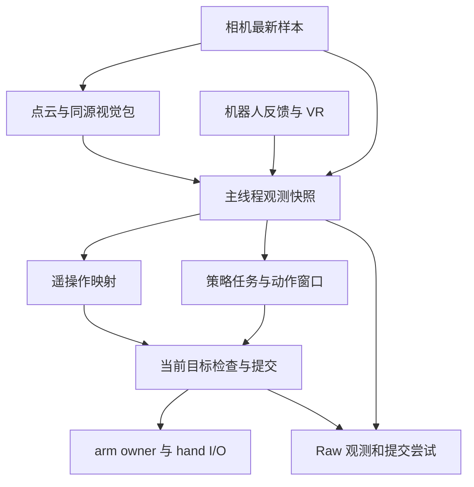

# DexMani Real 研究运行链路精简任务书

> 状态：P0–P6 本地软件实施及针对性离线验证已完成；真机/GPU 验收未执行。本文为本轮唯一实施规格与执行记录。
>
> 目标：面向单机、单套机器人、单人论文实验，使项目轻而薄、职责清晰、正确好用、简单高效。通过删除状态、协调和重复检查降低复杂度，同时保留硬件边界与实验数据的真实含义。

## 0. 任务身份、范围与优先级

- 仓库：`haoyangzhanglab/dexmani_real`。
- 编制日期：2026-11-01。
- 审查基线：[`e077df1d4a9171bb9db9605f6863d2c06abd2a3f`](https://github.com/haoyangzhanglab/dexmani_real/tree/e077df1d4a9171bb9db9605f6863d2c06abd2a3f)。开始实施时记录实际 HEAD，核对相关差异，不回退仓库以迁就本任务书。
- 范围：观测、感知输出与 IPC、运行状态、动作下发、时间与调度、teleop、sync/async/RTC、HOME、录制/导出/回放、相关关闭路径和文档。
- 入口：`scripts/collect_teleop.py`、`keyboard_teleop.py`、`run_policy.py`、`replay_episode.py`、`export_zarr.py`；同时追踪被影响的 viewer、标定和 CordVIP 集成消费者。
- 优先级：真实且一致的行为 > 明确的所有权和失败语义 > 少机制、少状态、少维护 > 局部性能与代码行数。
- 根目录及适用子目录的 `AGENTS.md` / `AGENTS.override.md` 仍适用。`.codex/tasks/architecture_refactor.md` 已是历史记录，不得据其恢复旧目录、旧测试目录或旧行为约束。
- 本任务书批准的是下文明确描述的软件契约变化；没有授权改变机器人限位、HOME 路径算法、IK/重定向目标函数、点云处理配方、模型权重或训练数据含义。

实施目标是完成代码、相关调用方、必要文档和针对性离线验证。不要停在再次写计划、移动目录、添加 wrapper 或完成第一阶段。实现以现有文件原地收敛为主，不另造一套运行框架。

## 1. 设计结论

采用以下最终方案，不并行保留“严格版/简化版”，不增加用于切换旧机制的配置项。

1. **一个输入契约。** 各源独立更新；控制循环读取最新完整快照，对本入口需要的输入检查一次。快照不是跨设备物理同步帧。
2. **一种视觉配对方式。** 点云 worker 发布自包含视觉包；需要 RGB-D 时随包携带生成该点云的原始图像及来源信息。删除“先读点云，再回相机历史按序列找图”的协议。
3. **一个运动身份。** 保留一个父进程写入的共享运行代际，以及停止/急停信号；设备执行处拒绝旧代际。模型与调度不再复制授权状态。
4. **一个动作有效期字段。** 高频目标只有 `expires_ns`，表示最后允许使用该目标的时间。删除 `feedback_until_ns`、`valid_until_ns`、`submit_until_ns`、`execute_until_ns` 之间的传递和组合。
5. **按职责保留不同时间约束。** 来源年龄、当前控制周期、目标有效期、有限操作超时是不同问题；统一定义和所有权，不把所有数值强塞进一个全局 timeout。
6. **一个模型任务所有者。** 模型加载、预热、首预测前 reset、推理、关闭仍串行；同一时刻最多一个未回收任务。没有另一套退休预测/episode 授权协议。
7. **保留三种研究调度。** sync 按实际动作顺序推进，async 使用时间锚点和有效尾部，RTC 保留策略动作空间前缀与严格交接。删除未来 `RobotCommand` 冻结和批量提前 IK。
8. **正常循环允许错过周期，禁止追赶旧动作。** 普通 teleop/jog/async 用最新输入继续；RTC 已承诺的前缀和交接、逐行回放按各自明确契约处理遗漏。
9. **录制保存事实。** Raw 保留观测来源和提交尝试；Canonical 继续执行固定周期训练数据准入；回放按标称周期重发目标，不冒充历史物理运动复现。
10. **一个结果出口。** 主要错误保留首次原因，关闭错误作为补充；设备、writer、模型各关闭自己的资源。普通超时不能自动污染为永久 SDK 故障。

## 2. 三个参考项目带来的约束

参考代码用于比较职责和必要性，不作为正确性证明，也不要求复制其架构。以下是审查所用固定版本，而非对未来版本的断言。

| 项目与基线 | 采用的思想 | 不照搬的实现 |
| --- | --- | --- |
| [ManiUniCon `85c6f2e`](https://github.com/Universal-Control/ManiUniCon/tree/85c6f2e32ecf9f2bed62d202b058c39623444686) | 明确的读观测→模型→动作转换→设备边界；动作窗口索引显式 | 通用 SharedStorage/配置平台、多重进程协调、wall/monotonic 混用、无限 ready 等待、把全过期预测末项重新定时后继续执行 |
| [T-Rex `ba4047c` hardware_code](https://github.com/ZhuoyangLiu2005/T-Rex/tree/ba4047ce3e9f3d2013d60de600e136897e90ccb8/hardware_code) | 最新状态与最新目标；动作执行线程/owner 职责直接；高层控制流程易读 | 旧目标无限继续、动作错误只告警后继续、无界录制队列、writer 失败导致 join 不结束。其底层控制库心跳也不能证明上层控制持续推进 |
| [Dexora `6f2869d`](https://github.com/dexoravla/Dexora/tree/6f2869d61483774aa75cda4cd2260dc6a5faa783) | 固定研究范围内的直接循环；仅在环境/SDK 隔离确有需要时增加进程 | 黑图/零状态/NaN 清零或补齐作为正常输入、忽略动作失败、按行号假定跨进程传感器同步、关闭 socket 等同于停止设备 |

关键代码定位：[ManiUniCon 策略循环](https://github.com/Universal-Control/ManiUniCon/blob/85c6f2e32ecf9f2bed62d202b058c39623444686/maniunicon/policies/torch_model.py)、[chunk wrapper](https://github.com/Universal-Control/ManiUniCon/blob/85c6f2e32ecf9f2bed62d202b058c39623444686/maniunicon/customize/act_wrapper/chunk_wrapper.py)；[T-Rex 主循环](https://github.com/ZhuoyangLiu2005/T-Rex/blob/ba4047ce3e9f3d2013d60de600e136897e90ccb8/hardware_code/teleop/main_teleop.py)、[动作执行](https://github.com/ZhuoyangLiu2005/T-Rex/blob/ba4047ce3e9f3d2013d60de600e136897e90ccb8/hardware_code/teleop/arm_hand_control.py)、[writer](https://github.com/ZhuoyangLiu2005/T-Rex/blob/ba4047ce3e9f3d2013d60de600e136897e90ccb8/hardware_code/teleop/data_writer.py)；[Dexora 部署](https://github.com/dexoravla/Dexora/blob/6f2869d61483774aa75cda4cd2260dc6a5faa783/deploy/dexora_inference_zmq.py)。

与上游的契约依据：[dexmani_policy `e610a2f`](https://github.com/haoyangzhanglab/dexmani_policy/blob/e610a2f9b214ce430c360f27307bb962204e33fc/dexmani_policy/deployment/runtime.py)。该版本 `reset_episode()` 只重置 RNG；RTC 接收物理单位的策略动作前缀，不认识 `RobotCommand` 或特定 IK 分支。实施前核对实际安装版本，不能用这个事实猜测新版本仍完全相同。

结论是减少本仓自己的协调协议，同时保留有实际消费者的研究语义。参考项目没有某项检查，不足以证明该检查可直接删除。

## 3. 最终职责与依赖

维持现有浅层目录：`sensor`、`perception`、`ipc`、`robot`、`control`、`runtime`、`teleop`、`deployment`、`data`、`replay`。只有删除重复职责直接需要时才合并文件，不按目录图机械迁移。

| 所有者 | 唯一负责 | 不负责 |
| --- | --- | --- |
| 主线程/具体入口 | 操作者输入、episode 流程、读快照、动作选择、手部 I/O、发命令、结束与录制协调 | arm SDK、模型并发、跨设备同步协议 |
| arm owner 进程 | arm SDK、模式、反馈采样、Ruckig、最新目标消费、停止、HOME 执行 | 视觉/VR 年龄、模型、数据质量、episode 成功率 |
| 相机/VR worker | 接收数据、验证外部格式、保留来源时间、发布完整样本 | 控制授权、训练网格、命令有效期 |
| 点云 worker | 单次消费最新相机样本、生成点云、发布同源视觉包 | 再次打开相机、跨传感器对齐、历史查询服务 |
| PolicyWorker | 一个工作线程内的模型生命周期和至多一个未回收任务 | 下发动作、运行代际管理、硬件停止 |
| RawWriter | 有界队列、写 HDF5/视频、首次写入错误、关闭一致性 | 运动状态、决定 episode 发布/丢弃 |
| recorder/入口 | 请求记录、统一决定已关闭产物发布或丢弃 | 复制 writer 的计数裁决、恢复硬件 |
| exporter/replay reader | 各自数据入口的结构与语义准入 | 改写原始来源时间、猜测 SDK/物理成功 |

保留现有进程/线程分工。本轮不把 arm SDK 搬回主线程，不为 hand 新建进程，不把模型改为 RPC 服务，不合并相机与点云 worker。先移除跨组件协议；是否合并感知进程属于之后有实测依据的性能工作。



相机直读与视觉包读取由实际模态需求在启动时选定；需要点云和图像时只读同一视觉包，不同时拼接另一个最新相机帧。

## 4. 时间、观测与视觉 IPC

### 4.1 时间字段的唯一含义

| 概念 | 最终定义与消费方 |
| --- | --- |
| 在线时间 | 同机 `time.monotonic_ns()` 整数纳秒；调度、来源年龄、有效期均用此域 |
| UTC/wall time | 仅文件命名、日志、人类可读实验起止时间；不参与在线比较 |
| `source_ns` | 各源原始有效样本的来源时间。缓存读取、IPC 复制、点云处理不能改写 |
| `control_ns` | 本次控制观测读取开始时间，保留现有 Raw 字段 |
| `observation_ns` | 本次快照读取完成时间，保留现有 Raw 字段 |
| `sequence` | 单一生产者样本身份/去重，不是心跳、动作 ACK 或跨设备同步编号 |
| `tick_end_ns` | 主线程当前计算/提交机会的结束边界；只在主线程使用，不塞进 IPC 目标 |
| `expires_ns` | 目标在执行器中允许继续使用的唯一截止时间；每次新提交生成一次 |
| 有限操作 deadline | 启动、HOME、模型等待、关闭等具体操作自己的等待上限；不继续传入控制观测或命令 |

本机 monotonic 时间不直接与另一台机器或设备时钟相减。设备时钟/曝光时间若保留，仅作为注明时钟域的事实；本轮不建立时钟同步、漂移估计或时钟换算框架。

统一年龄边界为 `0 < source_ns <= now_ns` 且 `now_ns - source_ns < max_age_ns`；等于阈值即过期。统一目标边界为 `now_ns < expires_ns`。删除 VR 的 `+1 ns` 特例。现有极少数包含等号的年龄检查会改变端点行为，作为本次明确变化验证。

**阈值先不调参。** 保留当前配置中的具体预算：arm/hand 默认约 `4/30 s`、camera 默认 `4/fps`、VR 默认 `0.5 s` 等，以代码实际值为准。arm 的预算不是由其 25 Hz 反馈频率严格推导出的“四个周期”；文档必须据实说明。不要为了名称整齐把所有源改成相同周期数或统一的 2 秒。

### 4.2 观测只检查一次

在入口装配时计算一次控制需求与录制需求的并集。每个控制周期执行：

1. 服务到期手部反馈与已发生的设备/worker 错误。
2. 读取机器人状态、所需视觉数据、所需 VR；每个来源只复制一次。
3. 用一个 `now_ns` 检查所需来源的存在、格式和年龄。
4. 需要推理时投影并拷贝模型实际消费的历史字段；映射当前动作时使用当前实测机器人状态。

`check_observation()` 只给出有效/问题，不再返回最小来源截止时间。删除全部 `feedback_until_ns` 调用链及相同观测在控制、录制、提交处的重复年龄扫描。底层缓存读取只负责快照；外部格式边界与实际 SDK 副作用边界仍负责各自检查。

arm owner 对其当前反馈的检查保留，因为它用于实际伺服，不是重复检查主线程之前拿到的旧数组。hand 发送边界核对当前手反馈与命令合法性，不要求重复扫描视觉、触觉和 VR。移除底层缓存年龄检查时必须同步核对所有实际读者，包括 HOME、jog、replay、预热和标定；不能只给 teleop 补齐新入口检查而让其他消费者失去原保证。

来源缺失/过期时结束本轮并停止；不增加自动降级为“无录制继续”“无相机继续”或替代模态的分支。启用记录就接受记录失败终止本轮的简单契约；不再维护名义上的两套健康裁决。

模型等待期间按原控制节拍检查当前所需源，但不因此向模型历史插入额外行。每次循环到下一控制时点必须刷新检查，不用旧 `sync_row` 冒充当前输入；已经在执行的 native 推理不声称可被取消。

### 4.3 自包含视觉包

改造 `ipc/sensors.py`、`perception/worker.py`、`runtime/observation.py`：

- 相机仍发布原始最新 RGB-D，保持现有采集和来源时间规则。
- 点云 worker 读取一个完整样本，在自己的副本上处理；成功后一次发布：点云、相机来源 sequence、来源时间，以及当前入口需要的原始 RGB/depth 字段。
- 需要 RGB-D 录制时必须在同一包内传递实际源帧；不使用较新的相机帧冒充同源，不向已覆盖历史重试找回。
- 不需要图像的 point-cloud-only 模式不额外复制 RGB-D；字段布局在启动时按需求确定，不逐帧建动态协议。
- 点云来源时间继承相机来源时间，计算完成时间不能使旧图重新变新。
- 空点云仍不发布成有效模型输入；旧包年龄自然增长并被已有来源检查拒绝，不用最后一次成功的发布时间续命。
- 删除针对相机历史的随机 sequence 查询 API 及没有消费者的历史管理。pointcloud worker 直接读最新完整样本并按返回 sequence 去重。
- `camera_static` 从逐周期需求中移出；仅需要内外参的模式在启动阶段取得一次静态参数，随后不启动或不保留无用途的视频循环。保留这些 checkpoint 的现有能力。

保留 `SharedRing` 的复制与前后版本校验，不换成无校验双缓冲、裸共享 ndarray 或通用消息框架。改为 latest-only 后，槽数不再表示用户可查询的历史；本轮无需为了省几个槽重写底层 primitive。现有 Linux x86_64、单写多读适用条件必须明确，不宣传跨平台无锁保证。

允许读到完整旧样本或读失败，禁止接受拼接了两次写入的样本。来源身份、完整性和字段含义比“每次读都成功”更重要。若保留固定小容量，说明它只用于复制竞争缓冲。

### 4.4 来源时间不能删成一个总时间

保留 arm、hand、aggregate tactile、dense tactile、camera、VR 的独立来源时间与已有 Raw sequence。手部部分字段更新时不能给所有触觉重打时间；相机重复 frame number 不能更新时间。机器人查询开始时间的保守口径保持，不改成缓存读取完成时间。

不增加跨设备最大 skew 门控、插值、全源 barrier、心跳包、来源追踪 DAG 或每帧 profiling 元数据。现有时间字段已足以说明该实验的近似同步程度。

## 5. 运行身份、动作有效期与 arm IPC

### 5.1 共享状态的最小集合

- **保留一个共享运行代际**：父进程在本地锁内更新，arm 只读；命令携带这一代际。旧命令在新段不能生效。
- **保留停止与急停信号**：取消必须先可见，不能等 IK、writer、模型或本地状态锁。
- 主线程之间需要的 `motion_lock` 改为 `threading.RLock`，不再创建/传递 multiprocessing RLock 给 child。
- `prepared_run_id` 不再跨进程发布、父进程也不再先读 status 再提交目标。prepare 的成功回复是父进程的唯一准备结果；arm 保留本地当前模式/准备代际即可。
- 删除本地 `stop_request → acknowledge_stop` 的第二套确认协议。停止完成由已有 arm 停止操作结果及手停止结果确认；入口按顺序完成收尾后才允许新 prepare。
- 现有 `DISARMED/ARMED/RUNNING` 若仍被入口实际使用可以保留为主进程局部状态；不要把它扩展成共享全生命周期状态机。准备、控制、关闭的局部流程也不能再另存第二份全局授权。
- `expected_run_id` 对过期清理请求的约束保留在真实有竞态的边界；不能为了删字段使旧 finally 撤销新一段。

不能将共享代际替换为仅父进程可见的局部编号，再假定共享 stop 足够。旧 prepare 的迟到完成/清 stop 必须仍受共享代际约束。

### 5.2 高频动作只用 latest target 和一个有效期

目标的最小语义为：`run_id`、arm target 或 hold、`expires_ns`。手目标仍通过现有主线程 I/O 路径下发。低频 HOME/prepare 继续通过现有 Pipe 请求/回复；不新增每个伺服目标 ACK。

- 新目标覆盖尚未消费目标，不排队补发。
- 先验证组合 arm/hand 命令格式、有限值和绝对限位，再产生任一设备副作用。
- 主线程对当前 tick 是否仍可提交检查一次；顺序提交的每个设备边界仍检查撤权/急停/有效期，避免 arm 发布后已取消却继续向手发送。
- `expires_ns = 本次发布起点 + 入口的命令断流预算`。teleop/jog 保留当前量级 `0.5 s`，policy/replay 保留 `2 s`；不在本轮调优数值。确切定义从“来源时间加预算”统一为“新命令发布时间加预算”。
- 禁止仅因读缓存、轮询 Future、worker 活着或重发同一 keepalive 而延长目标有效期。每次续期必须来自一次有新控制决策且通过当前输入检查的提交。
- 键盘 held-key 是本地输入状态，没有 VR 式来源时钟；命令有效期检测控制断流，不宣称检测键盘断连或按键事件新鲜度。本轮不为键盘补建心跳。
- arm owner 在每次 SDK servo 前检查共享代际、停止/急停、自己当前反馈、目标有效期、SDK 状态。目标首次消费不再有第二个 `submit_until`。
- `hold` 保留其 Ruckig 减速语义；它不是断开、急停或无限期保持。hold 也有相同的 `expires_ns`。
- 顺序组合提交仍不是原子执行；arm mailbox 写入成功也不等于 SDK 收到、轨迹跟踪完成或物理到位。出错即撤权和停止，不尝试回滚物理动作。

**明确的保证变化：** 删除来源期限传播后，不再保证某个观测在 SDK 发送瞬间仍小于采样年龄阈值；删除 `submit_until` 后，不再保证目标首次进入 arm SDK 位于主线程的原控制槽内。保留的契约是读取时输入有效、主线程及时提交、执行器当前反馈有效、目标到期不继续消费。最坏来源年龄会包含采样年龄预算、计算时间和命令有效期；不能把这些预算称为端到端实时保证。

### 5.3 不让 IPC 清理挡住实际停止

当前 `ArmController.stop()` 在 SDK stop 前阻塞清 mailbox、发布 status，可能把停止卡在另一进程持有的锁上。本轮必须修正这个具体问题，不扩成通用故障恢复平台。

- stop 路径先使本地 active/reference/准备状态失效并尝试 SDK stop；不能先阻塞等 goal/status 锁。
- 旧 mailbox 不必为了停止而同步清空：代际与 stop 已使其失效。清理只允许非阻塞完成；后续新代际读取也必须拒绝旧目标。
- arm 热循环对跨进程 goal/status/代际锁只做非阻塞尝试；读不到所需授权或状态时本次不下发。不能在 stop 检查之前无期限卡在 `Synchronized.value` 的隐式锁上。
- 代际仍使用有明确同步语义的现有 primitive；不要未经证明换成 RawValue 并宣称原子。必要时在实际读取处显式 try-lock，先检查 stop/closing/emergency；不新增通用“可恢复锁”类。
- 父进程的 IPC 等待使用已有操作边界的期限；不要发明每一层一套重试、锁租约或 lock watchdog。
- `stopped` 只表示停止请求处理完毕，失败必须仍上报；不命名或描述为物理停稳证明。

### 5.4 低频请求保持单请求、单回复

`request_operation()` 是一次 HOME/prepare 请求的唯一所有者。取消后先通知停止，仍由它在有界收尾时间内消费自己的回复；不得把旧回复留给下一次操作或转交 `wait_stopped()` 猜测归属。

- 删除 `operation_unresolved` 以及 stop 路径对旧请求回复的接管。
- 若停止或请求回复在边界内未解决，将这个 arm owner 判为不可继续复用，结束会话；保留错误和资源句柄直到明确关闭，不自动重启。
- 取消轮询中的 service/abort 回调只负责通知和查询，不重入同一个 Pipe 的接收，不同步调用会接管旧回复的 stop 等待。
- HOME 在各个 waypoint 之间继续检查撤权和父端连接的关闭；已观察到 Pipe EOF 后不得开始下一 waypoint。无需额外心跳进程。
- native SDK 已阻塞时，Python 不能保证立即取消或按期限退出；如实报告 unresolved，不伪造成功。

## 6. 控制节拍、超时与错误

### 6.1 只保留一组简单时间工具

复用/收敛 `utils/timing.py` 中的整数周期和下一个时点计算；输入为显式 `now_ns`，纯计算不读时钟、不 I/O、不管理状态。入口决定迟到的业务后果。

| 场景 | 调度与迟到处理 |
| --- | --- |
| teleop / keyboard jog | 绝对节拍，跳过错过的时点；本 tick 计算结果已过期就丢弃，从最新输入继续，不补发。输入失效、命令租期耗尽或真实动作拒绝仍终止 |
| sync | 动作游标只随实际提交推进；推理等待不消耗未执行动作。等待返回后使用当前状态映射，在后续有效提交机会执行 |
| async | 按时间锚点索引，迟到时裁掉已过期部分；旧计划仅可使用其仍有效尾部，完全耗尽即结束 |
| RTC | bootstrap 尚无前缀承诺时可重新锚定；有承诺前缀/预取/交接时严格检查对应时点，错过即结束，不补发 |
| replay | 按记录的标称频率逐行提交；漏掉必须执行的行或本行提交机会时终止，不静默跳过实验目标 |
| arm servo | 保持现有 Ruckig 固定步长和不追赶的实际发送限频；不能用循环堆积补发，也不冒充硬实时 |

普通 teleop 不再因为一次周期迟到而把整轮标为硬件故障。`dt/4` 是 Canonical 数据准入规则，不是设备停止时延，也不拿来创建第二个在线调度器。

**训练影响必须说明：** 柔性调度使 Raw 可以包含间隔缺口，Canonical 仍只接纳从第 0 行开始的合格连续前缀。保存成功不保证全部行可训练；导出必须明确打印保留行数、丢弃行数和第一个截断原因。不新增在线自动切段、补帧、重采样或“继续录但伪造固定频率”的机制。

### 6.2 等待预测与目标断流不再互相矛盾

保留具体等待操作的 deadline，但不得与执行器目标有效期产生先后矛盾。

- 尚未发布任何目标的 bootstrap：用一个预测等待上限；没有目标就不需要虚构目标心跳。
- sync 在已有目标上等待下一预测：进入等待时计算一次 `wait_until = min(当前目标 expires_ns, 本次查询开始时间 + 预测等待预算, 有配置的 episode 结束时间)`。不因为轮询或反复等待刷新它。
- 主线程到达 `wait_until` 时按预测等待/目标耗尽的真实原因结束；不等 owner 已因旧目标过期故障后，仍宣称模型还有另一份等待预算。
- async/RTC 有有效计划时，其可消费窗口决定交接机会；当前查询不是一个可无限续期的授权。RTC 精确交接约束保留，async 可以消费已有有效尾部。
- episode 最大时长、HOME 超时、启动/关闭等待属于各自操作；保留，不传播成目标的多层 min-deadline 参数树。

### 6.3 普通终止与硬件故障分开

- 输入变旧、目标到期、取消、预测超时、计划耗尽是本轮结束原因；停止成功且资源干净后，允许操作者显式开始下一轮。
- SDK 错误、控制器报告异常、停止失败、owner 异常退出是设备/会话故障；保留首次错误，禁止自动复用。
- 不为每个普通拒绝写永久 `fault`，也不为允许继续运行吞掉 SDK 错误。
- owner 的普通到期用现有停止信号和日志表达；主线程可用现有 executor-boundary 结束原因。不要为对齐每个字符串再加一套共享错误状态协议。
- arm 循环顺序为：停止/退出与已经过期的目标 → 到期反馈查询 → 当前 servo。恢复调度后先尝试一次已到期反馈更新，避免因未刷新缓存就永久 fault；查询失败或更新后仍过期则不发动作。
- 有限时限只限制软件何时继续等待/下发，不能中断已进入的阻塞 native 调用；文档不承诺 Python 级“硬停止”。

## 7. Teleop、手部与 HOME

### 7.1 Teleop 启动减为一次锚定

新的每段顺序：完成上一段停止/收尾 → 启动本段 writer（若需要）→ arm prepare → 读取一次当前有效快照 → reset controller 并建立实测/VR 锚点 → 最终检查代际 → ACTIVE。

删除每段手部软件缓存清空、为了清空而重等首样本、启动预计算后丢弃、`prepared_after` 和“所有来源必须晚于 prepare 完成时间”的额外屏障。有效性由来源年龄决定；prepare 前采得但仍新鲜的帧可以使用。

一次快照失败时不启动本段，不把它替换成零状态。真正发生硬件 reset、重连或触觉复位时，相关缓存失效与等待新有效样本继续保留。会话级算法预热只有实际冷启动耗时需要时保留，不能每段重做。

### 7.2 每个控制 tick 更新手部映射

删除以 VR `ring_sequence` 为条件的 hand target 缓存、`hand_observation_id`、失败已消费标记和相应事务分支。每个有效控制 tick 都用最新有效 landmarks 运行现有手重定向与速度限制；即使 VR 帧相同，也允许受限目标继续收敛。

保留 VR 来源 sequence/time 用于年龄、记录和诊断，不再将其当作 controller 是否更新的开关。手部最大速度、滤波、目标函数、关节约束、IK/重定向拒绝规则不改。

内部积分/阻尼所用 dt 由明确的控制更新时刻给出；不再混用“上次 VR 新帧时刻”和“上次提交时刻”。明确重复帧下的数值行为并做针对性比较。这是动力学行为变化，不声称逐步数值等价。

### 7.3 保留最后提交参考，删除围绕它的事务协议

controller 状态只有控制线程写入。最终采用直接的“计算候选 → 当期仍有效则发送 → 正常返回后赋值最后提交参考”，不增加事务对象、候选状态副本、回滚协议或仅用于 commit 的锁。

**这里不机械删除 compute/commit 两个时刻的区别。** 本方案允许计算迟到后丢弃并继续，前期讨论中“任何失败都结束本段，因此可以无条件先推进 controller”的前提不再完全成立。候选被丢弃时，必须保持最后提交的关节参考、滤波参考和时间不变，否则可能绕过限速或让内部状态领先实际下发。

参考值由同一控制线程在正常提交返回后直接更新；不再为这几次赋值加第二次加锁授权事务。真正的部分发送失败、撤权或 SDK 错误仍结束本段，下次启动重建锚点。小函数是否仍叫 `commit` 不作为验收指标；其职责只能是更新实际有消费者的参考，不能承载另一套授权/期限状态。

dt 按当前控制计算时点与上一实际提交参考时点计算并说明口径，不用 VR 新帧间隔代替；延迟丢弃不刷新参考时间。warm start 与最后提交目标没有不同实际用途时共用一份，不凭概念拆出额外缓存。XHand 发送返回仍不等于物理执行 ACK。

### 7.4 触觉按实际消费者启动

`initialize_hand()` 接收入口已经算出的 `required_tactile`，不再固定要求 aggregate+dense。

- 无触觉消费者：跳过启动时五指触觉 reset 和等待；手部 HOME、关节反馈就绪仍保留。
- 有消费者：只等待实际需要的触觉通道。若 SDK 只支持整手/五指 reset，仍执行 SDK 所需操作，不虚构分通道 reset 能力。
- 用户显式触觉复位命令仍可用，保持空闲且无接触的操作要求和原错误处理。
- 未请求 reset 的元数据据实为 `not_requested`，不写成已校准；SDK reset 成功与有效反馈不等于完成物理零点标定。
- XHand 的 CRC 处理保持驱动局部、次数有界、读写计数含义明确，不提升为会话重试框架。停止的独立有界处理保持，不因“去重试”而破坏实际停止请求。

### 7.5 HOME 保留物理职责，删除协议绕路

- 删除 `HomeResult(ok/reason/interrupted)` 与异常之间的多次转换。成功正常返回，取消、路径拒绝、超时、设备失败用现有明确异常，在交互入口统一转为用户提示/本轮结果。
- 仅发送手 HOME 不再调用 `arm.begin_operation()` 作为绕路。先由主线程完成整机停止边界，再独立执行手部动作；不能因为删绕路而漏掉 arm 的实际停止。
- 保留 HOME 路径搜索、等价分支、碰撞约束、逐 waypoint 实测位置/速度收敛、手部新来源样本收敛。
- 删除同一次零长度 HOME 上重复的“任意姿态停稳，再目标姿态停稳”；一次目标位置/速度 dwell 足够。非零路径逐段 dwell 保留。
- 一次停稳检查已取得的有效反馈可用于紧接着的起点检查，不无条件再次查询；若经过实际阻塞或模式切换使其失效，则照常读取。
- mode 只有发生变化才切换；SDK stop 后需要的恢复状态不能一并删掉。
- **本轮保留 prepare 从实测静止状态初始化轨迹的契约。** 不把 Ruckig 能接受非零初速度，误当作模式切换和真实加速度已被验证；不删除所有 0.3 秒 dwell，也不新增可跨操作复用的“停稳证书”。

## 8. PolicyWorker 与三种部署模式

### 8.1 一个串行模型 owner

- 维持单线程 executor，保留加载、推理、关闭的真实所有权。
- 最多一个未回收 Future；已 done 但未取回仍占用，异常不能被静默丢掉。
- 将 `reset_episode()` 合并进新一轮首次 `_predict()`，在同一模型线程执行，先 reset 后 predict。删除单独 reset Future、等待 reset 的准备循环和对应状态。
- episode 初始化本地设置一个“首次预测需 reset”的事实即可；只在首次预测任务真正执行时消费，不给未开始推理的段虚构 RNG 进度。
- 直接使用上游已有 `warmup(samples=1, ...)` 缩短预热，不在本仓改写上游模型算法。当前上游实现因此仍有普通路径 2 次预测、RTC 路径共 4 次预测；不要宣称已经只有 1 次。保留 RNG 恢复及普通/RTC 两条实际路径。
- 删除 Real 侧未消费的 benchmark 结果与转运。若现安装上游无此参数或 reset 含义变化，明确报告实际接口差异，局部适配现有公共 API，不修改另一个仓库来凑任务。
- 关闭时未完成 native 任务不能 hard-cancel；不允许新一轮复用同一模型。报告具体 pending/failure，不添加模型进程重启、超时替身结果或新 watchdog。

### 8.2 删除重复预测身份和 `sync_row`

episode 负责唯一 query，PolicyWorker 负责唯一 Future，结束时必须回收或明确不可继续。基于这个所有权删除 `Prediction.run_id`、handoff 的重复 `authorized` 参数和退休结果授权树；在 episode 决策入口检查一次当前运动代际，设备下发边界另作自己的检查。

query 只保存调度真正需要的观测锚点、最早/约定交接时点和结果。不要用两个可变对象同时记录 Future 是否 pending。

删除 `sync_row`：推理输入已经进入模型任务自己的历史副本，不需要跨等待期挂住整份 Raw 观测。sync 预测返回时再读当前观测，用于映射与记录；不向模型 history 重复 append 这一额外执行观测，保持原先输入历史采样频率。查询锚点仍明确保留，不能把执行时观测冒充该结果的推理输入。

这会改变 policy Raw 的 obs/action 行配对：新行是执行时快照和本次提交尝试。它是评估日志，不是宣称该 action 由同行 observation 直接推理得到的训练样本。

### 8.3 RTC 固定策略动作前缀，删除未来关节命令冻结

最终语义：RTC 固定接下来要采用的**策略控制动作**（joint 19D 或 EEF 21D，物理单位），给模型提供同一动作空间前缀；每个真实执行槽再用当时实测状态映射到当前 `RobotCommand`。

删除：`ActionChunk.frozen`、未来 `d` 步提前 IK/FK、`control_from_command()` 回编码仅服务冻结前缀的调用链、`frozen_rejection()` 和冻结命令事务。定义仍有其他真实消费者时，只删本用途，不机械删整个通用函数。

前缀只做与当前状态无关且实际必要的规范化/静态约束，与后续执行使用同一份规范化动作。复用既有有限输入上的手限位/workspace 投影语义，不改成 NaN 清零等伪造输入。关节等价分支依赖当前姿态，留到执行边界选择；不得先粗暴 clip 原始关节值而破坏原有等价角规则。每个将要执行的动作仍做实际 IK、jump、workspace、关节限位与碰撞准入。模型返回的前缀引导不是未来物理关节轨迹已验证的证明。

**明确放弃的旧保证：** 未来若干步预先算出且固定在同一 IK 关节分支、整个前缀事先都能映射成功。采用新方案后 EEF 前缀一致不等于未来关节目标逐项一致；未来映射失败时在对应执行边界终止，不回退到旧分支或跳过失败动作。保留当前状态与前一实际提交关节目标作为单步 IK 的连续性参考。

这是本轮选择的新 RTC 实现；不得同时留一个 `freeze_joint_commands` 开关。如果当前待复现实验明确依赖旧关节冻结语义，则在执行记录中将这项标为该实验的契约冲突，保持其可复现基线，不偷偷宣称两者等价。

### 8.4 动作窗口只保留能解释的状态

交接时裁掉过期前缀并重新锚定，避免同时维护互相推导的 `anchor_slot`、`segment_end` 和 frozen dict。

设预测源锚点为 `s`，实际交接为 `h`，预测长度为 `P`，名义执行窗口为 `A`：

- async 晚交接或普通 RTC 交接：接纳 `actions[h-s:]`，新起点为 `h`。
- 名义窗口结束为 `h + min(A, len(接纳后动作))`；总可用尾部结束为 `h + len(接纳后动作)`，均直接推导，不另存可变副本。
- async 仍可在下一预测未到时使用上述有效尾部；不得把裁剪误实现为只保留 A 项，破坏现有算法。
- RTC bootstrap 无既有前缀承诺，预测就绪后以 `h` 为起点接纳全长，不按 bootstrap 的推理延迟裁掉前部。
- RTC 稳态保留精确 prefetch/handoff 与 prefix delay 定义；有承诺时错过即失败。删除对 bootstrap 尚无任何计划/承诺阶段的无差别 `skipped → fail`。
- 完全过期预测明确拒绝；不拿最后一个动作重新标时间继续跑。

sync 的动作游标保持顺序语义，不强行变成 async 的绝对时间索引。共享纯数学 helper，但不创建 Scheduler 基类或模式插件系统。

## 9. Raw、Canonical 与 Replay

### 9.1 保留简单而真实的写入事务

RawWriter 保留：有界 FIFO、背压/写入错误可见、首次失败、HDF5 与视频计数一致性、关闭之后才允许发布、临时目录和不覆盖已有产物。

删除 Recorder 的 `closed_counts` 等重复计数复核：writer 的 `finish(..., expected_frames=...)` 已对全部列/视频做最终一致性裁决，recorder 只消费这一个结果，决定发布/丢弃。不能连带删掉 expected_frames 与实际写入数量的对照。

保持一行 Raw 表示一个真实采样与至多一次真实提交尝试；无动作仍可为 NaN。失败行和部分提交不能改成“成功 action”。不新增每个 servo 的执行回执、目标 ACK 或可回滚数据库事务。

视频固定帧率只提供观看时间轴，不代表真实采样时刻；HDF5 的原始时间才是依据。保留现有正常/失败技术状态及消费者，语义不混为任务成功率。

### 9.2 明确数据用途，不为部署日志添加训练修补器

- teleop Raw 是当前 Canonical 默认训练入口。
- policy Raw 是 rollout/evaluation 日志。bootstrap、历史积累和无计划等待允许无 action；因此从第 0 行扫描得到空训练前缀并不需要用补动作来“修复”。
- exporter 在用途入口明确拒绝 `policy_rollout` 作为默认示教导出，并给出解释；不偷偷忽略开头、截取中间段或冒充 teleop。
- 保留 Canonical 现有 13 个字段、单位、dtype、EEF 9D/21D、点云与手部几何配方、`source_id`、真实处理元数据和 URDF 归档。
- `source_id` 有上游 dataset split/resume 消费者，不能当作无用追踪 ID 删除。URDF 等低成本来源归档不因当前无运行时读取就删除。
- 本轮不改旧数据/旧 checkpoint，不加 Raw/Canonical 新 schema，不加兼容模式。已记录的数据仍按原格式读，新的用途准入在入口明确失败。

继续使用现有 `training_prefix()` 的保守规则：来源不倒退、控制网格/读出合法、触觉有效、数值有限，从第 0 行开始；技术失败段保守排除末行。虽然最后一行未必真失败，Raw 目前没有足够的逐行成功证据来精确恢复；不要为消除这一行损失新增提交凭证系统。

保留在线录制所需源的年龄检查，尤其 camera；现离线 exporter 并没有覆盖所有 arm/hand/camera 的最大年龄规则，不能以“离线会检查”为由直接删除。跨信任边界的离线验证不是热循环重复预检。

### 9.3 Replay 的最终契约是标称频率目标序列

- 只接受已完整发布、technical status 正常的 teleop episode，非空有限目标、形状/关节限位有效。
- 起点准备使用第一行实测 arm/hand；轨迹对象只保存这两个起点向量和完整 action 数组，长度从 action 得出，不再加载无人消费的整段实测关节历史。
- 对回放本身删除历史采集网格、读出时间和相机/触觉新鲜度准入。回放不按这些历史时间调度，保留它们在 Raw/exporter 的相应消费者中。
- 当前回放的起点检查、当前反馈年龄、动作检查、逐行周期、取消、目标租期保持；漏行/迟到不补发。
- 回放数据里的提交完成时间只表示调用返回或异常退出时间；不代表成功，更不代表到位。`COMPLETED` 只表示目标序列提交结束。
- 不新增“原时间回放”“严格采集回放”等模式开关。本次明确采用标称频率目标序列语义，并更新 CLI 帮助和 README。

## 10. 生命周期、结果与辅助边界

### 10.1 顺序收尾，不制造状态组合

统一顺序：撤权/请求停止 → 完成设备停止或明确失败 → 回收本段模型任务 → 关闭 recorder 并按结果发布/丢弃 → 关闭会话资源。所有有资源的步骤即使前一步失败也须尝试收尾；保留最初错误，补充错误另记。

保留一个主要异常/结束原因与一组实际发生的 cleanup 错误，最终 JSON 边界序列化一次。删除函数同时“改 error_state、改外部 errors 列表、返回布尔、再让 caller 推导另一套 outcome”的重叠写法；每个关闭函数用正常返回/异常表达自己的结果。

不要为删运行状态顺便改用户可能消费的 `session_result.json` 字段。最终现有 schema 可由一个出口推导；内部不再维持同名真值副本。已存在的 episodes 列表继续作为统计来源，段数不另存。

未解决的 writer/模型/arm 停止禁止开始下一段；“pending”是事实，不是假失败也不是成功。仅明确有消费者的 pending 资源句柄保留，不加恢复管理器。

### 10.2 传感器与持久化资源区别处理

sensor worker 不承担 Raw flush，不再共享 writer 的 60/65 秒漫长关闭预算。用现有退出标志、短的进程 join 和已有 terminate/kill 路径完成有界关闭，最终仍检查 exitcode/存活状态。

具体短等待按当前相机 read/stall 等已有阻塞上限选定并写在同一处，不逐层新建 timeout。不能把 sensor 的强制终止策略套到 arm owner 或 Python 模型线程；不能宣称 terminate 自动完成设备停止。

### 10.3 一次验证与现有辅助 IPC

- 配置、workspace bounds、静态 shape/顺序约束在配置/外部输入边界验证；已冻结的内部配置不每帧重验证或重新构造数组。
- 当前状态相关 IK/collision/跳变检查留在当前动作边界；配置有效不代表目标一定有效。
- SAM/CordVIP 现有二进制 framing、长度、请求身份和选中帧身份检查属于真实 IPC 边界，保留。不要仅因为其“独特”而删掉。
- 本轮不重写第三方 SAM 进程协议或进程组管理，不修改上游训练仓库。仅修复本轮公开接口变化影响到的本仓适配器。
- 不增加应用心跳：来源时间证明数据更新，命令有效期限定继续执行，进程状态说明 owner 是否退出，ready 仅用于启动。它们不能互相冒充，也不需要再加一个共享 heartbeat。

## 11. 删除、保留与暂不做清单

| 当前机制 | 决策 | 替代或保留理由 |
| --- | --- | --- |
| 来源期限取 min 后跨层传递 | 删除 | 读快照一次检查；当前 SDK 状态与唯一命令有效期另守边界 |
| submit/execute 双期限 | 删除 | latest target 仅 `expires_ns`；放弃首次 SDK 同槽保证 |
| multiprocessing motion_lock | 删除 | 仅父线程使用，换 threading.RLock |
| 共享 prepared 状态与父端预读 | 删除 | 低频 prepare 回复 + owner 本地状态 |
| 本地 stop_request/ACK 与旧 RPC 回复接管 | 删除 | 顺序停止，原请求 owner 消费自己的唯一回复 |
| 共享代际、停止/急停、真实设备状态检查 | 保留 | 防旧段动作生效，设备边界有独立职责 |
| 点云→相机历史回查 | 删除 | 自包含同源视觉包 |
| SharedRing 前后标记、数据复制 | 保留 | 防撕裂；不伪造原子跨传感器快照 |
| 每段清手缓存、三次启动观测、post-prepare 全源屏障 | 删除 | 一次当前有效快照建立锚点 |
| 手映射按 VR sequence 缓存、失败消费、通用 compute/commit | 删除/收敛 | 按控制 tick 更新；只留有实际数值含义的参考 |
| 无触觉需求仍 reset 五指并等两类触觉 | 删除 | 从实际 consumers 推导 |
| RNG-only reset 独立 Future | 删除 | 首预测同线程执行 reset |
| 预热五次统计样本 | 缩减 | 调现有 samples=1，保留实际预热/RNG 恢复 |
| query run_id / handoff 授权副本 / sync_row | 删除 | episode 与 Future 唯一所有权；执行时读当前行 |
| RTC 未来 RobotCommand 冻结与提前 IK | 删除 | 固定策略动作前缀，逐槽映射 |
| 可推导 segment_end 状态 | 删除 | 接纳时裁剪/重锚定后直接推导窗口 |
| 普通调度迟到立即结束、普通租期到期写永久 fault | 删除 | 跳过过期周期；正常终止与设备失败分开 |
| 训练固定网格准入 | 保留 | checkpoint/Canonical 时间语义真实，不能靠伪造数据简化 |
| 重复 writer 关闭计数 | 删除 | writer 唯一裁决，recorder 唯一发布 |
| writer 有界队列/首次错误/close 后发布 | 保留 | 真实丢数据和损坏风险 |
| Replay 整段 measured-state 缓存及无消费的历史 timing 准入 | 删除 | 起点向量 + action 序列 + 当前执行条件 |
| HOME 逐段实测到位、Ruckig 约束、hold | 保留 | 与真实运动有关的职责，不能从参考项目缺失推断无用 |
| Raw 独立来源时间/source_id/配方/URDF | 保留 | 数据解释、上游消费与实验复现，不是运行协调开销 |
| 新心跳/ACK/自动重连/重启/补帧/故障恢复平台 | 不做 | 不符合单人研究定位，也不解决上述状态重复根因 |
| 合并相机与点云进程、移除所有 dwell、改训练仓库、删 CRC 处理 | 不做 | 本轮收益不足或会改变尚未验证的设备/算法契约 |

## 12. 实施阶段与文件落点

以下顺序确保每阶段删除旧调用链并留下可解释的闭环。阶段名是实施顺序，不对应新的源码目录或新框架。

| 阶段 | 主要文件（相对 `dexmani_real/`） | 工作与出口 |
| --- | --- | --- |
| P0 核对基线 | `AGENTS.md`、相关入口、上游公共接口 | 查工作区改动与实际消费者；记录当前数值/调度代表性结果、实际依赖；核对本任务的行为变化。不生成第二份设计 |
| P1 身份与设备边界 | `runtime/state.py`、`robot/system.py`、`robot/xarm7/{protocol,process,worker}.py`、`robot/commands.py` | 本地锁、一个共享代际、一个 expires、prepare 本地状态、RPC 回复唯一 owner、停止先于 IPC 清理。全调用方同步，不留旧参数适配层 |
| P2 观测与感知 | `runtime/observation.py`、`ipc/{sensors,ring}.py`、`perception/worker.py`、`runtime/preflight.py`、`deployment/observation.py` | 一次 needs/年龄裁决、自包含视觉包、删除历史配对、静态相机需求移到启动。保留数值配方 |
| P3 直接控制与 HOME | `teleop/{loop,vr,run,keyboard}.py`、`runtime/{home,jog,keyboard}.py`、`robot/xhand/*`、`utils/timing.py` | 一次锚定、每 tick 手映射、精简内部 commit、按需触觉、HOME 异常/重复 dwell、柔性节拍。核对原键位/命令仍可用 |
| P4 模型与动作窗口 | `deployment/{inference,rollout,schedule,session,run}.py`、`control/actions.py` | 首预测 reset、缩短 warmup、无 sync_row/重复授权、策略空间 RTC 前缀、窗口重锚定、唯一等待上限。三模式逐个验收 |
| P5 数据与收尾 | `data/{raw,recorder,export}.py`、`replay/{trajectory,joint_replay,run}.py`、`runtime/lifecycle.py`、结果出口 | 去重复计数、明确用途与 replay 新契约、精简关闭结果、保留既有 schema 与真实数据；更新所有实际消费者 |
| P6 验收与交付 | README、`docs/hand_retargeting.md`、CLI help、本文执行记录 | 端到端离线验证、残余旧机制搜索、diff 与复杂度检查，明确真机/GPU待验项 |

可以因调用链耦合调整小步顺序，但不能只加新 API 后让旧路径继续作为实际入口。当前文件若已变化，按真实职责定位，不按历史文件名盲改。

## 13. 验证要求

这次是行为重构，需要有意义的验证，但不恢复已经移除的根 `tests/`，不新增测试框架/通用 mock 平台/永久审计脚本。优先用现有工具、临时目录中的小型验证代码、fake SDK 和纯调度案例；记录可复现命令、关键输入和结果摘要即可。

### 13.1 最小离线矩阵

| 范围 | 必须验证的行为 |
| --- | --- |
| 年龄与时间 | 时间为 0/未来/阈值前/恰好阈值的裁决；重复缓存/相机帧不刷新时间；不同触觉字段独立过期；无 wall 与 mono 比较 |
| 视觉 IPC | copy 期间覆盖不会接纳混合帧；点云+图像确实同一 source；相机突发超过旧 5 帧窗口仍可读已发布完整视觉包；无图需求不复制图像 |
| 身份与停止 | 旧代际迟到目标拒绝；取消与 prepare 回复交错不能恢复旧授权；stop 不等待被占的 goal/status/代际锁才进入 SDK；SDK stop 失败仍可见 |
| RPC | 单次取消的迟到回复不会被下一请求收到；无法在期限内消费回复后禁止复用；父端关闭被观察后不开始后续 HOME waypoint |
| 目标有效期 | first consume 与后续 servo 用同一 expires；边界等于即拒绝；普通到期不写永久 SDK fault；逐个设备边界可阻止撤权后的后续发送 |
| Teleop | prepare 后一份有效快照建锚；旧而仍新鲜的帧可用；重复 VR 帧下手部按 tick 收敛且不破坏速度上限；迟到丢弃不错误推进最后提交参考 |
| HOME/触觉 | 无触觉需求不调用 reset/等待触觉；有需求仅等待必要通道；手 HOME 不以 arm prepare 绕路；取消/失败直达入口；逐 waypoint 收敛不丢 |
| Model owner | done 未消费仍占用；首预测 reset 恰好一次并保留种子语义；load/predict/close 同线程；迟到异常仍上报；pending 时不开始新段 |
| sync | 等待不耗动作索引；执行使用当前快照；等待期间检查所需源但不额外污染模型 history；query deadline 不晚于仍被依赖的目标 expires |
| async | 正常/晚交接、尾部消费、全过期拒绝；新裁剪/重锚定与原有效窗口在相同时间线上一致；不丢 A 之后仍可用的尾部 |
| RTC | bootstrap 迟到可锚定；稳态前缀相同、delay 与交接正确；不提前执行 d 次 IK；执行时单次映射；missed committed slot 失败；固定 EEF 前缀可产生不同关节映射的变化被明确记录 |
| Raw/writer | 满队列/写入失败/close 失败/计数不一致不发布；成功一次发布；无动作/部分失败保持事实；首个异常不被 cleanup 覆盖 |
| Export/replay | 13 字段、shape/dtype/配方/source_id 不变；policy Raw 用途错误清楚；不补齐 NaN；export 前缀规则保持；replay 起点+action 同旧读数，拒绝坏目标并允许原 timing 不规则但目标合法的正常 teleop |
| 收尾 | 部分启动失败仍关闭已建资源；一个 close 失败不阻止其余 close；sensor 可短时回收，arm/model pending 不伪造退出；结果 JSON 与技术状态仍真实 |

不要仅复制实现表达式做同构测试。用取消/发送交错、时钟边界、快慢生产者、具体动作窗口等可推翻错误实现的用例。fake SDK 只证明调用顺序和软件状态，不证明真实到位、无碰撞或物理停止延迟。

### 13.2 数值和性能边界

- 本轮未批准变化的 FK、点云、手部特征、单位/顺序、模型投影配方，在相同输入和环境下对比基线；没有真实数值 backend 就明确留下缺口。
- 手部每 tick 更新、RTC 逐槽 IK、soft teleop、sync Raw 配对、replay 准入属于已批准行为变化，验证新契约，不能机械要求与旧轨迹逐项相等。
- 测量新视觉包的字节数和固定输入复制/处理耗时，确认没有 point-cloud-only 模式的无用图像复制。不为此新建 tracing、benchmark 仓库或每帧统计协议。
- 记录 warmup 路径调用次数和 RNG 行为；没有真实模型/GPU时不能宣称启动性能已验证。

### 13.3 常规检查

先确认命令无硬件副作用，再执行相关 `--help` / `--print-config`、导入/语法检查、已有静态检查、`git diff --check`。禁止在仓库生成 `.pytest_cache`、`.mypy_cache`、`.ruff_cache`；需要缓存的工具显式禁用或放到任务自有临时目录。

用 `rg` 检查生产路径中的旧机制引用，重点包括：`feedback_until`、`submit_until`、`execute_until`、`operation_unresolved`、共享 `prepared_run_id`、`sync_row`、`frozen_rejection`、`closed_counts`、stop ACK、每段清缓存、按 VR sequence 的控制缓存。任务书与历史文档可以保留这些名字，不以全仓零字符串作为验收。

不要用删除失败断言、宽泛 ImportError skip、放宽数值容差、自动安装新依赖或改返回码制造通过。已知依赖不齐和未执行检查分开报告。

## 14. 完成定义、边界与交付

### 14.1 完成定义

- [x] 输入链只有一次当前所需来源裁决，视觉图像/点云同源包成立，历史配对协议已删除。
- [x] 一个共享运动代际、父线程局部锁、owner 局部准备状态；stop 和 RPC 不再互相接管旧状态/回复。
- [x] 高频目标只有一个有效期，所有 teleop/jog/policy/replay 调用方已迁移，旧参数/兼容层消失。
- [x] 停止路径不会先被 goal/status/代际锁无限挡住；普通到期与 SDK 故障分开。
- [x] teleop 一次锚定、每 tick 手映射、按需触觉、HOME 去重复但保留真实收敛条件。
- [x] 模型单 owner/单任务、首预测 reset；sync/async/RTC 均按新规格工作，不靠删除一种模式简化。
- [x] RTC 无未来 RobotCommand 冻结与批量提前 IK；前缀、交接和 EEF/关节语义差异已有证据。
- [x] writer 只有一个关闭一致性裁决；Raw/Canonical/Replay 用途明确，真实时间和来源未伪造。
- [x] 收尾只保留一个主要失败与实际补充错误，现有结果格式可正确输出，无无关共享状态。
- [x] README/CLI 与真实行为一致；旧任务书没有被误当作当前规格。
- [x] 有针对性的离线证据；未做的硬件/GPU检查如实标注；无新框架、无双套实现、无临时产物混进代码。

### 14.2 实施边界

- 默认在现有工作区完成软件修改和离线验证，保留用户改动；不自动 reset、stash、重写历史或覆盖数据。提交/push 按执行会话中用户的 Git 授权办理。
- 不修改 `AGENTS.md`、权限/审批配置来绕过规则。
- 不连接或操作真实 arm、hand、相机、VR；不发 HOME、stop、reset 或标定写入请求。真实设备验收由操作者另行安排。
- 不覆盖 episodes、datasets、rollouts、replay_results、checkpoints、标定文件；临时验证只写任务自有目录。
- 不擅自安装/升级系统、SDK、CUDA、项目依赖，不下载大型权重，不修改 `dexmani_policy` 等外部仓库。
- 缺硬件不阻塞能完成的代码和离线工作；真实源码冲突、公共接口变化或研究契约冲突只阻塞受影响项，并记录精确原因。常规命名/合并/实现细节自主决定。

### 14.3 交付内容

用中文给出：实际删除/保留的机制、最终关键调用链、已批准行为变化的落实情况、测试命令与真实结果、数据/配置/外部消费者影响、剩余阻塞与真机验收项目。

不能只报告代码减少多少行。应让读者能直接回答：谁拥有状态、谁检查什么、什么时候停止、哪些数据代表什么、哪个事实只保存一次。

真实设备待验项目至少包括：停止/取消与模式切换；重复 VR 帧下手部限速和收敛；HOME；三种策略模式；录制与导出有效前缀；replay；目标到期后的实际行为；视觉包与 warmup 的实际开销。离线通过不能替代这些测量。

## 15. 执行记录

本轮在现有工作区原地实施，未回退基线；软件验收时尚未提交或推送 Git，随后按操作者授权交付，提交标识与同步结果以 Git 历史和会话交付为准。无已有用户改动需要合并。以下证据仅证明离线软件行为，不证明真实到位、碰撞安全或停止延迟。

| 阶段 | 状态 | 证据、必要偏差或阻塞 |
| --- | --- | --- |
| P0 基线 | 完成 | 起始 HEAD `dce626ad69b7f91746ee73982e889ce14a90f0b1`，工作区干净；相对 `e077df1` 只新增任务书。适用指令仅根 AGENTS。实际 Policy HEAD `df11303209600b8a43910eec438d956084b78408`，deployment/runtime.py 相对任务书引用版无差异，支持 samples=1/RNG-only reset。 |
| P1 身份与设备 | 完成 | 父线程 RLock、单共享代际、owner 局部 prepared、单 expires；stop 在 SDK 之后才非阻塞清理 IPC。取消 RPC 原 owner 消费回复，未解决 owner closing 禁复用。共享锁交错/fake SDK 覆盖旧代际、到期等号、占锁停止、取消 prepare、Pipe EOF、部分发送、停止失败、反馈刷新顺序。 |
| P2 观测与感知 | 完成 | needs 入口装配一次；缓存仅快照，观测只返回 issues；视觉包按启动需求携带同源 RGB-D。覆盖20新相机帧与处理期间10帧覆盖，marker 防撕裂、独立来源/重复帧端点、静态相机启动需求验证；删除随机历史查询。 |
| P3 Teleop/HOME | 完成 | writer→prepare→一次锚定，每 tick 手映射，soft tick 丢迟到候选且不推进参考。按需触觉、HOME 异常、手 HOME 停止归 Robot；零路径一次目标 dwell，非零路径逐 waypoint 保留收敛，复用刚读有效反馈。真实 NLopt 重复帧8tick收敛及限速通过。 |
| P4 模型与调度 | 完成 | 首预测同线程 reset，warmup samples=1；无独立 reset Future/sync_row/预测授权副本/未来 RobotCommand 冻结。sync 等待、async 晚交接全尾、两次 RTC 严格交接与逐槽映射、bootstrap 重锚、pending/迟到错误/部分失败通过；实际上游 warmup 方法配 fake predict/RNG 验证普通2次、RTC4次及 RNG 恢复。 |
| P5 数据与收尾 | 完成 | writer 独占 expected_frames 与最终计数；真实 HDF5/MP4/Zarr、满队列/写入/关闭失败与一次发布通过。policy Raw 默认示教导出拒绝；replay 首行起点+完整目标，历史不规则 timing 接纳、坏目标拒绝。既有13字段/schema/source_id/URDF及 CordVIP read_timing_rows 保留；关闭首因与嵌套补充错误保留。 |
| P6 离线验收 | 完成 | 下列临时矩阵、95文件 AST、33个改动生产模块导入、5入口 help、2入口 print-config、git diff --check、实际消费者与旧机制残留搜索通过。README/手映射文档/CLI同步。无新增依赖、框架、根 tests 或永久审计脚本。 |
| 真机/GPU 验收 | 未执行 | 操作者安排，不在本轮本地软件实施范围。 |

### 15.1 命令与覆盖

使用已有 `real_robot` 环境，未安装/升级依赖：Python3.10.20、NumPy1.26.4、SciPy1.15.3、Pinocchio2.7.0、Ruckig0.17.3、OpenCV4.9.0、fpsample0.3.3、h5py3.16.0、av17.1.0、zarr2.18.3。系统无 python 命令，系统 python3 的依赖不符合项目；最终用现有环境完成验证，没有以 skip 代替缺失依赖。

```bash
PYTHONDONTWRITEBYTECODE=1 PYTHONPATH=. /home/zhanghaoyang/miniconda3/envs/real_robot/bin/python -B /tmp/dexmani_p1_verify.py
PYTHONDONTWRITEBYTECODE=1 PYTHONPATH=. /home/zhanghaoyang/miniconda3/envs/real_robot/bin/python -B /tmp/dexmani_p1_owner.py
PYTHONDONTWRITEBYTECODE=1 PYTHONPATH=. /home/zhanghaoyang/miniconda3/envs/real_robot/bin/python -B /tmp/dexmani_p1_review.py
PYTHONDONTWRITEBYTECODE=1 PYTHONPATH=. /home/zhanghaoyang/miniconda3/envs/real_robot/bin/python -B /tmp/dexmani_p23_checks.py
PYTHONDONTWRITEBYTECODE=1 PYTHONPATH=. /home/zhanghaoyang/miniconda3/envs/real_robot/bin/python -B /tmp/dexmani_p23_numeric.py
PYTHONDONTWRITEBYTECODE=1 PYTHONPATH=. /home/zhanghaoyang/miniconda3/envs/real_robot/bin/python -B /tmp/dexmani_p23_sources.py
PYTHONDONTWRITEBYTECODE=1 PYTHONPATH=. /home/zhanghaoyang/miniconda3/envs/real_robot/bin/python -B /tmp/dexmani_p23_home.py
PYTHONDONTWRITEBYTECODE=1 PYTHONPATH=. /home/zhanghaoyang/miniconda3/envs/real_robot/bin/python -B /tmp/dexmani_p4_validation.py
PYTHONDONTWRITEBYTECODE=1 PYTHONPATH=. /home/zhanghaoyang/miniconda3/envs/real_robot/bin/python -B /tmp/dexmani_p5_verify.py
PYTHONDONTWRITEBYTECODE=1 PYTHONPATH=. /home/zhanghaoyang/miniconda3/envs/real_robot/bin/python -B /tmp/dexmani_final_checks.py
git diff --check
```

最终命令均 exit0。故意注入 SDK stop、writer、model、shutdown 错误的 traceback 被断言为预期事实。临时脚本、日志、合成 Raw/Canonical 仅在 /tmp，不加入仓库；供本次工作区复现，若临时文件被系统清理须按上述场景重建。

数值对比用 git show e077df1 加载基线，不改变工作树：5组固定状态 ArmFK/HandFK/Jacobian、指尖及1024手点云、固定 RGB-D 过滤+FPS点云、11种模型观测字段精确 array_equal（含shape/dtype），模型投影独立复制。重复 landmarks 的新动力学另验连续收敛、4rad/s限制、丢弃候选不改参考，不声称与旧逐VR帧轨迹等价。

默认1024点视觉包24,592B，带640×480 RGB-D包1,560,600B；1000次固定输入复制约2.6/26μs，160×120固定深度点云处理约8ms。只证明该主机离线固定输入开销；未测真实相机吞吐、权重/GPU warmup或端到端控制时延。

### 15.2 行为变化、修正与待验

- 明确采用新契约：来源/目标等号过期；有效期从新发布起点算，删除来源期限传播与首次SDK同槽保证；teleop/jog soft ticks；重复VR每tick手映射；RTC策略前缀替代未来关节冻结；sync执行快照配对；replay不要求历史采集timing合格。均为批准的行为变化。
- 交叉审查实际复现并修正：等代际锁期间取消仍可能进入hand SDK；Ruckig计算后授权读取失败仍沿未发送参考推进；外层关闭覆盖嵌套补充错误。回归通过。owner恢复调度先刷新到期反馈，成功但过慢查询保留来源时间、停止本轮而不写永久SDK fault；真实SDK/query异常继续报告故障。
- 无规格偏离或外部接口冲突。sensor退出预算在lifecycle一处定为3s（现有相机read0.3s、stall2s），terminate/kill各1s；模型/writer仍用原有有限收尾预算，未把强制终止套给arm/model。ring少量槽仅缓冲复制竞争。
- 真机/GPU未执行：停止/取消与模式切换、SDK stop失败及实际延迟、重复VR手部限速/收敛、HOME逐段到位、三策略模式与EEF当前状态映射、Raw导出有效前缀、replay目标跟踪、目标到期后的物理行为、视觉包与权重warmup开销。fake SDK/模型不证明物理安全、真实IK分支或GPU性能。


### 15.3 全链路复审与对齐

在上述38个未提交文件的基础上继续复审并原地修正，没有回退、覆盖用户工作或建立兼容双轨；新增涉及的生产文件仅为点云 dtype 注解、相机关闭与两个标定调用方。本节记录软件验收时的工作区状态，后续 Git 提交与同步按操作者授权执行。

- **设备与 HOME**：删除仅剩单字段的 STATUS_DTYPE/frame 包装，双方直接传 ARM_STATE_DTYPE。区分 owner 自己等待预算耗尽与 SDK 原生 TimeoutError，后者保留 fault；新增内部 TimeoutError 子类仅用于该已复现的错误分类，不增加状态或协议。手 HOME 在阻塞 stop 后刷新反馈；arm HOME 在模式操作后检查起点，过慢的新查询也不能发 waypoint。wait_stopped/close 均拒绝 owner exit0但未处理停止的情况；Pipe关闭失败保留在最初设备错误之后。撤权失败不跳过后续资源关闭。
- **控制与观测**：修复 teleop/keyboard 急停、writer清理失败或Q+ESC被返回为成功；jog输入过期按取消，真实目标拒绝停止当前motion，松开后新按键才能prepare。T显式复位传实际触觉需求。目标拒绝保留原有手部诊断。相机接收错误不被disconnect错误覆盖。sample_is_fresh改为必选显式now_ns的纯函数，HOME与两个标定消费者同步迁移；共享ring字段集合只在构造时验证，worker复用该布局事实。点云dtype注解不改变算法。
- **模型与调度**：以真实Future复现回收超时/完成交错吞掉late exception，改用标准wait确认完成再result；未回收仍占用。取消分支stop失败进入段结果和Raw技术失败状态。启动等待在deadline等号先拒绝、再考虑poll结果；实际pending由Future事实表达。删除unused import，三种研究调度和上游接口保持当前有效契约。
- **数据与回放**：实际复现并修复AV flush/container close/HDF5 close覆盖首因，以及RawReader构造/处理错误被close覆盖。资源owner直接持有并关闭真实H5/AV对象，不再重复维护ExitStack；writer/recorder的实际补充错误进入已有结果出口。replay手起点准备把有限收敛等待与固定2s命令租期分开，逐行expires从已记录submit_started计算。13字段、来源、URDF、Canonical前缀及正常teleop Replay准入保持；未发现生产SHA-256/hash校验或旧格式兼容分支可删，未误删防撕裂、限位、数据计数和来源校验。

复审新增临时验证（统一使用前述real_robot Python、PYTHONDONTWRITEBYTECODE=1、PYTHONPATH=.）：

```bash
/home/zhanghaoyang/miniconda3/envs/real_robot/bin/python -B /tmp/dexmani_followup_device.py
/home/zhanghaoyang/miniconda3/envs/real_robot/bin/python -B /tmp/dexmani_device_review_second.py
/home/zhanghaoyang/miniconda3/envs/real_robot/bin/python -B /tmp/dexmani_policy_review.py --fixed
/home/zhanghaoyang/miniconda3/envs/real_robot/bin/python -B /tmp/dexmani_p23_review.py --verify --verify-tactile --verify-diagnostics --verify-jog-rejection --verify-camera-cleanup
/home/zhanghaoyang/miniconda3/envs/real_robot/bin/python -B /tmp/dexmani_data_recheck.py
/home/zhanghaoyang/miniconda3/envs/real_robot/bin/python -B /tmp/dexmani_data_admission_recheck.py
/home/zhanghaoyang/miniconda3/envs/real_robot/bin/python -B /tmp/dexmani_followup_build.py
/home/zhanghaoyang/miniconda3/envs/real_robot/bin/python -B -m mypy --cache-dir=/tmp/dexmani_followup_mypy_cache --ignore-missing-imports --follow-imports=silent --namespace-packages --explicit-package-bases dexmani_real scripts
/home/zhanghaoyang/miniconda3/envs/real_robot/bin/python -B -m ruff check --no-cache --select F dexmani_real scripts
git diff --check
```

新增6份回归与原10份矩阵最终共16份脚本均exit0；上述build另通过，wheel在/tmp/dexmani_followup_build_8n85k60f，构建使用--no-deps/--no-index/--no-build-isolation/--no-cache-dir，不安装依赖，确认包含全部Python模块与标定JSON。Ruff F检查全源码和F/I检查全部改动Python文件均exit0。Mypy默认检查95文件exit0，未注解函数体未全面检查，第三方缺失类型信息使用ignore-missing-imports，不声称全量严格类型验证。语法、37个改动生产模块导入、五CLI help、两print-config、旧机制搜索、diff检查与无缓存/无新增永久文件检查通过；真实FK/点云/手特征和模型投影再次与e077精确相同。

完整默认Ruff规则集实际exit1、99项，包含C408字典写法、BLE001资源清理边界捕获、B010动态异常元数据和脚本EXE001等风格规则；未修改配置、批量格式化无关源码或将其称为全部通过。报告在/tmp/dexmani_followup_ruff_full_default.json，F/I报告在/tmp/dexmani_followup_ruff_changed_FI.json。没有恢复根tests或加入永久审计脚本。

仍未执行真实硬件、权重推理/GPU、物理停止/到位及实际性能验收；新增安全边界用fake SDK和真实软件锁/文件I/O证明调用顺序与错误状态，不能替代真机测量。README、CLI提示与当前接口同步。
