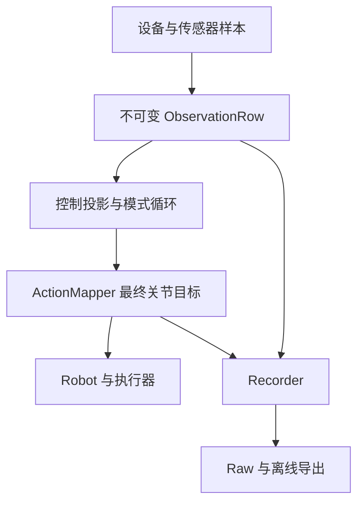

# Codex CLI 任务书：简化运行协议与数据链路

> 本任务书由仓库所有者明确要求写入根目录。它是本次实施依据，不是新的长期规则系统。任务书中的具体契约变更优先于当前 `AGENTS.md` 中与其冲突的旧契约；实现时同步修订对应条款。其余规则继续适用，尤其是未经明确授权不得连接或操作真实硬件。

## 1. 目标与执行范围

在保持当前实验定义的前提下，减少 `dexmani_real` 的跨层状态、重复机制和无效计算，让设备样本、模型输入、最终目标、Raw 与训练数据之间的关系可以直接追踪。

执行本任务意味着完成代码改造及离线验证，不只是补一份计划。默认完成第 5 节的 A—D；第 6 节是有证据后才启用的后续优化，不属于默认实现范围。不要为了完成所有报告建议同时重写控制器、存储格式、点云算法和 IK 后端。

本次主要决策：

1. 保留“实际反馈”和“最终目标”两种实验量，删除公共六态 SDK 回执和逐命令账本。
2. 运行生命周期由每个入口的 Session／协调者拥有；设备只处理本地 I/O、停止和故障。
3. 保留一个真实 `ObservationRow`，控制和录制从同一行分流；模型历史只保存控制需要的数据。
4. 不新增通用同步器。统一时间戳含义，保留来源时间和云图帧对应，先把现有延迟统计做正确。
5. 复用现有组件。已有的有界写入、共享几何算子、不可变快照和模型线程所有权继续使用。

明确不做：通用 Runner 基类、事件总线、服务容器、模态 registry、schema 插件、自动恢复框架、长期兼容层、全速多传感器日志系统、零拷贝生命周期协议、额外平滑，以及与本任务无关的风格清理。

## 2. 依据、版本与参考项目的取舍

本任务书由三轮审查及《dexmani_real 三轮审查与数据链路专项报告》收敛而来，不要求执行者取得 Word 报告才能实施。以下固定版本在编写任务书时再次核验；开始实施时检查本地 HEAD 和已有 diff，若相关代码已变化，应按实际调用链调整，不覆盖用户改动。

| 仓库 | 审查提交 | 借鉴内容 | 不照搬的内容 |
| --- | --- | --- | --- |
| [dexmani_real](https://github.com/haoyangzhanglab/dexmani_real/tree/30b2a86693b7dd4303249891a702fa7a93ac68fa) | `30b2a86693b7dd4303249891a702fa7a93ac68fa` | 保留已有的设备边界、ActionMapper、Raw 流式写入和在线离线共享算子 | 公共 Dispatch 协议、停止结果与训练准入绑定、重复授权镜像 |
| [T-Rex](https://github.com/ZhuoyangLiu2005/T-Rex/tree/ba4047ce3e9f3d2013d60de600e136897e90ccb8) | `ba4047ce3e9f3d2013d60de600e136897e90ccb8` | 动作生产和高频执行通过直接目标缓冲分离；物理转换集中 | 部分 SDK 错误处理和时间记录不足；不能因此删除本项目的必要检查 |
| [ManiUniCon](https://github.com/Universal-Control/ManiUniCon/tree/85c6f2e32ecf9f2bed62d202b058c39623444686) | `85c6f2e32ecf9f2bed62d202b058c39623444686` | 状态接收、观测包装、动作包装、执行各有责任；保留动作时间和 RTC 语义 | 网格累积可能重复使用同一样本；分别读取 state/camera 历史不自动证明物理同步 |
| [Dexora](https://github.com/dexoravla/Dexora/tree/6f2869d61483774aa75cda4cd2260dc6a5faa783) | `6f2869d61483774aa75cda4cd2260dc6a5faa783` | 直接的 gather observation → model → execute action 路径 | 阻塞式推理、失败时零值和部分录制路径的整段内存累积不作为本项目目标 |

“三个项目没有同样机制”仅限已检查的路径，不能当作全仓不存在或机制一定多余的证明。这里的删除依据是：当前实验是否消费它、是否跨层传播同一事实、能否用更小接口保持所需行为。

优先核对的参考代码：

- T-Rex：[arm_hand_control.py](https://github.com/ZhuoyangLiu2005/T-Rex/blob/ba4047ce3e9f3d2013d60de600e136897e90ccb8/hardware_code/teleop/arm_hand_control.py) 的 `full_robot_action_loop`、`smooth_and_check_action`；[main_teleop.py](https://github.com/ZhuoyangLiu2005/T-Rex/blob/ba4047ce3e9f3d2013d60de600e136897e90ccb8/hardware_code/teleop/main_teleop.py) 的目标与记录路径。
- ManiUniCon：[core/robot.py](https://github.com/Universal-Control/ManiUniCon/blob/85c6f2e32ecf9f2bed62d202b058c39623444686/maniunicon/core/robot.py)、[policies/torch_model.py](https://github.com/Universal-Control/ManiUniCon/blob/85c6f2e32ecf9f2bed62d202b058c39623444686/maniunicon/policies/torch_model.py)、[timestamp_accumulator.py](https://github.com/Universal-Control/ManiUniCon/blob/85c6f2e32ecf9f2bed62d202b058c39623444686/maniunicon/utils/timestamp_accumulator.py)。
- Dexora：[dexora_inference_zmq.py](https://github.com/dexoravla/Dexora/blob/6f2869d61483774aa75cda4cd2260dc6a5faa783/deploy/dexora_inference_zmq.py)、[xhand_forwarder.py](https://github.com/dexoravla/Dexora/blob/6f2869d61483774aa75cda4cd2260dc6a5faa783/deploy/xhand_forwarder.py)、[record_4_rgb_cam.py](https://github.com/dexoravla/Dexora/blob/6f2869d61483774aa75cda4cd2260dc6a5faa783/teleop/imitate_all/record_4_rgb_cam.py)。

## 3. 最终结构与不可改变的实验语义

### 3.1 数据路径



Recorder 记录交给提交入口的最终目标，不反推 SDK 是否送达或机器人是否到位。模型投影不读 SDK，设备不理解模型字段，Raw 不导入发送状态枚举。

| 现有责任位置 | 最终保留职责 | 应移除的职责 |
| --- | --- | --- |
| Session／入口协调者 | 资源装配、开始与结束、首个终止原因、录制失败决策 | 逐 SDK 返回码解释、逐字段变换、发送账本 |
| `runtime/observation.py` | 单次读取、来源时间、物理来源准入、不可变行 | 策略名称知识、全局停止、训练筛选 |
| `deployment/observation.py` | 固定字段依赖、模型投影、按需几何复用 | 录制开关、设备控制、文件发布 |
| Teleop／Policy／Replay | 各自的动作时序；Policy 的 chunk、async 和 RTC | SDK 细节、writer 状态机、独立授权副本 |
| `planning/action.py` | 单位、坐标、关节顺序、IK、最终目标检查 | 运行阶段、SDK 回执 |
| Robot／Executor／Driver | 单一设备 I/O 所有者、本地插值、边界检查、停止与故障 | 完整 RuntimeState 的业务决策、Raw schema |
| Recorder／Raw／Exporter | 写入、文件完整性、物理样本、离线准入与派生 | 运动授权、SDK 对账、物理停止证明 |

复用普通函数和现有组件即可，不按这张表机械新建类或搬动整棵目录。保留三个模式各自的循环；只有语义和时序确实相同的装配、结果格式化和收尾代码才抽取。

### 3.2 必须保留

- arm7 + hand12 的关节顺序、rad、基座系米、URDF 末端 frame、rot6d 列顺序；公共训练 `action` 为 19 维、`action_ee` 为 21 维。禁止用固件末端姿态替换既有 FK 定义。
- action 是最终目标，observation 是实测反馈，二者不互相填充。普通返回、SDK 返回成功、物理到位不是同一件事。
- Policy 的 sync／async／RTC 接管规则、slot 锚点、前缀冻结和模型所需的已提交动作上下文。LAMP 等动作历史不能替换成实测关节历史。
- Raw 是控制循环实际消费的行，不是所有传感器的全速原始流。当前默认 teleop 16 Hz、camera 30 Hz、arm reference 100 Hz、arm feedback 25 Hz；策略 dt 来自 artifact，不改这些默认值来掩盖超时。
- 来源年龄、云图帧身份、触觉有界保持、WAIT 真实时间轴、已发布 Raw 不可变、I/O 失败 staging 保留。
- 最终设备边界的形状、有限值和机械限位检查；已有控制器模式、跟踪误差、速度加速度与 HOME 静止条件。当前端点碰撞检查不代表整条轨迹经过碰撞验证。
- 源行通过准入后可删除同一不可变值的重复检查；跨进程、数值变换或时间推进后的检查不视为同一检查。

## 4. 机制取舍清单

| 机制 | 本次决定 | 最小替代或保留理由 |
| --- | --- | --- |
| 公共 `DispatchStatus`、`DispatchResult`、携带回执的异常 | 删除 | 正常返回与异常；设备特有状态留在 driver 内 |
| Raw `dispatch_status` 与跨层 `command_id` 对账 | 删除 | 观测、最终提交尝试目标、episode 终止事实 |
| `failed_dispatches`／`unwritten_dispatches` 数组账本 | 删除 | 首个失败、阶段、行数等小摘要；I/O 失败保留 staging |
| `stop_result=confirmed` 作为训练准入 | 删除 | I/O 完整性、数据语义和采集中断单独判定 |
| 正负 authority、prepare 隐含 `epoch + 1`、多层全局授权镜像 | 收缩 | 一个运行代号、及时停止信号、设备本地准备与故障状态 |
| 每层重新计算／刷新来源健康截止时间 | 合并 | 主协调者按控制需要计算一次；执行器只消费截止时间 |
| 命令接收、决策寿命、设备 watchdog | 保留语义并局部化 | 三者解决不同失效，不能用一个随到随续的超时代替 |
| 控制和录制合并为一个准入条件 | 拆开责任 | 设备按并集启动、一次采样、两个消费者独立检查 |
| 来源时间与 RGB-D／点云序号 | 保留 | 新鲜度、重复帧和几何输入对应关系 |
| 有界共享 ring 副本、只读数组、16 行队列和 32 行批量 | 保留 | 当前已有直接实现；避免零拷贝管理或整段内存累积 |
| 固定 13 字段公共导出 | 保留 | 维持当前多模态比较和下游接口，不引入可选 schema 组合 |
| 正常零行 capture | 保留现有零行 Raw 路径 | 没有必要为“少几个文件”另造结果存储分支；不再附发送账本 |
| 重叠历史重复 FK／手几何 | 按实际窗口复用 | 有界、推理线程私有；没有重叠就不建立缓存 |
| 全局同步 barrier、自动重采样、多时钟服务 | 不引入 | 尚无任务证据要求它们 |

这里对报告的一项落地收敛是保留现有健康零行 Raw 路径：零行可以只有运行结果是可选简化方向，但当前代码已有一致路径，额外改写它没有足够收益。停止确认仍可用于设备重新开始的本地条件，只从数据准入中移除。

## 5. 必须完成的改造

### A. 先修正来源时间和统计边界

主要位置：`robot/robot.py`、`robot/xhand/feedback.py`、`deployment/inference.py`、`data/results.py`、相关观测与测试。

#### A1. XHand 时间

1. 在 `get_state()` 前后取得同一主机 monotonic 时钟的 `query_started_ns` 和 `query_completed_ns`。
2. 当前无已验证的硬件采样时间，使用查询开始时刻作为新关节反馈和新有效触觉向量的保守来源时间；不要把它宣称为真实采样时刻。
3. 将 `XHandFeedback.consume` 的来源时间与检查时刻分开传入，例如 `consume(state, source_ns=..., now_ns=...)`，以完成时刻检查年龄和初始等待预算。只传开始时刻给整个 consume 会漏掉查询耗时，是错误修复。
4. `state is None`／CRC 时不推进旧关节或触觉时间；某个三轴向量无效时整向量保持旧值、旧时间，不能逐标量拼出伪有效值。
5. 现有触觉通道时间仍表示该通道中最旧有效向量的时间。不新增逐 taxel 公共时间数组或第二套健康管理器。
6. 若一次查询已经消耗完整年龄预算，返回时就应按现有过期行为失败；不通过扩大预算恢复表面通过率。初始化绝对 deadline 不得在每次重试时刷新。

相机现有“SDK 队列返回、重复帧不刷新、较旧通道取最小时间”的逻辑保留。点云仍继承来源相机时间，不用处理完成时刻续新鲜度。

#### A2. 延迟统计

`InferenceWorker.run_operation` 当前在 `build_observation` 后覆盖 `start`。保留已有模型耗时的语义，另记录观测组装耗时和总耗时，不能静默将旧 inference 指标改名不改消费者。

最小做法是保留开始、模型开始、完成三个时刻，复用 `EpisodeResults` 的摘要。加入来源年龄、组装、模型、映射／提交耗时所必需的小量数据；可用现有日志做一次性诊断，不建立追踪平台或无限列表。异步入队到开始的等待如需统计应另命名，不能叫模型耗时。

验收构造：组装 20 ms、模型 10 ms，应得到组装 20、模型 10、总处理 30 ms。它是统计边界测试，不是性能基准。

### B. 一次完成发送接口与 Raw 契约收缩

主要位置：`robot/commands.py`、`robot/robot.py`、`robot/xhand/driver.py`、`robot/xarm7/{driver,executor,worker,protocol}.py`、各模式调用方、`data/recorder.py`、`data/raw/*`、canonical、replay、查看工具和测试。

#### B1. 公共提交接口

- 保留一个不可变的最终目标对象，可沿用 `RobotCommand`；不要仅为名称更换全仓接口。它承载 arm／hand 目标及跨异步边界需要的运行身份，不承载 SDK 返回码。
- 公共 `send_action`／`submit` 正常返回 `None`；正常返回只表示本次主机提交路径按当前驱动规则完成，不表示双设备原子提交、SDK 最终送达或物理到位。
- 两侧目标均先做边界检查再开始任何设备副作用。同步不可继续的失败抛出普通、明确的异常；只在取消与设备故障确有不同处理时保留少量有意义的异常类型，不重建一组 Dispatch 状态异常。
- arm 异步故障沿一个已有故障通道通知协调者；目标 sequence 可继续作为执行器内部去重／替换身份，不成为公共 action 回执或 Raw 列。
- XHand 普通发送的短暂 CRC 与连续 CRC 预算继续留在驱动本地，不重发普通动作、不读回“证明接收”。不可将所有瞬时 CRC 改成硬失败，也不可将连续 CRC 失败改成静默成功。
- 移除上层 `check_hand_send` 对 SDK 枚举的解释。若驱动内部确需区分返回类型，使用局部返回码或小型私有语义；禁止以改名后的公共枚举复刻旧协议。
- 对已进入但无法由 Python 中断的原生 SDK 调用，不承诺立即取消。返回后不得再启动下一次受停止约束的调用。

#### B2. 明确定义新的 Raw 目标语义

新 Raw 保留现有 `action_arm_joint_target`／`action_hand_joint_target` 数据列名，语义明确为：**本行交给公共提交入口的最终目标，即提交尝试，不是 SDK 接收证明**。arm 仍记录低频 `q_goal`，不把 100 Hz reference 插值点替换成模型动作，也不改成发送前尚未经 ActionMapper 转换的输出。

| 本行情况 | 保存的目标 | 后续行为 |
| --- | --- | --- |
| 最终目标进入提交入口，调用正常返回 | 最终目标 | 后续按模式运行 |
| 已开始提交尝试后某侧失败或中断 | 同一最终目标，不伪造逐侧成功 | 结束本轮；终止记录保留失败阶段；不自动用于训练／回放 |
| WAIT、尚未得到目标，或提交前被取消 | 对应目标缺失，沿用 NaN 表示 | 保留真实观测与时刻，不填前一动作 |
| 未启用某执行器 | 对应目标缺失 | 不冒充完整 19 维动作 |

只有“交给提交入口”才算尝试；单纯完成 ActionMapper 计算并不算已提交。存在一个明确的赋值位置，避免分散在多个异常分支推断。模型需要的已提交动作上下文仍在公共提交正常返回后更新，不能用失败尝试替代。

记录沿同一 `ObservationRow` 与最终目标分支进行，不为录制再次读取设备。异常清理时尽可能保存本行或可靠前缀；写入也失败时保留 staging 与小摘要。记录失败不得覆盖原控制异常，二者都可解释即可，不恢复逐次发送审计。

#### B3. 文件完整性、采集结果与停止清理分离

采用最小的三个责任边界，复用现有元数据，不创建状态框架：

1. **I/O 完整性**：writer／recorder 确认数组、时间行、视频及接受行数一致，编码器和文件关闭成功后原子发布。部分 batch 写入失败不重试、不发布，保留 staging。
2. **采集结果**：保留 `termination_reason`；可沿用 `technical_status=normal|failed`，但其定义收紧为采集期间是否出现控制／样本／记录中断，不能再由事后 `stop_result` 推导。发送部分失败、缺必需录制数据、队列饱和等标为 failed；正常操作者结束不等于任务成功。
3. **停止与清理结果**：属于 Session 结果及异常摘要，不参与 writer 的物理停止判定。采集完成后的单独 stop 确认失败，不得反向把此前完整有效的样本全部判坏；设备侧仍锁存失败、阻止不安全重启。

区分“采集结束之前发生的控制故障”和“结束后的清理失败”。已有结果记录优先复用；没有启用独立 session summary 时，在 capture 终止详情中保存不参与准入的清理错误文本即可，不为此强制所有模式生成第二套结果文件。

从 `CaptureFinishRequest`、`save_episode`、writer、reader 和 exporter 中移除专门的 `stop_result` 契约；删除发送账本及其去重／回填逻辑。继续保留总行数、首个失败、错误阶段与可靠文件前缀。正常零行 capture 沿用现有零行 Raw；显式丢弃与 I/O 失败的处理仍不同。

#### B4. 训练与回放准入

- 将当前 `validate_fixed_rate_rows` 的时间检查与 Dispatch 检查拆开。固定频率规则只处理真实时间，相邻间隔和累计网格容差均保持当前 `dt/4`，不顺便改变研究假设。
- 有效训练动作通过必需目标完整且有限来判断，不再读取 SDK 枚举。采集期间技术失败默认整段拒绝自动训练／回放；允许查看完整 Raw 事实。不要在此任务中新增自动截取有效前缀或连续片段的策略。
- 包含 WAIT／缺失目标的 rollout Raw 默认不作为完整固定频率示教导出。不删除 WAIT 后拼接，不生成理想时间覆盖真实时间。
- 公共 canonical 仍为当前 13 字段；shape、dtype、单位、坐标、字段顺序不变。不引入逐模型 schema，也不默认修改 `dexmani_policy`。
- Raw 格式发生实际破坏性变更：把当前 `RAW_FORMAT="dexmani.raw"` 切换成明确的新值，例如 `dexmani.raw.v2`；新 reader 对旧格式清楚报错，不静默混读，不原地迁移旧 Raw。旧实验文件继续保留，可用对应旧提交查看；canonical 是可重建缓存。
- 同步更新 `arm_action_semantics` 等元数据，使用一个精确描述提交尝试的新常量，writer 和 reader 一致。不要保留含糊的旧 `q_goal_submitted` 说明。
- 全量查找本仓库 Raw 消费者、可视化、replay、诊断入口、fixtures、README／AGENTS。格式标识、接口和消费者必须在同一完整改动中闭合，不留下永久双轨。

### C. 集中生命周期，收缩授权和健康传播

主要位置：`runtime/state.py`、`runtime/operator_input.py`、各 Session／Runner／Episode、`robot/robot.py`、`robot/home.py`、`robot/xarm7/*`。

#### C1. 一个协调者，一个运行代号

- 各入口只有一个组件决定开始、结束和首个终止原因。沿用并缩小 `RuntimeState` 即可，不新建 RuntimeManager／SafetyManager／RunContext 体系。
- 键盘／VR 回调只提出意图并及时设置停止信号；不得在回调中完成 HOME、等待 writer 或执行 SDK 关闭。
- 只保留一个单调运行代号，用于可能跨运行返回的 model future、IPC 目标和必要的低频设备操作。当前运行结束后其结果不可再成为有效目标；纯同步局部函数不层层传递授权对象。
- Robot／ArmExecutor 不持有完整 RuntimeState 并自行改写 Session 状态。传递必要的运行身份、停止信号和操作参数，故障由设备报告、由协调者决定本轮结束。
- 移除 signed authority 的正负号编码和 `prepared_run_id = epoch + 1` 的隐含约定。准备和本次运行明确绑定同一个身份；低频 `prepare`／`home` 的完成或取消回复有真实用途，可以保留最小请求回复，不为“删除握手”盲删必要完成边界。
- 输入改变导致的旧 jog proposal 作废应在 jog 生产／消费边界完成。不要让每次非零方向变化都扮演一次全局运行重启；也不能执行输入改变前滞留的目标。

#### C2. 停止与重新开始

停止顺序固定为：关闭新的目标准入并设置执行侧停止信号 → 清除待执行目标／reference、丢弃旧推理结果 → 执行设备本地停止与状态检查 → 收尾 recorder、模型和文件。

停止通知不等待模型、视频编码或 HDF5；停止信号不通过普通目标队列排队。不得持有全局锁跨 SDK 调用或阻塞等待。设备故障锁存到本次运行结束，不增加自动恢复。

设备本地停止未成功时不得自行清除标志并进入新运行。重新开始需要旧操作结束、待执行槽清空和显式准备；只有协调者和设备所有者的受控开始路径能复位停止状态，普通目标发布不能复位它。保留必要的本地停止完成确认，删除其跨层镜像和数据有效性用途。

必须用可控时钟／线程屏障验证停止与开始交错，不能用大量 `sleep` 猜测顺序。检查点与原生 SDK 调用之间仍有不可原子撤销的窗口，不声称软件协议能中止已开始的调用；测试覆盖后续调用被阻止及旧结果不生效。

#### C3. 时间约束归属

| 约束 | 唯一解释者 | 执行侧需要什么 |
| --- | --- | --- |
| 当前样本是否新鲜 | observation 准入 | 由控制所需源原时间推导的健康截止值 |
| 模型决策／chunk 是否仍可用 | Policy scheduler | 已解析的执行截止时刻；不重解释模型字段 |
| 提交后首次发送是否过晚 | Robot／Executor 边界 | 内部提交截止时刻；首次消费时检查 |
| 活跃目标能执行到何时 | 执行器 | 独立执行截止；新目标或新鲜反馈不能无限延长旧决策 |
| 主协调者卡住／上游停止续供 | 执行器 watchdog | 一个有界的协调者健康截止值 |
| arm 本地反馈、模式、跟踪状态 | ArmWorker | 本地反馈与已有边界条件 |

可以把当前 `service_until`、`upstream_until`、`hand_until` 的跨层传播收敛为一个协调者健康截止值：只在控制必需来源通过检查时更新，取服务预算及各必需来源年龄预算的最早截止。不得只因 `robot.check()` 被调用就刷新全部来源，录制专用相机／触觉不加入该控制期限。

本地 arm 反馈检查继续由 worker 拥有；模型决策的执行期限不与上述健康值混同。WAIT、prepare、HOME、启动初始化的既有时序要分别覆盖，尤其不能用 streaming 的租期误杀合法 HOME，或把 WAIT 期间的旧目标无限保持。

是否保留 `submit_until_ns`／`execute_until_ns` 的现有字段名由最小改动决定。目标是集中计算和解释，不是为了减少两个数值字段而改变语义。跨耗时计算后，在真正消费／发送边界重新检查会变化的条件，属于必要检查。

### D. 整理采集、同步与观测组装

主要位置：`runtime/observation.py`、`deployment/{observation,session,episode}.py`、`teleop/session.py`、传感器启动、触觉反馈、共享几何与测试。

#### D1. 一次采样，两组需求

- `control_needs` 来自模式和模型实际字段，并包含运动必须的 arm／hand 反馈；`record_needs` 来自当前 Raw 采集契约。
- 启动设备使用二者并集；每个 tick 只读取一次设备／ring，产生一份拥有内存的不可变样本。不要用两次 `read_observation` 分别取控制和录制。
- 读取与准入分开：允许采样结果表达未取得的可选来源，再用普通函数对 control／record 需求分别判断。不可恢复的设备 I/O 异常仍正常上抛。不得把全部失败都压成一个无来源的 `None`。
- 默认启用完整录制时，record 必需数据失败由协调者以 recording failure 结束本次实验，且在下一次目标提交前处理。没有自动“继续运行但不录制”模式，不增加可配置故障策略矩阵。
- `control_needs` 不因 `record_raw` 改变；录制专用来源不能改变模型字段、策略决策年龄或执行器健康解释。设备初始化需要并集，运行准入分别判断；设备失效的报错归属不能又在 `check_services` 中重新合并。
- XHand 解析／触觉缓存与“哪些触觉对当前消费者必需”拆开。关节通信、有限值与初始化硬边界保留；可选触觉缺失由相应消费者判定，不在底层把录制触觉一律升级为控制故障。
- 移除 `ObservationRow.required_tactile` 这类消费策略状态，需求在消费者／会话中保存；行只表达样本及来源。不要让并集需求永久附着在样本上再被后续误用。

这里分离的是数据依赖与失败责任。默认完整采集失败仍会结束运行，不承诺录制故障时机器人继续运动。

#### D2. 固定字段依赖集中定义

将策略字段依赖集中到现有 `deployment/observation.py` 的小型定义与普通函数。`runtime/observation.py` 只认识物理来源，不反向导入 deployment；把 `ObservationNeeds.for_policy` 中策略字段知识移到 deployment 调用方。支持字段集合、启动需求、来源时间和几何构建条件从同一处取得，避免几处平行字段清单。

| 模型字段 | 数值依赖 | 动态时间来源 |
| --- | --- | --- |
| `joint_state` | arm qpos + hand qpos | arm、hand |
| `eef_pose` | arm qpos + arm FK | arm |
| `fingertip_xyz`／`hand_pointcloud` | arm、hand qpos；安装变换；手 FK／模板 | arm、hand |
| 两种 tactile | XHand 已处理消费值 | 对应通道最旧有效向量时间 |
| `point_cloud` | 指定相机帧派生点云 | 原相机来源时间 |
| `rgb`／`depth` | 所选相机 payload | 所选相机来源时间 |
| `camera_intrinsic`／`camera_extrinsic` | 会话静态参数 | 无独立动态来源；初始化校验 |

静态相机参数可以在初始化读取并确认设备／标定身份，之后不要求每 tick 取得一张新图来证明参数新鲜。仅请求静态参数的模型不增加动态 camera deadline；若该查询没有任何动态模型来源，使用实际控制反馈作为决策时间锚，不生成无限寿命决策。图像、深度或点云仍绑定真实动态帧。

一个行只保留一种相机身份。同时需要 RGB-D 与点云时，RGB-D 必须取 `cloud.source_camera_sequence` 对应帧；这也适用于“模型只用点云、录制要 RGB-D”。找不到对应帧应明确失败，不退回最新图像伪装匹配。

#### D3. 保持消费行同步设计

- 现有同步的准确描述是“来源年龄有界的消费快照，另保证相机与点云帧对应”，不是所有源同时采样。
- 保留 `control_ns`、`observation_ns`、arm／hand／两类 tactile／camera 来源时间、camera sequence。能推导的 age／skew 不再做每行重复持久化列。
- 不改变共享 ring 复制与只读数组规则。按字段读取已有支持；不重新实现零拷贝。训练／模型历史和 recorder 共享可安全共享的不可变数组。
- **模型历史只保留 control 投影**：录制专用的 RGB-D、大块触觉不因位于采样并集中而滞留整个模型窗口。投影可引用同一行的小字段／同一不可变数组，不再次读取或复制全帧；源时间和行身份保持一致。
- 使用现有保存的来源时间做离线年龄／差值统计。默认不新增严格全源 skew 门限、插值、全速独立时间轴或自动补帧。
- 相机主机接收时间不能直接与未经映射的设备时钟相减；空间 depth-to-color alignment 也不证明曝光同时。

#### D4. 按窗口复用几何

默认采用推理线程私有、容量受当前 history 限制的行特征复用，前提是当前配置存在重叠窗口且请求几何字段。`n_obs_steps=1` 且每次都是新行时直接走简单路径，不加新 cache 开关。

具体要求：

1. 优先复用已有行身份；同一运行中严格递增的 `observation_timestamp_ns` 可用于关联，缓存同时限定本次运行／固定投影配置。无需新建全局 UUID 或配置哈希服务。
2. 每个新行至多执行一次所需 arm FK、手 FK；同一行的指尖和手点云共享手 FK。当前 `compute_hand_geometry_history_xarm_base` 已共享单行手 FK，不重新开发这项能力。
3. 缓存只保留当前查询历史和所需派生小数组，不能持有整段 Raw 或录制专用图像。旧行随窗口淘汰；reset／新运行／投影配置变化时清空。
4. 只在模型线程内访问缓存和 Pinocchio Data；停止期间未完成 future 的结果被丢弃，reset 与后续推理仍串行，不能由主线程并发清缓存。
5. 在线 history 和离线 block 保留各自外壳，共用现有数值算子。只合并确实重复的单位、坐标和派生步骤，不创建能同时处理所有模式的观察工厂。
6. 构造 H=4 的三个连续窗口、共 6 个唯一行，几何处理计数从 12 降为 6，输出与旧实现在约定浮点容差内一致；H=1、新运行、重复帧和不同请求字段均覆盖。

若实际入口没有重叠窗口或没有请求几何，明确说明不启用复用路径；不能为了完成“性能优化”保留无消费者的缓存。调用次数减少不等于已测得真机加速。

## 6. 后续优化：本次默认不实施

| 候选改动 | 先取得的证据 | 通过后最小做法 |
| --- | --- | --- |
| 将 arm 同步反馈查询从 100 Hz tick 拆开 | 查询耗时、发送间隔 p50／p95、超时位置；SDK 线程安全与 qvel 来源 | 优先已有 report 快照；确有必要才单独读取线程；SDK 写入仍唯一所有者 |
| 删减点云过滤 | 同一批 Raw 上薄／小／反光物体保留、离群点、处理耗时及任务影响 | 离线比较深度范围、工作空间／桌面、体素、固定采样基线，选择一条最终管线并删无收益参数 |
| 去掉 MPlib、统一 IK 后端 | FK、Jacobian、IK 收敛率、误差、限位和解连续性等价检查 | 独立提交后端替换，不和本次协议改动混在一起 |
| TargetChecker 几何计算复用 | 同一完整 arm+hand 目标确实重复 FK／collision，实际开销值得优化 | 在单一所有者的局部工作区复用；不跨线程共享 Data、不漏 hand q |
| 降低点云生成频率／按查询生成 | 点云 CPU 成本显著且当前预生成浪费，延迟和历史可用性可接受 | 保留帧身份，明确新延迟语义；不直接将“更少计算”认作更好控制 |
| 存储压缩、批量或队列调整 | 编码／压缩耗时、吞吐、队列高水位、内存与输入质量 | 微调现有实现，不默认换存储后端、无损视频或无限队列 |
| 增加关键模态时间差门限 | 来源偏差与任务失败有明确关系 | 一项针对必要模态的规则；不建立通用同步服务 |

点云候选上限目前位于半径图之后，直接提前截断会改变密度语义；9 点簇被最小分量 10 删除是规则验证，不是实际物体误删率。先做消融，不把猜测写成 bug。

在线和离线虽然共用算子，离线 RGB 来自有损视频解码，不能要求逐像素一致。记录实际导出 recipe 即可，不引入历史标定兼容门禁。也不在本次新增轨迹碰撞证明或新的控制补偿。

## 7. 实施顺序与改动边界

1. 读取根目录及相关子目录 `AGENTS.md`，检查 `git status`／已有 diff。追踪 teleop、policy、replay、HOME、录制、导出与查看工具的相关调用方；不做无关全仓审计。
2. 完成 A，建立正确时间与指标，保留小型离线构造案例。
3. 完成 B 的整个契约闭环：driver → Robot／worker → 模式调用方 → Raw → reader／export／replay／viewer → fixtures／文档。中间可分步骤编辑，最终不得留下旧回执接口。
4. 完成 C，清除全局状态镜像和隐含 epoch 约定。为 prepare／HOME／WAIT／stop／restart 建立明确顺序；不得用大范围删检查代替责任集中。
5. 完成 D，先分需求与字段定义，再加入真实有用的窗口复用。检查没有产生 runtime → deployment 循环依赖。
6. 同步更新 `AGENTS.md` 中默认 dispatch、Raw 目标、部分发送、停止确认和离线验证相关条款；README 只保留用户需要知道的工作流和新 Raw 格式变化，不复制全部内部协议。
7. 完成第 8 节相关验证；复查 diff 只包含本次工作。按语义拆分可审查的修改，不把缺依赖或未做真机验证写成通过。

文件名与函数名优先沿用当前清晰命名。除确实消失的机制外，不为追求文件数或行数减少合并所有模块。删除旧路径、别名、无消费者字段及只测试旧协议的断言，不删除覆盖真实失败行为的测试。

本任务书不授权修改历史实验数据、不要求改动 `dexmani_policy`，也不授权连接硬件。格式切换和本仓库相关长期规则修改已经是本任务范围，无需因旧文档仍写着 Dispatch 契约而停下再次确认。

## 8. 离线验证与验收矩阵

使用现有 unittest／纯逻辑检查。硬件 SDK 用 mock／fake／注入时钟替代；先检查相关 import、fixture 和测试入口无硬件副作用。不要引入 pytest、Ruff、新测试框架或依赖升级。

| 场景 | 必须得到的结果 |
| --- | --- |
| XHand 查询耗时超过年龄预算 | 完成时按真实已耗时判过期，不能出现新值 age=0 |
| 读 CRC 与部分触觉无效 | 旧值／旧时间保持；按三轴向量处理；预算耗尽后失败 |
| 停止发生在 arm 提交与 hand 发送之间 | 后续 hand 调用受停止检查；最终尝试目标和终止原因可解释；无普通动作重试 |
| arm worker 晚到故障 | 协调者终止本轮，执行器清目标；不能只写一条日志继续 |
| 旧 future／旧 IPC 目标跨运行返回 | 不得更新当前 plan、reference 或有效动作上下文 |
| 停止与重新开始交错 | 旧操作未结束不复位停止；新 stop 请求不被 begin 清掉；不跨运行复用旧 reference |
| 主协调者阻塞或退出 | 执行器本地 watchdog 有界失效；旧目标不会被新鲜局部反馈无限续期 |
| prepare、HOME、WAIT | 各自完成／取消边界保持；不误用 streaming 租期，不丢 HOME 所需 qvel |
| joint-state-only 策略开关录制 | control 字段与控制期限不变；采样一次；缺录制相机归 recording failure 并结束 |
| 仅录制需要 tactile | 缺该 tactile 不伪装为策略缺输入；完整录制失败按默认结束 |
| 点云与 RGB-D 同时需要 | 对应同一 camera sequence；匹配不到不替换最新图 |
| 重复相机帧 | 来源时间不刷新；允许正常重复消费，但不声称新帧 |
| 仅请求相机静态参数 | 初始化校验；不要求逐 tick 相机图；决策仍有有限时间边界 |
| 来源均新鲜但彼此错位 | 如实保持当前准入语义；离线可计算差值，不默默加硬同步规则 |
| WAIT／缺失目标 | Raw 保留时间与缺失值；严格训练／回放拒绝，不删行压缩时间 |
| 固定网格漂移 | 16 Hz、64.5 ms 步长在索引 8 累计偏差 16 ms 时仍按原规则拒绝 |
| 提交尝试失败／部分发送 | 保存最终尝试目标与失败结束事实；整段不自动训练／回放 |
| 单独 stop 清理失败 | 不改写采集期间结果；完整有效行不因 stop 确认失败自动判坏；设备禁止自行重启 |
| 队列饱和、写入／编码失败 | 明确结束；无静默丢行、无限积压或部分 batch 重试；不把 staging 发布为成功 Raw |
| 正常零行及显式丢弃 | 零行路径一致；没有完整发送账本；显式丢弃保持原有用户语义 |
| 新旧 Raw 格式 | 新格式可读写导出；旧格式明确拒绝且历史文件不被修改 |
| 模型窗口有录制专用图像 | history 不持有这些大数组；recorder 继续使用原不可变样本 |
| H=4 重叠窗口几何 | 6 个唯一行仅处理 6 次；值与旧实现一致；缓存容量有界、reset 生效 |
| 在线／离线共享几何 | 对同一数值输入验证输出；单独说明视频解码和 recipe 差异 |
| 推理计时 | 组装 20 ms + 模型 10 ms，三个指标分别为 20／10／30 ms |

必要命令：

```bash
git diff --check
python -m compileall -q dexmani_real scripts
```

按改动运行现有受影响的 unittest 模块，例如 `tests.test_recording`、`tests.test_control`、`tests.test_lifecycle`、`tests.test_visualization`；执行前检查它们及 fixtures 已适配新契约且不会接入真实设备。缺 h5py、av、Pinocchio 等依赖时，完成可运行的纯逻辑验证并准确报告未验证项，不擅自安装或升级实验环境，不把编译通过当作数值或硬件验收通过。

完成条件：

- `data/` 不再依赖公共 Dispatch 类型，不再要求 stop confirmed；不存在改名后的同构回执／发送账本。
- 生命周期主写入者明确；设备不再读写完整全局 RuntimeState；旧运行结果不可生效，停止可以及时抵达设备所有者。
- control／record 需求独立、采样一次、模型 history 不夹带录制专用大 payload；字段依赖不存在多处平行维护。
- Raw／canonical／replay／viewer／fixtures／文档对新契约一致，旧格式处理明确，目标和实测反馈没有混淆。
- 必须保留的控制与实验语义有离线证据覆盖，缺失的真机与性能证据明确列出。
- 没有新增无消费者的抽象、缓存、配置开关、全局同步或恢复协议。

## 9. 最终交付格式

用中文简洁说明：

1. 实际完成的 A—D 和关键文件；哪些旧机制被删除、哪些必要边界被局部保留。
2. 新的样本 → 模型投影 → 最终目标 → 执行／Raw 路径，以及新 Raw 标识和目标语义。
3. 执行过的离线检查及结果；未执行的检查、缺依赖和仍需真机验证的项目。
4. 第 6 节哪些候选因缺证据保持原状；不得编造加速百分比、物理停止时延或任务成功率。
5. 若确有无法完成的关键项，给出具体源码原因和影响，不用“后续可优化”替代尚未闭合的核心契约。

除非用户进一步要求，不自动提交、push、创建 PR、运行真机或扩展到其他仓库。任务书保留为本次用户指定产物；长期行为只在 `AGENTS.md` 和必要用户文档中维护，不再生成新的根目录进度日志。

## 10. 配套 Codex CLI prompt

```text
请在当前 dexmani_real 仓库执行根目录 CODEX_TASK.md。

先读取 AGENTS.md、相关子目录规则和 CODEX_TASK.md，检查当前 HEAD 与已有 diff，保留用户改动。任务书已包含三轮审查、专项报告和三个参考项目的固定版本依据，不需要重新泛化调研。

请把任务书 A—D 作为本次完整实施范围，先列出简短的调用方／数据契约改动清单，然后直接完成代码、受影响消费者、测试与文档，不停留在设计建议。核心目标是删除公共发送回执和账本、集中生命周期、修正时间语义、分离控制与录制需求，并让观测组装只做实际需要的工作。

任务书明确授权的 Raw／AGENTS 契约调整以任务书为准，同步修改所有消费者；不维护旧协议别名、永久双格式或新的通用框架。保留真实反馈与最终提交尝试目标的区别、必要停止和时效边界、云图帧对应、触觉旧时间、WAIT 时间轴及 Raw 不可变性。sync／async／RTC 和模型动作上下文语义不得顺手改变。

第 6 节的硬件线程、点云、IK 和存储优化默认不实施；有证据才做，不为了“优化”增加配置与架构。常规可逆实现选择自行完成；发现当前代码与任务书存在实质冲突时，先核实并采用满足目标的最小正确方案，最终解释差异。

仅运行确认无硬件副作用的编译、现有 unittest 和纯逻辑检查。不要连接设备、执行 HOME／rollout／采集、改历史 Raw、升级依赖、运行 pytest／Ruff，也不要自动提交或推送。完成后按任务书第 9 节交付实际改动、验证结果、格式影响及未验证项。
```
