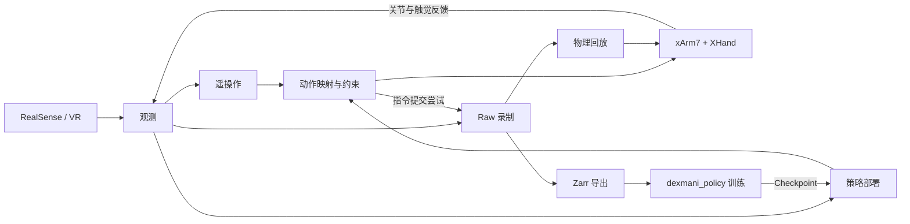

# DexMani Real

面向 xArm7 + XHand 真机灵巧操作实验的 Python 研究代码，使用 RealSense RGB-D 与 VR/HTS 采集示教，支持 Raw 录制、Zarr 导出、策略部署和物理回放。

策略训练与模型推理由配套 [dexmani_policy](https://github.com/haoyangzhanglab/dexmani_policy) 提供，本仓库负责设备交互、观测读取与动作执行。

## 整体架构



遥操作与策略部署共用设备、观测、动作映射和录制组件；末端目标经局部 IK 转为关节目标。Raw 分别保存实测状态与指令提交尝试，导出为训练数据，或按已记录的关节目标回放。

## 使用入口

在已配置设备与模型依赖的 `real_robot` 环境中，从仓库根目录运行脚本；完整参数通过对应入口的 `--help` 查看。

VR 接收依赖包含 DR-004 接收时间及 DR-027 同时间更新修复的 `hand-tracking-sdk 1.1.0` 源码（基于上游
`6ca05d1d5b00dfd89535aef74f698d6765bf1229`）。将[修复后的 SDK](https://github.com/haoyangzhanglab/hand-tracking-sdk) checkout 放在相邻的
`../hand-tracking-sdk`，在 `real_robot` 环境执行 `python -m pip install --no-deps -e ../hand-tracking-sdk`。
接收器须提供 `last_recv_ts_ns`，保留行在主机完整接收时的单调时间，供组帧与现有 TTL 检查使用。
同次接收中的多条组件更新可共享时间戳，SDK 仍逐次输出并递增序号；手部标定按 Ring 发布序号识别新观测。

| 任务 | 入口 |
| --- | --- |
| VR 示教／键盘点动 | [collect_teleop.py](scripts/collect_teleop.py) / [keyboard_teleop.py](scripts/keyboard_teleop.py) |
| Raw 查看与分析 | [visualize_episode.py](scripts/visualize_episode.py) |
| 离线任务结果标注 | [label_episode.py](scripts/label_episode.py) |
| Zarr 训练数据导出 | [export_zarr.py](scripts/export_zarr.py) |
| Checkpoint 策略评估 | [run_policy.py](scripts/run_policy.py) |
| Raw 关节目标回放 | [replay_episode.py](scripts/replay_episode.py) |
| 相机／VR 朝向标定 | [calibrate_camera.py](scripts/calibrate_camera.py) / [calibrate_vr_heading.py](scripts/calibrate_vr_heading.py) |
| 物体资产与 HOI 点云 | [CordVIP 实验入口](scripts/cordvip/README.md) |

感知环境默认只安装跟踪能力；单图重建在同一环境中按需增量安装，见 [CordVIP 安装与模型下载](third_party/cordvip_geometry/README.md#安装与命令)。

默认配置由 [config/real.py](dexmani_real/config/real.py) 组装。采集、部署与回放可用 `--config` 指定导出 `CONFIG: RealConfig` 的本地 Python 实验文件。可先查看参数与配置：

```bash
python scripts/collect_teleop.py --print-config
python scripts/run_policy.py --help
python scripts/run_policy.py --print-config
```

`run_policy.py --print-config` 打印本地声明的 RealConfig（declared config），不加载 Checkpoint 或标定，不代表部署后的全部有效参数。模型输入输出契约由 Checkpoint 决定；硬件、安全限制、传感器和环境由 RealConfig 决定。`execution.control_dt_s` 和 `action_steps` 的非 `None` 本地值优先，否则使用 Checkpoint；其余执行参数使用 RealConfig。完整规则见[配置来源](docs/policy_deployment.md#配置来源与启动信息)。

部署自动从 `observation_fields` 识别 HOI：包含 `object_pointcloud` 才校验并加载任务模板、启动 HOI Worker；普通策略不加载 HOI。以 info.task_name 定位任务目录，模板保存对象名与点分段；资产由研究者固定，不比较哈希。execution.hoi_max_skew_s 默认 None，关闭额外来源时间差限制；显式设置有限正数秒值后，手物联合输入超限则停止。

## 一次实验

在 `real_robot` 环境中，按采集、检查、导出、评估的顺序运行。以下使用 `pnp_apple_banana`，Episode 路径和 Checkpoint 路径替换为本次实验产物：

```bash
python scripts/collect_teleop.py pnp_apple_banana --print-config
python scripts/collect_teleop.py pnp_apple_banana
python scripts/visualize_episode.py episodes/pnp_apple_banana/episode_20261101_165909 --info
python scripts/export_zarr.py episodes/pnp_apple_banana \
  --output datasets/pnp_apple_banana.zarr
python scripts/run_policy.py /path/to/checkpoints/latest.pt --record-raw
```

需要修改实验参数时，在本地 Python 文件中导出 `CONFIG: RealConfig`，通过 `--config` 传入。普通 point_cloud 的 recipe 从 Checkpoint 恢复；hand_pointcloud 使用 RealConfig.hand_pointcloud。Raw 保存数据解释所需标定，部署完整配置保存在 run_config.yaml；遥操作完整配置由研究者自行管理；导出按训练所需字段选择，目标目录必须不存在。HOI 先按 [CordVIP 流程](scripts/cordvip/README.md) 完成标注，再选择 `object_pointcloud` 导出。

省略 `--fields` 默认导出全部现有常用模态（不含 `object_pointcloud`），供不同策略复用同一份 Canonical Zarr；也可显式选择字段子集。`--exclude EPISODE` 按目录名排除整段，可重复指定；任何未知名称都会报错，全部排除也会拒绝导出。

已有 Episode 目录可离线标注人工任务结果：

```bash
python scripts/label_episode.py episodes/task/episode_xxx success
python scripts/label_episode.py episodes/task/episode_xxx failure --note "抓取后滑落" --overwrite
python scripts/visualize_episode.py episodes/task/episode_xxx --info
```

标签为 `success`、`failure` 或 `unknown`，独立保存在 `outcome.json`，新标注只含 outcome 和用户提供的可选 note。默认拒绝覆盖，`--overwrite` 原子替换整个标注（未传备注则移除旧备注）。读取仅要求 JSON 对象含合法 outcome；旧时间戳、备注和其他额外字段不参与验证。已有目录缺少标签时返回 unknown，损坏 JSON、非法 outcome 和权限错误直接报错。

写标签只要求目录已存在，不打开 Raw 或检查录制质量。任务结果、控制结束原因和 Raw 保存状态互相独立；在线摘要不读取离线标签，以 INFO 显示 `unknown`；Raw 录制结果独立使用对应日志级别。标注不改写 HDF5/MP4 或已有 Zarr，不改变导出或训练选择；未标注 Episode 仍可使用，现有数据集不需重新生成。不提供 success-only 筛选、Raw 来源映射或标签快照。

采集和评估均按 B 开始新段，S/C 保存结束，D 丢弃，Q 保存退出，Esc 急停。来源失效或录制失败会结束本段；停止与收尾完成后才能再次按 B。触觉录制与模型输入共用默认 200 ms 时效预算。

物理回放使用 `python scripts/replay_episode.py EPISODE`；多区间数据必须加 `--segment N`。运行前将机器人就位到所选区间的起始姿态，入口会检查目标和起点差异。详细数据与停止约定见[策略部署](docs/policy_deployment.md)。

## 核心模块

以下目录均位于 `dexmani_real/` 下。

| 模块 | 职责 |
| --- | --- |
| [sensor](dexmani_real/sensor/) / [ipc](dexmani_real/ipc/) | 采集传感器数据，通过共享内存传递快照。 |
| [robot](dexmani_real/robot/) | 设备连接、反馈读取与命令提交。 |
| [runtime](dexmani_real/runtime/) | 共享观测、会话状态、资源生命周期、回位与点动。 |
| [control](dexmani_real/control/) | 动作映射、局部 IK、运行限位及仅供 HOME 使用的碰撞检查。 |
| [teleop](dexmani_real/teleop/) | 腕部映射、手部重定向与示教采集。 |
| [geometry](dexmani_real/geometry/) / [perception](dexmani_real/perception/) | 相机几何、正运动学、场景／手部／HOI 点云。 |
| [data](dexmani_real/data/) | Raw 录制与读取、Zarr 导出。 |
| [deployment](dexmani_real/deployment/) | 模型输入构造、推理调度与多段策略评估。 |
| [replay](dexmani_real/replay/) | 校验 Raw 目标与连续区间，进行物理回放。 |

[config](dexmani_real/config/) 保存实验配置，[utils](dexmani_real/utils/) 提供标定与可视化工具，[assets](assets/) 保存机器人模型和几何模板。

## HOME

VR／Policy 的 H 和 Keyboard Jog 的 R 共用 `runtime/home.py` 的 `home_robot()`：
先停止并确认反馈／停稳，再验证、执行 Arm HOME，最后以实测小步位置控制执行 XHand HOME。
正常 Teleop、Policy EEF 和 Jog 不计算算法碰撞；关节范围、工作空间、IK 速度／lead、Ruckig 与设备停止机制保留。

自动 HOME 默认不可用：必须在实验配置中确认 `environment.home_model_confirmed`，配置可信的 `static_boxes`，
并填写经测试的 HOME 参数。空障碍列表只允许用于确认无固定障碍的场景；手部禁用时拒绝组合 HOME。
详细参数和验证边界见[HOME 约定](docs/policy_deployment.md#home-规划与准入)。

## 离线验证

离线契约测试在已安装项目依赖和 `control` 可选依赖（Ruckig）的 `real_robot` 环境运行：

```bash
python -B -m unittest discover -s tests -v
```

测试使用合成观测、设备替身和 `/tmp` 临时数据，不连接硬件或加载实际策略模型；不覆盖真机停止效果、实时延迟和实际 Checkpoint 推理。

## 主题文档

- [手部重定向](docs/hand_retargeting.md)：人体关键点到 XHand 关节目标的映射。
- [策略部署](docs/policy_deployment.md)：执行模式、来源时效、录制区间与停止边界。
- [物体重建与 HOI](docs/object_reconstruction.md#hoi-五阶段流程)：资产与模板流程、训练／部署契约、实验结论及验证限制。
