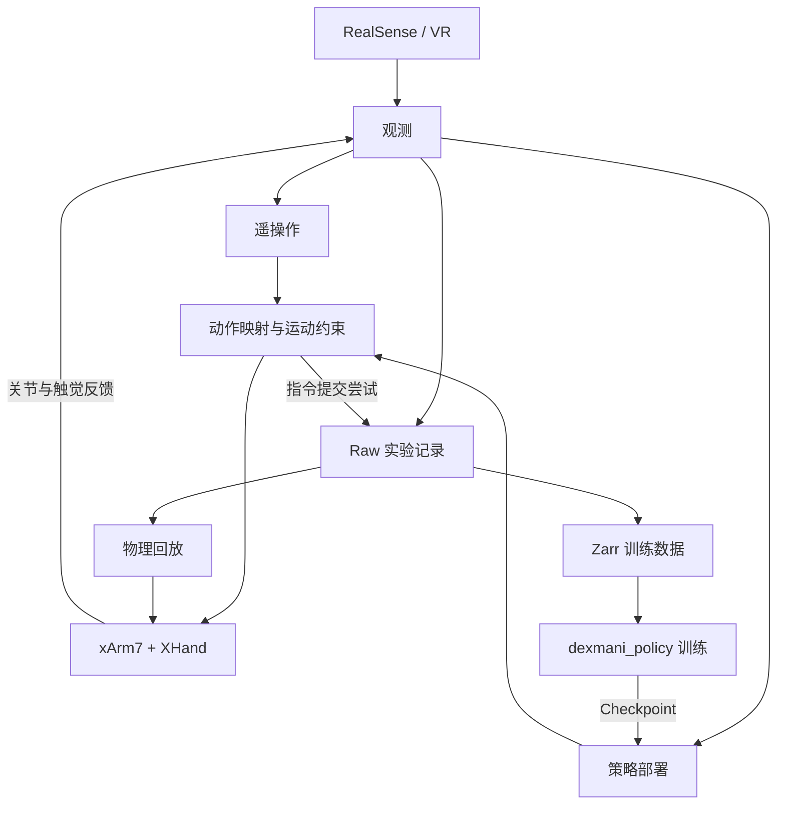

# DexMani Real

面向 xArm7 + XHand 真机灵巧操作实验的 Python 研究代码，使用 RealSense RGB-D 与 VR 采集示教，支持数据导出、策略评估和物理回放。

配套项目 [dexmani_policy](https://github.com/haoyangzhanglab/dexmani_policy) 负责策略训练与模型推理，本仓库负责设备交互、观测构建与动作执行。

## 整体架构



遥操作与策略部署共用设备、观测、控制和录制组件。关节动作直接形成关节目标，末端动作通过局部逆运动学（IK）转换为关节目标。Raw、HOI 和 Zarr 的读取与导出规则见[实验数据](docs/data.md)。

## 实验流程

先完成[相机标定](scripts/calibrate_camera.py)与 [VR 朝向标定](scripts/calibrate_vr_heading.py)。场景点云需要去桌面时，运行[点云工具](scripts/tools/view_pointcloud.py)并选择桌面标定。以下命令在 `real_robot` 环境下从仓库根目录运行。将 `TASK`、`EPISODE`、`CHECKPOINT` 替换为实际任务、录制目录与模型路径。

| 要做的实验 | 命令 |
| --- | --- |
| 查看采集配置（不连接设备） | `python scripts/collect_teleop.py TASK --print-config` |
| VR 采集 / 仅遥操作 | `python scripts/collect_teleop.py TASK` / 加 `--no-record` |
| 键盘调整姿态 | `python scripts/keyboard_teleop.py` |
| 查看记录 | `python scripts/visualize_episode.py EPISODE`（`--no-hoi` 绕过标注，`--max-frames N` 只解码和显示前 N 帧图像） |
| 导出训练数据 | `python scripts/export_zarr.py episodes/TASK`（可加 `--fields joint_state action` 指定字段） |
| 策略评估并录制 | `python scripts/run_policy.py CHECKPOINT --record-raw` |
| 回放具有完整目标的 Raw 连续段 | `python scripts/replay_episode.py episodes/pick/episode_001 --segment 0`（替换实际采集目录，段号从 0 开始） |

VR 采集或仅遥操作启动时，启用的 XHand 一连接就会向 `hand.home_qpos_deg` 配置的位置回位。手部到位并停稳后，才继续启动 VR 和录制所需的相机。

HOI 数据先完成[物体资产准备与离线标注](docs/object_reconstruction.md)。具体选项见各入口的 `--help`。

### 从示教训练并部署 CordViP

以下命令使用支持本文动作约定的配套 `dexmani_policy`。从本仓库根目录运行。示例 Raw 的 `meta.task_label` 为 `pick`，训练命令的 `task_name` 须与它一致。将前三个路径改为实际的 VR 采集目录、已准备好米制网格和 `task.json` 的资产目录、新的实验输出目录。标注和现场部署需要配好 HOI 跟踪后端，完整训练使用带 GPU 的 Policy 环境。

```bash
RAW=/data/episodes/pick
ASSETS=/data/tasks/pick
RUN=/data/experiments/pick_01

python scripts/cordvip/sample_template.py --task-dir "$ASSETS"
python scripts/cordvip/annotate_episodes.py "$RAW" --task-dir "$ASSETS"
python scripts/export_zarr.py "$RAW" --output "$RUN/pick.zarr" \
    --fields joint_state hand_pointcloud object_pointcloud action
python -m dexmani_policy.train --config-name cordvip task_name=pick \
    zarr_path="$RUN/pick.zarr" hydra.run.dir="$RUN/train"
python scripts/run_policy.py "$RUN/train/checkpoints/latest.pt" \
    --task-dir "$ASSETS" --output "$RUN/evaluation"
```

`run_config.yaml` 保存训练处理参数，以及部署实际使用的场景和手部点云处理参数。场景点云去桌面时记录归一化平面系数。场景点云过滤为空时，在线继续使用最近一次非空结果，直到其来源过期。HOI 标注与部署可传同一个 `--config experiment.py`，部署在 `effective_parameters.hoi_tracking` 记录实际跟踪参数。[跟踪配置](docs/object_reconstruction.md#跟踪配置)

物理回放要求先将机器人就位到所选连续段的起点。连接设备前，回放检查原始 Raw 所选段的每行是否都有完整、有限且在限位内的臂手绝对目标。能定位到具体行时，错误会给出 Raw 内从 0 开始的绝对行号。通过检查后按 Raw 标称频率顺序重发目标，慢槽会延长播放时间。播放结束并停稳后保持连接，按 H 回到初始位并退出，按 S/Q 停止并退出，Esc 急停。会话耗时包含等待按键和回位。

VR 只录制臂手组合命令成功提交的拍。策略正常等待时可录制观测，该行两列动作目标均填 NaN。停止或失败终止的控制拍省略。训练导出在各连续段内填充等待行，形成统一的关节 `action`，并由同一序列派生 `action_ee`。实测关节位置由反馈列给出。主机时间戳记录采样过程，视频 PTS 取自相对首帧的控制采样时间。详见[时间与动作](docs/data.md#时间与动作)。

实验配置由 [RealConfig](dexmani_real/config/real.py) 组装。用一个可信本地 Python 文件导出 `CONFIG`，将实际设备、工作空间、运动参数集中保存；采集、部署、导出和回放均可传 `--config experiment.py`。例如下面只改变采集周期，其余配置仍须符合实际设备：

```python
from dataclasses import replace
from dexmani_real.config.real import RealConfig

base = RealConfig()
CONFIG = replace(base, teleop=replace(base.teleop, control_hz=20.0))
```

先用 `python scripts/collect_teleop.py TASK --config experiment.py --print-config` 检查声明值；策略的有效配置还会结合 checkpoint 在启动时解析。

`MotionConfig.ik_target_speed_deg_s` 限制单拍 IK 关节目标变化。

`ArmConfig.collision_sensitivity` 默认是 `None`，准备运动时保留 xArm 控制器的当前设置。显式设置整数 0–5 时才下发，0 会关闭控制器碰撞检测。这个默认值只约定程序如何处理控制器设置，检测是否开启、场地验收和全路径碰撞情况仍需现场核实。

运行 `python scripts/calibrate_camera.py` 打开相机标定窗口。将 ArUco 标记刚性固定在机械臂末端，并拆除 XHand 或将其固定在配置的 HOME 姿态。用 WASD、方向键和 IJKL 点动机械臂，按 R 回 HOME。按 Space 停止点动并在机械臂停稳后采样，至少采集 10 组有效样本，摆位时绕不同方向转动末端。

按 Enter 择优求解并显示位置和旋转 RMS。位置 RMS ≤ 5 mm 且旋转 RMS ≤ 3° 时，按相机序列号更新默认的 `cameras.json`。Backspace 撤销末次采样，X 移除最近一次求解中残差最差的样本，之后按 Enter 重算。Q 或关闭窗口退出，Esc 触发软件急停。可用 `--config experiment.py` 指定实验配置，或用 `--output camera_calibration.json` 指定外参文件。采集或部署时，通过 `--camera-calibration` 可选用自定义外参文件。 [默认外参文件](dexmani_real/config/calibration_data/cameras.json)

VR 朝向标定复用 `CONFIG.vr`，用 `python scripts/calibrate_vr_heading.py --config experiment.py` 启动，临时端口可用 `--port` 覆盖。默认监听 TCP 8000。使用 USB 时先执行 `adb reverse tcp:8000 tcp:8000`，在 Quest 的 Hand Tracking Streamer 里选 **TCP Wired**。无线时选 **TCP Wireless**，填入 Quest 可达的电脑 IP 和端口。启动脚本后戴上头显，打开 **Head Pose**，再点 **Start**。标定结果保存成功后，电脑会播报「轴向已标定」。 [HTS 连接说明](https://github.com/wengmister/hand-tracking-streamer/blob/main/CONNECTIONS.md)

VR 接收器报告 TCP 断开时，程序请求停止并结束当前段。`tcp_client` 会在已建立的连接断开后重试连接。重连后按 B 启动新段，以当时的实测臂姿态重新定锚。设置 `hand.enabled=False` 并使用 `--no-record` 时，只需右腕输入。触及工作空间边界时，成功提交新目标后会丢弃超界的手势位移，让反向输入从边界开始响应。

VR 遥操作第一次按 Q 播报准备退出，当前操作继续。再次按 Q 停止并保存当前录制，收尾后播报「操作结束」再退出。Esc 立即请求急停。

策略的运行预算、动作接续与 HOI 恢复见[策略部署](docs/policy_deployment.md)。

VR 和键盘启动时各自检查控制周期严格短于 `target_max_age_s`。两者默认控制频率分别为 16 Hz 和 30 Hz，命令租约均为 0.25 秒。

xArm 切到 Mode 1 后会主动确认控制器的运动状态。每次发送前检查上报的状态和模式。HOME 在就绪后重新核对规划起点。若发送被拒，错误会记录控制器状态、上报模式及最近的就绪查询结果，HOME 还会标出参考点序号。同一用户在一台 Linux 工作站上运行本仓入口时，相同配置地址只能由一个会话持有。

XHand 诊断的 `--read-only` 不发送诊断运动目标，但仍会连接和断开设备。特定 EtherCAT 配置在断开时可能请求固件状态切换。见 [control_xhand.py](scripts/tools/control_xhand.py)。

串口连接会在打开前检查设备类型和权限。若 `hand.device_name=None` 且枚举得到多个串口，请在实验配置指定实际端口。XHand 的触觉解析由会话决定。录制 Raw 时读取合力和稠密触觉，无录制策略只解析模型需要的通道，键盘、回放和无录制 VR 使用关节反馈。显式触觉校准及独立诊断使用两路触觉。

### 遥操作跟随时序

VR 遥操作默认 16 Hz。实验配置可通过 `teleop.control_hz` 指定频率。若要保持滤波时间常数，将位置和姿态的 EMA 权重分别按 `1 - (1 - alpha_old) ** (hz_old / hz_new)` 换算。

用相同起点和手势对照不同频率，分别保存 Raw 和时序。以下命令采集默认频率的基线。每次运行使用新的 `--timing-output` 路径，可加 `--no-record` 仅测控制链路。

```bash
python scripts/collect_teleop.py TASK --episodes-dir episodes/vr-16hz \
    --timing-output episodes/vr-16hz/TASK-timing.json
```

VR 控制频率也决定 XHand 目标提交、Raw 行和 `rgb.mp4` 的标称频率。视频 PTS 采用实际控制采样时间。xArm 反馈查询默认为 25 Hz，采集频率更高时，相邻 Raw 行可能引用同一次关节反馈。

每份 Canonical Zarr 使用单一 `dt`。将不同采集频率的 Raw 分开导出。

```bash
python scripts/export_zarr.py episodes/vr-16hz/TASK --output datasets/TASK-16hz.zarr
```

键盘提频对照可把下面的配置保存为 `tracking.py`。50 Hz 下每拍步长为 4.8 mm 和 0.018 rad，对应原来的名义操作速度。

```python
from dataclasses import replace
from dexmani_real.config.real import RealConfig

base = RealConfig()  # 用实际实验配置作为基线
jog_hz = 50.0
jog_rate_ratio = base.keyboard_teleop.control_hz / jog_hz
CONFIG = replace(
    base,
    keyboard_teleop=replace(
        base.keyboard_teleop, control_hz=jog_hz,
        delta_pos_m=base.keyboard_teleop.delta_pos_m * jog_rate_ratio,
        delta_rpy_rad=base.keyboard_teleop.delta_rpy_rad * jog_rate_ratio,
    ),
)
```

```bash
python scripts/keyboard_teleop.py --config tracking.py --timing-output traces/keyboard-50.json
python scripts/replay_episode.py EPISODE --segment 0 --timing-output traces/replay.json
```

会话结束后输出 JSON。`control` 收集输入、求解和提交事件，`servo` 收集常规跟随的 SDK 调用时刻与关节参考，`feedback` 收集 SDK 查询与实测关节。用 `control_ns` 对齐一拍内的事件，用 `goal_published_ns` 对齐伺服参考与 `arm_publish.timestamp_ns`。各缓冲保留最近的样本，`dropped` 为已覆盖或收尾时无法完整取得的条数。短段对照宜在约两分钟内结束会话。

有手部重定向事件时，时序 JSON 和离线汇总都提供手部求解耗时分位数与失败次数。逐拍失败原因见 `control.samples` 中的 `hand_retarget` 事件。

```bash
python -m dexmani_real.runtime.teleop_timing episodes/vr-16hz/TASK-timing.json
```

离线汇总以每次成功反馈的主机查询起点配对最近完成的伺服调用，要求该调用成功且相距至多两个名义伺服周期。输出配对条数、关节最大绝对偏差和 URDF 末端位置及姿态误差的分位数。`reference_age_ms` 表示这两个主机时刻之差。比较配置时同时查看配对数量和误差，采样间隔和空闲时长会影响配对。

汇总中的 `dispatch` 统计目标发布到首次伺服、SDK 调用、调度迟到和反馈查询耗时。回放汇总按 Raw 的绝对行号显示组合提交结果和观测到的伺服调用，并用末帧留驻内的新鲜反馈计算关节误差和实测最大关节速度。

在相同起点和意图速度下重复平移、旋转和组合动作，比较跟随差距、伺服发送间隔及松键或停腕后的位移。`ik` 事件中用 `goal_qpos` 与 `reference_qpos` 的差值和 `h_s × metadata.ik_speed_rad_s` 对照单拍关节步长，用 `goal_qpos` 与 `measured_qpos` 的差值观察目标和实测之间的偏差。

`summary` 汇总保留窗口内的手部读取和写入 p95、调度错过的控制槽及主动跳过的控制步，也记录会话累计的 XHand CRC 计数。在线反馈的读 CRC 退避由下一次轮询承担，写入耗时包含同步 CRC 重试等待。比较解包成本时，用相同 SDK 样本分别测关节、合力和稠密解析。

## 核心模块

以下目录均位于 `dexmani_real/` 下。

| 模块 | 职责 |
| --- | --- |
| [sensor](dexmani_real/sensor/) / [ipc](dexmani_real/ipc/) | 采集传感器数据，通过共享内存向消费者提供观测。 |
| [robot](dexmani_real/robot/) / [control](dexmani_real/control/) | 连接设备，读取反馈，完成动作映射、IK 与运动约束。 |
| [runtime](dexmani_real/runtime/) | 组织共享观测、会话状态、资源生命周期、回位与点动。 |
| [teleop](dexmani_real/teleop/) | 将 VR 腕部与手部运动映射为机器人动作，采集示教。 |
| [geometry](dexmani_real/geometry/) / [perception](dexmani_real/perception/) | 提供相机几何、正运动学及场景、手部和物体点云。 |
| [data](dexmani_real/data/) | Raw 录制与读取、HOI 数据写入、Zarr 导出。 |
| [deployment](dexmani_real/deployment/) | 构建模型输入，调度推理与动作序列，组织多段评估。 |
| [replay](dexmani_real/replay/) | 按 Raw 中的连续区间回放关节目标。 |

[config](dexmani_real/config/) 保存实验配置，[utils](dexmani_real/utils/) 提供标定与可视化工具，[assets](assets/) 保存机器人模型和几何模板。

### 修改实验时从哪里入手

| 需求 | 代码入口与职责 |
| --- | --- |
| 改采集过程 | `scripts/collect_teleop.py` → `teleop/run.py` 装配资源 → `TeleopLoop` 运行示教 |
| 改策略执行 | `scripts/run_policy.py` → `PolicySession` 管会话资源 → `Rollout` 管单段控制和动作窗口，`schedule.py` 提供控制槽计算 |
| 改模型观测 | `runtime/observation.py` 读取并检查来源 → `ObservationBuilder.project()` 投影 → `Rollout` 保存历史 → `ObservationBuilder.build()` 构建模型输入。字段依赖见 `FIELD_DEPENDENCIES`。 |
| 改训练数据 | `RawReader` 按需读取并校验输入 → `export.py` 分块派生 → 完整产物发布；失败录制由 `EpisodeRecorder` 向运行层报告 |

直接从 Python 启动策略使用 `PolicySession(runtime, checkpoint, record_raw=True).run()`（从 `dexmani_real.deployment.session` 导入）。HOI 策略还须传 `task_dir="/data/tasks/pick"`。启用 Raw 时默认写入当前工作目录下的 `rollouts/`，可通过 `output_root` 指定其他输出位置。

主进程持有会话与 XHand I/O；机械臂 SDK、相机、VR 与启用的感知任务运行在子进程；策略推理和录制各有自己的工作线程。设备 SDK 留在驱动层，动作映射只生成目标，实际发送归 `Robot`。新增实验优先修改配置和对应流程，独立算法放入现有几何或感知模块。

## 主题文档

- [手部重定向](docs/hand_retargeting.md)：人体关键点到 XHand 关节目标的映射。
- [策略部署](docs/policy_deployment.md)：观测、推理、动作执行与多段评估流程。
- [实验数据](docs/data.md) · Raw 记录、时间、动作与 Zarr 导出。
- [物体重建与 HOI](docs/object_reconstruction.md)：物体资产、固定点云模板及训练与部署流程。
