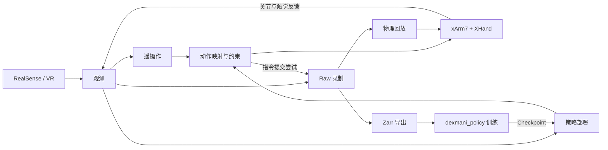

# DexMani Real

面向 xArm7 + XHand 真机灵巧操作实验的 Python 研究代码，使用 RealSense RGB-D 与 VR/HTS 采集示教，支持 Raw 录制、Zarr 导出、策略部署和物理回放。

策略训练与模型推理由配套 [dexmani_policy](https://github.com/haoyangzhanglab/dexmani_policy) 提供，本仓库负责设备交互、观测读取与动作执行。

## 整体架构



遥操作与策略部署共用设备、观测、动作映射和录制组件；末端目标经局部 IK 转为关节目标。Raw 分别保存实测状态与指令提交尝试，导出为训练数据，或按已记录的关节目标回放。

## 使用入口

在已配置设备与模型依赖的 `real_robot` 环境中，从仓库根目录运行脚本；完整参数通过对应入口的 `--help` 查看。

| 任务 | 入口 |
| --- | --- |
| VR 示教／键盘点动 | [collect_teleop.py](scripts/collect_teleop.py) / [keyboard_teleop.py](scripts/keyboard_teleop.py) |
| Raw 查看与分析 | [visualize_episode.py](scripts/visualize_episode.py) |
| Zarr 训练数据导出 | [export_zarr.py](scripts/export_zarr.py) |
| Checkpoint 策略评估 | [run_policy.py](scripts/run_policy.py) |
| Raw 关节目标回放 | [replay_episode.py](scripts/replay_episode.py) |
| 相机／VR 朝向标定 | [calibrate_camera.py](scripts/calibrate_camera.py) / [calibrate_vr_heading.py](scripts/calibrate_vr_heading.py) |
| 物体资产与 HOI 点云 | [CordVIP 实验入口](scripts/cordvip/README.md) |

默认配置由 [config/real.py](dexmani_real/config/real.py) 组装。采集、部署与回放可用 `--config` 指定导出 `CONFIG: RealConfig` 的本地 Python 实验文件。可先查看参数与配置：

```bash
python scripts/collect_teleop.py --print-config
python scripts/run_policy.py --help
```

## 核心模块

以下目录均位于 `dexmani_real/` 下。

| 模块 | 职责 |
| --- | --- |
| [sensor](dexmani_real/sensor/) / [ipc](dexmani_real/ipc/) | 采集传感器数据，通过共享内存传递快照。 |
| [robot](dexmani_real/robot/) | 设备连接、反馈读取与命令提交。 |
| [runtime](dexmani_real/runtime/) | 共享观测、会话状态、资源生命周期、回位与点动。 |
| [control](dexmani_real/control/) | 动作映射、局部 IK、限位与碰撞检查。 |
| [teleop](dexmani_real/teleop/) | 腕部映射、手部重定向与示教采集。 |
| [geometry](dexmani_real/geometry/) / [perception](dexmani_real/perception/) | 相机几何、正运动学、场景／手部／HOI 点云。 |
| [data](dexmani_real/data/) | Raw 录制与读取、Zarr 导出。 |
| [deployment](dexmani_real/deployment/) | 模型输入构造、推理调度与多段策略评估。 |
| [replay](dexmani_real/replay/) | 校验 Raw 目标与连续区间，进行物理回放。 |

[config](dexmani_real/config/) 保存实验配置，[utils](dexmani_real/utils/) 提供标定与可视化工具，[assets](assets/) 保存机器人模型和几何模板。

## 主题文档

- [手部重定向](docs/hand_retargeting.md)：人体关键点到 XHand 关节目标的映射。
- [策略部署](docs/policy_deployment.md)：执行模式、来源时效、录制区间与停止边界。
- [物体重建与 HOI](docs/object_reconstruction.md#hoi-五阶段流程)：资产与模板流程、训练／部署契约、实验结论及验证限制。
