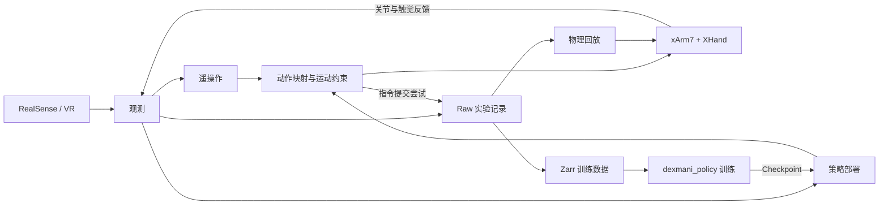

# DexMani Real

面向 xArm7 + XHand 真机灵巧操作实验的 Python 研究代码，使用 RealSense RGB-D 与 VR 采集示教，支持数据导出、策略评估和物理回放。

配套项目 [dexmani_policy](https://github.com/haoyangzhanglab/dexmani_policy) 负责策略训练与模型推理，本仓库负责设备交互、观测构建与动作执行。

## 整体架构

遥操作与策略部署共用设备、观测、控制和录制组件。关节动作直接形成关节目标，末端动作通过局部逆运动学（IK）转换为关节目标。Raw 分别记录实测状态与指令提交尝试，供离线分析、训练数据导出和回放使用。

## 实验流程

1. **准备设备与标定**：通过[相机标定](scripts/calibrate_camera.py)和 [VR 朝向标定](scripts/calibrate_vr_heading.py)建立观测与机器人之间的坐标关系。
2. **采集示教**：使用 [VR 遥操作](scripts/collect_teleop.py)采集任务 Episode；需要手动调整姿态时使用[键盘点动](scripts/keyboard_teleop.py)。
3. **检查数据**：通过 [Episode 可视化](scripts/visualize_episode.py)查看图像、状态和动作；需要人工记录任务成败时使用[结果标注](scripts/label_episode.py)。
4. **导出与训练**：将 Raw [导出为 Zarr](scripts/export_zarr.py)，交给 dexmani_policy 训练。使用手物交互（HOI）点云的任务，先完成[物体资产准备与离线标注](docs/object_reconstruction.md)。
5. **评估与回放**：通过[策略入口](scripts/run_policy.py)加载 Checkpoint 进行闭环评估，也可[回放 Raw 关节目标](scripts/replay_episode.py)检查已记录的动作。

实验配置由 [RealConfig](dexmani_real/config/real.py) 组装，涵盖设备、传感器、运动约束与运行方式。采集、部署和回放可通过 `--config` 使用本地 Python 实验配置；在已配置依赖的 `real_robot` 环境中从仓库根目录运行脚本，具体参数见各入口的 `--help`。

Zarr 根属性 `task_name` 来自 Raw 的 `meta.task_label`，不受目录名影响；合并的各段必须属于同一任务。

`action_space="joint"` 描述采集的绝对关节目标，即使仅导出观测或 `action_ee` 也保持不变。训练通过 `action_key` 选择关节目标 `action` 或经 FK 派生的 `action_ee`。

## 核心模块

以下目录均位于 `dexmani_real/` 下。

| 模块 | 职责 |
| --- | --- |
| [sensor](dexmani_real/sensor/) / [ipc](dexmani_real/ipc/) | 采集传感器数据，通过共享内存向消费者提供观测。 |
| [robot](dexmani_real/robot/) / [control](dexmani_real/control/) | 连接设备，读取反馈，完成动作映射、IK 与运动约束。 |
| [runtime](dexmani_real/runtime/) | 组织共享观测、会话状态、资源生命周期、回位与点动。 |
| [teleop](dexmani_real/teleop/) | 将 VR 腕部与手部运动映射为机器人动作，采集示教。 |
| [geometry](dexmani_real/geometry/) / [perception](dexmani_real/perception/) | 提供相机几何、正运动学及场景、手部和物体点云。 |
| [data](dexmani_real/data/) | Raw 录制与读取、HOI 数据写入、Zarr 导出。 |
| [deployment](dexmani_real/deployment/) | 构建模型输入，调度推理与动作序列，组织多段评估。 |
| [replay](dexmani_real/replay/) | 按 Raw 中的连续区间回放关节目标。 |

[config](dexmani_real/config/) 保存实验配置，[utils](dexmani_real/utils/) 提供标定与可视化工具，[assets](assets/) 保存机器人模型和几何模板。

## 主题文档

- [手部重定向](docs/hand_retargeting.md)：人体关键点到 XHand 关节目标的映射。
- [策略部署](docs/policy_deployment.md)：观测、推理、动作执行与多段评估流程。
- [物体重建与 HOI](docs/object_reconstruction.md)：物体资产、固定点云模板及训练与部署流程。
