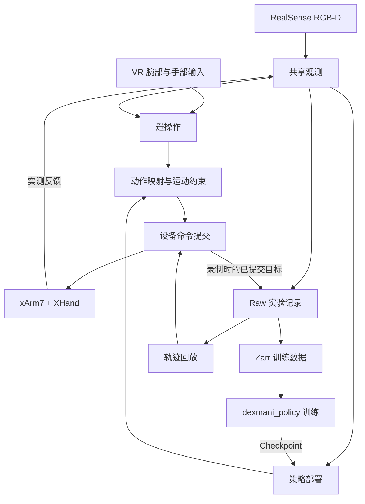

# DexMani Real

面向 xArm7 与 XHand 的真机灵巧操作研究代码。仓库负责 VR 示教采集、训练数据构建、真机策略评估和轨迹回放。配套项目负责策略训练与模型推理。[dexmani_policy](https://github.com/haoyangzhanglab/dexmani_policy)

## 整体架构

遥操作与策略部署复用观测、运动控制和录制流程。关节动作直接给出关节目标，末端动作经局部逆运动学转换为关节目标。Raw 分别保留已提交的目标和设备实测反馈。

## 实验流程

1. **标定与示教**。标定相机外参与 VR 朝向，遥操作采集 Raw 示教。
2. **构建训练数据**。需要手物交互（HOI）观测时，准备物体模板并对 Raw 进行离线标注。按训练所需的模态导出 Zarr。
3. **训练与评估**。配套项目从 Zarr 训练策略。本仓库按 Checkpoint 构建观测，调度预测动作并进行真机闭环评估。
4. **检查与回放**。通过可视化检查记录，也可选择目标完整的 Raw 连续段，在机器人上重发原始关节目标。

## 核心模块

| 模块 | 职责 |
| --- | --- |
| [sensor](dexmani_real/sensor/) / [runtime](dexmani_real/runtime/) | 采集相机与 VR 数据，组织观测和实验会话。 |
| [robot](dexmani_real/robot/) / [control](dexmani_real/control/) | 读取设备反馈，映射并约束动作，提交机器人目标。 |
| [teleop](dexmani_real/teleop/) | 将腕部与手指运动映射为臂手动作，录制示教。 |
| [geometry](dexmani_real/geometry/) / [perception](dexmani_real/perception/) | 提供相机几何、运动学和场景、手部及物体点云。 |
| [data](dexmani_real/data/) | 记录与读取 Raw，关联 HOI 标注，导出 Zarr。 |
| [deployment](dexmani_real/deployment/) / [replay](dexmani_real/replay/) | 执行策略闭环评估，或按记录顺序回放关节目标。 |
| [config](dexmani_real/config/) | 组织设备、标定来源与运动约束等实验配置。 |

## 专题文档

- [实验数据](docs/data.md)
- [手部重定向](docs/hand_retargeting.md)
- [物体重建与 HOI](docs/object_reconstruction.md)
- [策略部署](docs/policy_deployment.md)
