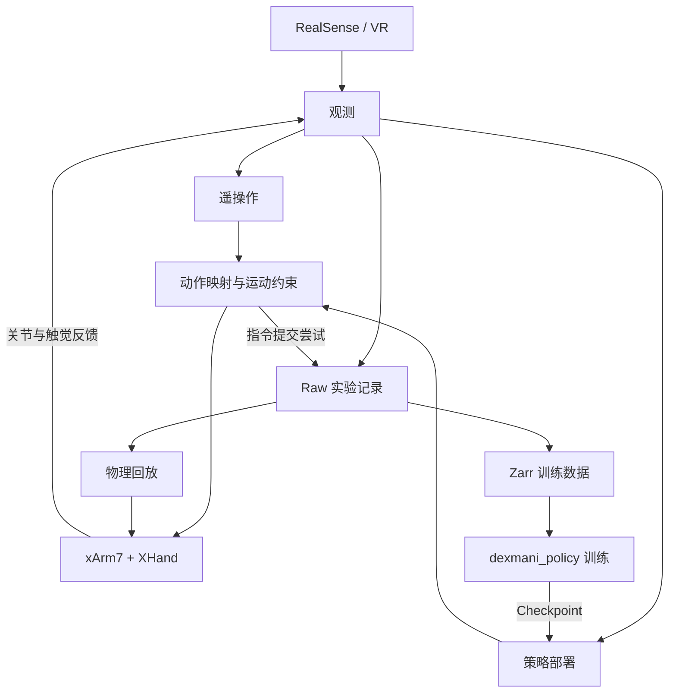

# DexMani Real

面向 xArm7 + XHand 真机灵巧操作实验的 Python 研究代码，使用 RealSense RGB-D 与 VR 采集示教，支持数据导出、策略评估和物理回放。

配套项目 [dexmani_policy](https://github.com/haoyangzhanglab/dexmani_policy) 负责策略训练与模型推理，本仓库负责设备交互、观测构建与动作执行。

## 整体架构



遥操作与策略部署共用设备、观测、控制和录制组件。关节动作直接形成关节目标，末端动作通过局部逆运动学（IK）转换为关节目标。Raw 分别记录实测状态与指令提交尝试，供离线分析、训练数据导出和回放使用。

## 实验流程

先完成[相机标定](scripts/calibrate_camera.py)与 [VR 朝向标定](scripts/calibrate_vr_heading.py)。在已配置依赖的 `real_robot` 环境、仓库根目录中运行以下入口；`TASK`、`EPISODE`、`CHECKPOINT` 替换为实际任务、录制目录与模型路径。

| 要做的实验 | 命令 |
| --- | --- |
| 查看采集配置（不连接设备） | `python scripts/collect_teleop.py TASK --print-config` |
| VR 采集 / 仅遥操作 | `python scripts/collect_teleop.py TASK` / 加 `--no-record` |
| 键盘调整姿态 | `python scripts/keyboard_teleop.py` |
| 查看记录 | `python scripts/visualize_episode.py EPISODE` |
| 导出训练数据 | `python scripts/export_zarr.py episodes/TASK --output datasets/TASK.zarr` |
| 策略评估并录制 | `python scripts/run_policy.py CHECKPOINT --record-raw` |
| 回放关节目标 | `python scripts/replay_episode.py EPISODE` |

需要手动标记任务成败时使用 [label_episode.py](scripts/label_episode.py)。HOI 数据先完成[物体资产准备与离线标注](docs/object_reconstruction.md)。具体选项见各入口的 `--help`。

实验配置由 [RealConfig](dexmani_real/config/real.py) 组装。用一个可信本地 Python 文件导出 `CONFIG`，将实际设备、工作空间、运动参数集中保存；采集、部署、导出和回放均可传 `--config experiment.py`。例如下面只改变采集周期，其余配置仍须符合实际设备：

```python
from dataclasses import replace
from dexmani_real.config.real import RealConfig

base = RealConfig()
CONFIG = replace(base, teleop=replace(base.teleop, control_hz=20.0))
```

先用 `python scripts/collect_teleop.py TASK --config experiment.py --print-config` 检查声明值；策略的有效配置还会结合 checkpoint 在启动时解析。

Raw 保留采集时的原始 RGB-D、K、畸变参数及已有外参。Canonical RGB/depth 与在线策略 RGB（包括纯 RGB 策略）统一采用固定 K、原始分辨率和光轴的无畸变针孔网格；RGB 双线性重采样，depth 使用同一映射最近邻重采样，越界填零。含图像的 Zarr 标记 `image_geometry="pinhole"`。Raw 可视化也使用矫正图像与针孔相机叠加；点云仍由原始 RGB-D 配对生成。

Zarr 根属性 `task_name` 来自 Raw 的 `meta.task_label`，不受目录名影响；同一产物中的 Raw 必须属于同一任务。

`action_space="joint"` 描述采集的绝对关节目标，即使仅导出观测或 `action_ee` 也保持不变。训练通过 `action_key` 选择关节目标 `action` 或经 FK 派生的 `action_ee`。

## 数据导出

导出默认保留全部基础模态，并在已有有效 HOI 标注时加入 `object_pointcloud`。一条完整 Raw 对应一条 Zarr episode；控制断点、录制截断、必要数据损坏或 HOI 无效/无法完整对齐均导致整条拒绝，其他 Raw 继续处理。任务失败标签不作为数据损坏依据。

请求 `--output datasets/task.zarr` 时，只有一类合格数据仍生成该路径；同时接纳有、无物体点云的数据时，整体发布 `datasets/task_modalities/`，内含 `with_object.zarr` 和 `without_object.zarr`。训练的 `zarr_path` 指向所需的具体子 Zarr。CLI 打印实际路径、各组 episode 数和帧数；全被拒绝时失败，已有输出不覆盖。显式 `--fields` 控制输出列，已有损坏 HOI 仍拒绝。

已有 HOI 时，无论是否输出物体点云，都检查相机时间为正、不晚于 observation 且非递减，并检查所选观测字段需要的关节流能否完整对齐。仅输出关节时保留原始观测值；联合输出物体点云时使用相机时间上的插值观测。动作目标始终保持原值，仅 EEF 观测不要求手部历史。

导出属性 `source_episodes` 与完整 Raw episode 顺序对应；`data_processing` 记录实际点云处理参数和模板内容标识，并经衍生数据传入 Checkpoint 的 `effective_config`。模板内容标识用于检查训练与部署的点序、分段及几何一致性，不依赖文件路径。

## 核心模块

以下目录均位于 `dexmani_real/` 下。

| 模块 | 职责 |
| --- | --- |
| [sensor](dexmani_real/sensor/) / [ipc](dexmani_real/ipc/) | 采集传感器数据，通过共享内存向消费者提供观测。 |
| [robot](dexmani_real/robot/) / [control](dexmani_real/control/) | 连接设备，读取反馈，完成动作映射、IK 与运动约束。 |
| [runtime](dexmani_real/runtime/) | 组织共享观测、会话状态、资源生命周期、回位与点动。 |
| [teleop](dexmani_real/teleop/) | 将 VR 腕部与手部运动映射为机器人动作，采集示教。 |
| [geometry](dexmani_real/geometry/) / [perception](dexmani_real/perception/) | 提供相机几何、正运动学及场景、手部和物体点云。 |
| [data](dexmani_real/data/) | Raw 录制与读取、HOI 数据写入、Zarr 导出。 |
| [deployment](dexmani_real/deployment/) | 构建模型输入，调度推理与动作序列，组织多段评估。 |
| [replay](dexmani_real/replay/) | 按 Raw 中的连续区间回放关节目标。 |

[config](dexmani_real/config/) 保存实验配置，[utils](dexmani_real/utils/) 提供标定与可视化工具，[assets](assets/) 保存机器人模型和几何模板。

### 修改实验时从哪里入手

| 需求 | 代码入口与职责 |
| --- | --- |
| 改采集过程 | `scripts/collect_teleop.py` → `teleop/run.py` 装配资源 → `TeleopLoop` 运行示教 |
| 改策略执行 | `scripts/run_policy.py` → `PolicySession` 管会话资源 → `Rollout` 管单段控制；`schedule.py` 只计算动作窗口 |
| 改模型观测 | `runtime/observation.py` 读取并检查来源 → `ObservationBuilder` 组装模型历史；字段依赖在 `FIELD_DEPENDENCIES` 声明 |
| 改训练数据 | `RawReader` 按需读取并校验输入 → `export.py` 分块派生 → 完整产物发布；失败录制由 `EpisodeRecorder` 向运行层报告 |

直接从 Python 启动策略使用 `PolicySession(runtime, checkpoint, record_raw=True).run()`（从 `dexmani_real.deployment.session` 导入）。原 `deployment.run.run_policy` 转发入口已移除；其 `output` 参数在会话入口名为 `output_root`，命令行参数保持不变。

主进程持有会话与 XHand I/O；机械臂 SDK、相机、VR 与启用的感知任务运行在子进程；策略推理和录制各有自己的工作线程。设备 SDK 留在驱动层，动作映射只生成目标，实际发送归 `Robot`。新增实验优先修改配置和对应流程，独立算法放入现有几何或感知模块。

输入文件、设备反馈、动作提交和资源回收承担各自的校验职责；已建立的内部契约直接复用。命令租约、取消状态、来源时间与录制失败传播分别对应真实的并发和 I/O 问题。重构时按这些行为验证，不以删行或增加抽象层作为目标。

## 开发验证

安装本项目与配套 Policy 的测试依赖后运行 `python -m pytest -p no:cacheprovider tests -q`。CUDA 用例需要可用 GPU；无设备测试会使用替身，因此通过不代表真机时序、实际执行误差或模型任务性能已验证。

## 主题文档

- [手部重定向](docs/hand_retargeting.md)：人体关键点到 XHand 关节目标的映射。
- [策略部署](docs/policy_deployment.md)：观测、推理、动作执行与多段评估流程。
- [物体重建与 HOI](docs/object_reconstruction.md)：物体资产、固定点云模板及训练与部署流程。
