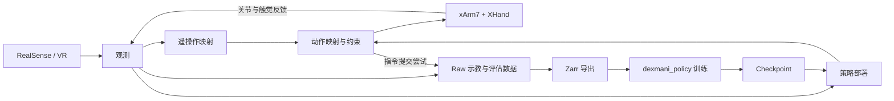

# DexMani Real

面向 xArm7 + XHand 真机灵巧操作实验的研究代码，使用 RealSense RGB-D 和 VR/HTS 采集示教，支持训练数据导出、策略部署和物理回放。策略训练与模型推理由配套 [dexmani_policy](https://github.com/haoyangzhanglab/dexmani_policy) 提供，本仓库负责真实设备、观测与动作之间的衔接。

## 整体架构

遥操作与策略部署共用机器人接口、观测读取、动作映射和录制组件。末端位姿目标经局部 IK 转为关节目标，机器人模块负责与设备交互。Raw 区分实测状态与指令提交尝试；导出模块从中构造训练所需的多模态观测与动作。

## 核心模块

以下路径均位于 `dexmani_real/` 下。

| 模块 | 职责 |
| --- | --- |
| [sensor](dexmani_real/sensor/) / [ipc](dexmani_real/ipc/) | 采集 RealSense、VR 数据，通过共享内存传递传感器快照。 |
| [robot](dexmani_real/robot/) | 封装 xArm7、XHand 的设备连接、反馈读取和命令提交。 |
| [runtime](dexmani_real/runtime/) | 提供共享观测、会话状态、设备与传感器生命周期，以及回位和点动流程。 |
| [control](dexmani_real/control/) | 将关节或末端动作意图映射为关节目标，提供 IK、关节与工作空间约束及碰撞检查。 |
| [teleop](dexmani_real/teleop/) | 将 VR 腕部运动和手部关键点映射为机械臂与灵巧手动作，组织示教采集。 |
| [geometry](dexmani_real/geometry/) / [perception](dexmani_real/perception/) | 提供位姿、相机几何与正运动学，生成场景点云、手部点云和指尖几何。 |
| [data](dexmani_real/data/) | 录制、读取 Raw episodes，并导出训练用 Zarr 数据。 |
| [deployment](dexmani_real/deployment/) | 构造策略观测、调用模型推理、调度动作序列并组织真机评估。 |
| [replay](dexmani_real/replay/) | 从 Raw episode 加载已记录的关节目标，进行物理回放。 |
| [config](dexmani_real/config/) | 集中描述设备、控制、感知、遥操作和部署配置。 |

[scripts](scripts/) 提供采集、部署、导出、回放和标定入口；[utils](dexmani_real/utils/) 提供标定、可视化等辅助功能；[assets](assets/) 保存机器人模型与几何模板。

CordVIP 是独立的离线物体几何工具，用于资产重建和位姿分析，尚未接入主包的策略观测。

## 主题文档

- [手部重定向](docs/hand_retargeting.md)：人体手部几何到 XHand 关节目标的映射。
- [策略部署](docs/policy_deployment.md)：观测、推理、动作调度与控制执行的关系。
- [物体重建](docs/object_reconstruction.md)：从物体图像生成米制网格与点云资产。
