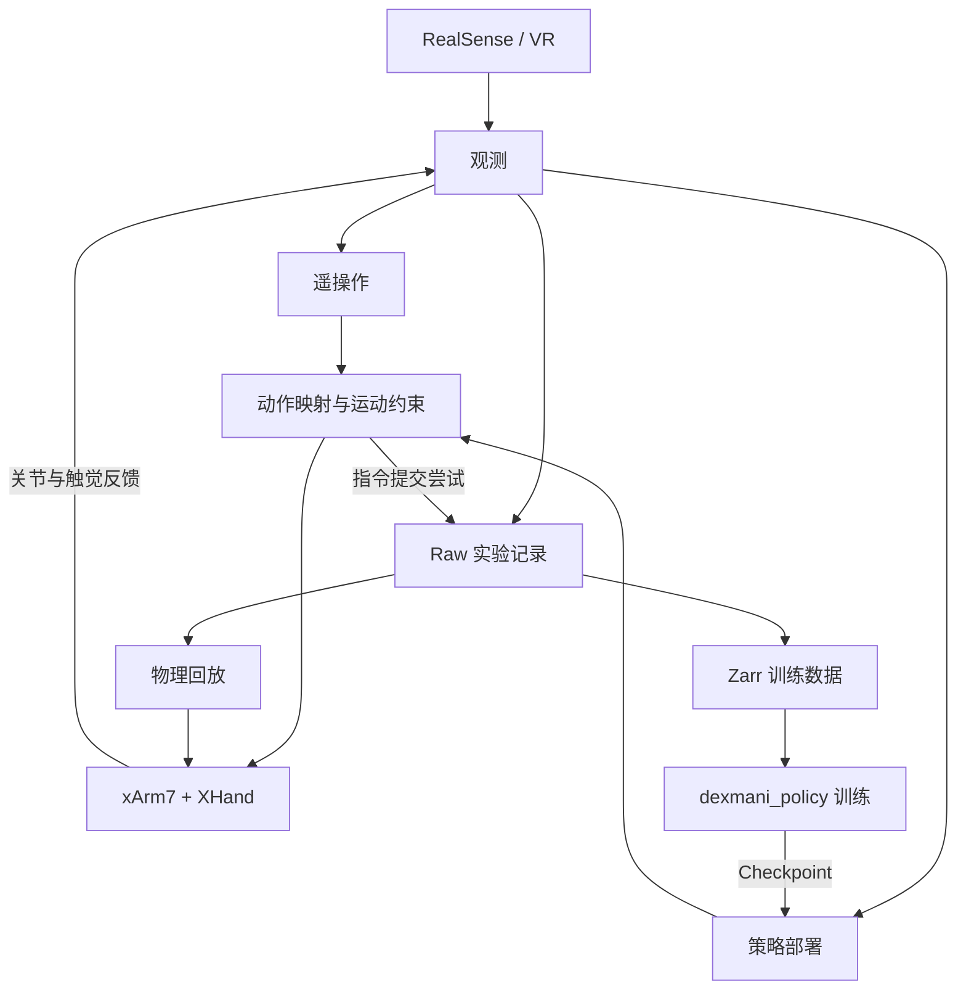

# DexMani Real

面向 xArm7 + XHand 真机灵巧操作实验的 Python 研究代码，使用 RealSense RGB-D 与 VR 采集示教，支持数据导出、策略评估和物理回放。

配套项目 [dexmani_policy](https://github.com/haoyangzhanglab/dexmani_policy) 负责策略训练与模型推理，本仓库负责设备交互、观测构建与动作执行。

## 整体架构



遥操作与策略部署共用设备、观测、控制和录制组件。关节动作直接形成关节目标，末端动作通过局部逆运动学（IK）转换为关节目标。Raw 分别记录实测状态与指令提交尝试，供离线分析、训练数据导出和回放使用。

## 实验流程

先完成[相机标定](scripts/calibrate_camera.py)与 [VR 朝向标定](scripts/calibrate_vr_heading.py)。在已配置依赖的 `real_robot` 环境、仓库根目录中运行以下入口；`TASK`、`EPISODE`、`CHECKPOINT` 替换为实际任务、录制目录与模型路径。

| 要做的实验 | 命令 |
| --- | --- |
| 查看采集配置（不连接设备） | `python scripts/collect_teleop.py TASK --print-config` |
| VR 采集 / 仅遥操作 | `python scripts/collect_teleop.py TASK` / 加 `--no-record` |
| 键盘调整姿态 | `python scripts/keyboard_teleop.py` |
| 查看记录 | `python scripts/visualize_episode.py EPISODE`（`--no-hoi` 绕过标注，`--max-frames N` 按需读取前 N 帧） |
| 离线调试手部重定向 | `python scripts/preview_hand_retargeting.py EPISODE`（`--no-view` 仅计算统计，`--max-frames N` 限制前缀） |
| 导出训练数据 | `python scripts/export_zarr.py episodes/TASK --output datasets/TASK.zarr --fields joint_state action` |
| 策略评估并录制 | `python scripts/run_policy.py CHECKPOINT --record-raw` |
| 回放关节目标 | `python scripts/replay_episode.py EPISODE` |

需要手动标记任务成败时使用 [label_episode.py](scripts/label_episode.py)。HOI 数据先完成[物体资产准备与离线标注](docs/object_reconstruction.md)。具体选项见各入口的 `--help`。

手部预览使用 Raw 记录的参数、标定和限位；`--config experiment.py` 仅替换重定向参数。输入要求、记录时间和分段语义见[手部重定向](docs/hand_retargeting.md#离线预览)。

实验配置由 [RealConfig](dexmani_real/config/real.py) 组装。用一个可信本地 Python 文件导出 `CONFIG`，将实际设备、工作空间、运动参数集中保存；采集、部署、导出和回放均可传 `--config experiment.py`。例如下面只改变采集周期，其余配置仍须符合实际设备：

```python
from dataclasses import replace
from dexmani_real.config.real import RealConfig

base = RealConfig()
CONFIG = replace(base, teleop=replace(base.teleop, control_hz=20.0))
```

先用 `python scripts/collect_teleop.py TASK --config experiment.py --print-config` 检查声明值；策略的有效配置还会结合 checkpoint 在启动时解析。

VR 朝向标定复用 `CONFIG.vr`：`python scripts/calibrate_vr_heading.py --config experiment.py`，临时端口可用 `--port` 覆盖。相机离线求解须指定候选文件，例如 `python scripts/calibrate_camera.py solve samples/run1 --output candidate_cameras.json`；合法可解的结果即使残差超过经验阈值也会保存并警告。采集或部署用 `--camera-calibration candidate_cameras.json` 选择采用它。

策略每轮默认运行预算 60 秒，从准备完成、运动授权成功后开始计时，包含推理等待、动作提交和 HOI 遮挡恢复。`--max-duration none` 表示直到用户停止或真实失败，具体流程见[策略部署](docs/policy_deployment.md)。

每份 Raw 的 `effective_parameters` 记录实际使用的硬件、控制与算法参数，以及该段相机信息、相关 VR 标定和触觉复位结果。共同硬件白名单与 Episode 元数据组装由 [raw.py](dexmani_real/data/raw.py) 统一维护；Teleop 和 Policy 分别补充实验参数。策略会话配置写入 `run_config.yaml`，运行结果写入 `session_result.json`。

普通 EEF/Jog 不检查 HOME 专用盒子及参数；显式 HOME 仍要求默认关闭的人工确认。Jog 可以从工作空间外尝试一步，但只有 IK 得到合法终点且满足关节、速度、lead、时效与停止要求才提交。

Raw 保留采集时的原始 RGB-D、K、畸变参数及已有外参。Canonical RGB/depth 与在线策略 RGB（包括纯 RGB 策略）统一采用固定 K、原始分辨率和光轴的无畸变针孔网格；RGB 双线性重采样，depth 使用同一映射最近邻重采样，越界填零。含图像的 Zarr 标记 `image_geometry="pinhole"`。Raw 可视化也使用矫正图像与针孔相机叠加；点云仍由原始 RGB-D 配对生成。

Zarr 根属性 `task_name` 来自 Raw 的 `meta.task_label`，不受目录名影响；同一产物中的 Raw 必须属于同一任务。

数据与任务资产可以放在仓库外。下面的准备、采样、标注和 HOI 部署共用同一个任务资产目录：

```bash
python scripts/collect_teleop.py pick --episodes-dir /data/episodes
python scripts/cordvip/prepare_task.py --task-dir /data/tasks/pick
python scripts/cordvip/sample_template.py --task-dir /data/tasks/pick
python scripts/cordvip/annotate_episodes.py /data/episodes/pick --task-dir /data/tasks/pick
python scripts/run_policy.py CHECKPOINT --task-dir /data/tasks/pick
```

先在任务目录准备 `task.json` 和对象参考图或米制网格，结构见 [CordViP 实验入口](scripts/cordvip/README.md)。标注输入是单个 Episode，或直接包含 `episode_*` 子目录的数据目录，不递归查找。显式路径支持 `~`，相对路径以 cwd 为准；采集默认写入 cwd 下的 `episodes/<task_name>/`。实验标签不决定 HOI 资产位置，也无需与资产目录名一致；非 HOI 策略不需要任务资产。

`action_space="joint"` 描述采集的绝对关节目标，即使仅导出观测或 `action_ee` 也保持不变。训练通过 `action_key` 选择关节目标 `action` 或经 FK 派生的 `action_ee`。

## 数据导出

`--fields` 必填，一条命令只发布一份字段集合固定的 Zarr。`--output` 指定输出路径；省略时写入 cwd 下的 `datasets/<输入目录名>.zarr`，单个 Episode 使用其父目录名。目录名只用于输出文件命名，任务标签仍来自 Raw。缺少所选数据或晚发现损坏时整条 Raw 回滚，继续其他采集；全被拒绝时失败，已有输出不覆盖。

HOI 标注独立保存在 `episode/hoi.h5`，默认跳过已有标注，使用 `annotate_episodes.py --overwrite` 明确重算。重算失败保留此前完整文件，不修改 `data.h5` 或 `rgb.mp4`。未选 `object_pointcloud` 时完全不读取 HOI；纯关节导出不需要相机，纯 RGB 不需要深度单位。

每个 `timing/segment_starts` 原生连续段成为一个 Zarr episode。联合 HOI 输出只在各段内对齐所需关节，不裁边、不补帧、不按质量重新切段。任一段不合法则拒绝整条 Raw；正常提前终止或队列满留下的完整有效前缀仍可接纳。动作目标保留原值。

`source_episodes` 与 `source_row_ranges=[start, stop)` 每段一项，对齐 `episode_ends`。Policy 的策略训练、观察预训练和手部 VQ 先验均按原采集分组划分训练/验证集；`val_episodes`、`max_train_episodes` 按采集组计数，采样窗口不跨段。

`data_processing` 是研究记录，普通训练、恢复和部署不要求它相等或存在。Zarr 的 object `geometry_sha256` 标识有序局部点及 offsets 的数值身份；混合合法几何时公共摘要为 null。只有开启 contact loss 的固定 1024 槽预训练及完整续训要求明确且一致的共享身份。部署分别保存 `training_processing` 与 `actual_processing`，只比较实际使用的处理参数，不计算模板哈希；缺少记录为 None。

Raw 以整个 episode 目录为单位使用：`data.h5` 保存采集数据，`rgb.mp4` 保存图像，`hoi.h5` 保存可选标注。读取时不寻找其他位置的附件。使用 `python scripts/visualize_episode.py EPISODE --info` 查看文件结构和录制截断原因。

## 核心模块

以下目录均位于 `dexmani_real/` 下。

| 模块 | 职责 |
| --- | --- |
| [sensor](dexmani_real/sensor/) / [ipc](dexmani_real/ipc/) | 采集传感器数据，通过共享内存向消费者提供观测。 |
| [robot](dexmani_real/robot/) / [control](dexmani_real/control/) | 连接设备，读取反馈，完成动作映射、IK 与运动约束。 |
| [runtime](dexmani_real/runtime/) | 组织共享观测、会话状态、资源生命周期、回位与点动。 |
| [teleop](dexmani_real/teleop/) | 将 VR 腕部与手部运动映射为机器人动作，采集示教。 |
| [geometry](dexmani_real/geometry/) / [perception](dexmani_real/perception/) | 提供相机几何、正运动学及场景、手部和物体点云。 |
| [data](dexmani_real/data/) | Raw 录制与读取、HOI 数据写入、Zarr 导出。 |
| [deployment](dexmani_real/deployment/) | 构建模型输入，调度推理与动作序列，组织多段评估。 |
| [replay](dexmani_real/replay/) | 按 Raw 中的连续区间回放关节目标。 |

[config](dexmani_real/config/) 保存实验配置，[utils](dexmani_real/utils/) 提供标定与可视化工具，[assets](assets/) 保存机器人模型和几何模板。

### 修改实验时从哪里入手

设计取舍、资源所有权及本轮删减/优化计划见[个人研究工作流与代码简化](docs/research_design.md)。

| 需求 | 代码入口与职责 |
| --- | --- |
| 改采集过程 | `scripts/collect_teleop.py` → `teleop/run.py` 装配资源 → `TeleopLoop` 运行示教 |
| 改策略执行 | `scripts/run_policy.py` → `PolicySession` 管会话资源 → `Rollout` 管单段控制；`schedule.py` 只计算动作窗口 |
| 改模型观测 | `runtime/observation.py` 读取并检查来源 → `ObservationBuilder` 组装模型历史；字段依赖在 `FIELD_DEPENDENCIES` 声明 |
| 改训练数据 | `RawReader` 按需读取并校验输入 → `export.py` 分块派生 → 完整产物发布；失败录制由 `EpisodeRecorder` 向运行层报告 |

直接从 Python 启动策略使用 `PolicySession(runtime, checkpoint, record_raw=True).run()`（从 `dexmani_real.deployment.session` 导入）；HOI 策略还须传 `task_dir="/data/tasks/pick"`。输出路径通过 `output_root` 指定。

主进程持有会话与 XHand I/O；机械臂 SDK、相机、VR 与启用的感知任务运行在子进程；策略推理和录制各有自己的工作线程。设备 SDK 留在驱动层，动作映射只生成目标，实际发送归 `Robot`。新增实验优先修改配置和对应流程，独立算法放入现有几何或感知模块。

输入文件、设备反馈、动作提交和资源回收承担各自的校验职责；已建立的内部契约直接复用。命令租约、取消状态、来源时间与录制失败传播分别对应真实的并发和 I/O 问题。重构时按这些行为验证，不以删行或增加抽象层作为目标。

## 开发验证

安装本项目与配套 Policy 的测试依赖后运行 `python -m pytest -p no:cacheprovider tests -q`。CUDA 用例需要可用 GPU；无设备测试会使用替身，因此通过不代表真机时序、实际执行误差或模型任务性能已验证。

## 主题文档

- [手部重定向](docs/hand_retargeting.md)：人体关键点到 XHand 关节目标的映射。
- [策略部署](docs/policy_deployment.md)：观测、推理、动作执行与多段评估流程。
- [物体重建与 HOI](docs/object_reconstruction.md)：物体资产、固定点云模板及训练与部署流程。
