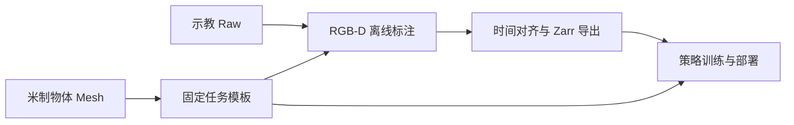

# 物体重建与 HOI

HOI（Hand–Object Interaction，手物交互）观测用手部与物体点云描述操作场景，供 CordViP 等策略训练与部署使用。

## 点云与资产

物体点云来自固定网格表面模板，由 RGB-D 跟踪位姿逐帧变换；手点云来自固定的 link 局部模板，由机械臂和手部关节通过 FK 变换。两者均为 xArm base 坐标系下的米制 float32 XYZ，保留点序和分段。

任务资产位于 `assets/pointcloud_template/object/<task>/`。米制网格确定物体尺度、原点和朝向；任务模板共 1024 点，按表面积分配配额，每对象至少 64 点，最多 16 个对象。新模板先按面积采样 8 倍候选点，再用固定种子和起点的 FPS 选点。手模板沿用各 link 的面积配额与 URDF visual 变换，使用同一采样函数。

实验期间固定并复用网格和模板。已有模板直接复用，不会自动重采样。显式更换模板后，训练数据和部署须使用相同资产。

## 数据流程

1. **准备资产**：[prepare_task.py](../scripts/cordvip/prepare_task.py) 按 `task.json` 分割参考图、通过 Hunyuan3D 重建，再用实测尺寸调整为米制尺度；已有米制网格直接复用。
2. **生成模板**：[sample_template.py](../scripts/cordvip/sample_template.py) 固定对象顺序、点分段与点序，已有模板直接复用。
3. **标注 Raw**：[annotate_episodes.py](../scripts/cordvip/annotate_episodes.py) 跟踪录制的 RGB-D，整段成功后发布位姿、质量和物体点云。
4. **导出数据**：[export_zarr.py](../scripts/export_zarr.py) 读取物体标注，对齐关节并生成手部几何，与所选状态和动作一同导出。
5. **训练与部署**：在 dexmani_policy 中训练；部署共用任务模板、跟踪器、坐标变换和 FK。

## 跟踪与时间对齐

在线 worker 加载模型、完成预热后宣告就绪。每段首帧先对 RGB-D 去畸变，由 Grounding DINO 检测目标、SAM2 分割，再由 FoundationPose 注册位姿。后续从上一帧位姿开始合批 refinement，并检查遮挡感知的轮廓与实测深度一致性。质量指标和阈值见[后端说明](../third_party/cordvip_geometry/README.md#质量检查)。

模型跨段复用；初始化重置视频历史、位姿及相机缓存，段内相机参数和图像尺寸固定。离线标注使用相同跟踪流程，相同相机序列复用位姿与质量。跟踪失败或必需观测过期会结束当前段，下一段重新初始化。

HOI 的 `joint_state`、`eef_pose`、指尖及手点云共用插值到相机来源时间的关节。插值要求前后反馈间隔不超过 `execution.hoi_max_joint_gap_s`，默认 0.10 秒；精确命中直接取样，禁止外推和跨连续区间插值。

在线每段按观测所需设备建立反馈历史，无法对齐时结束本段。离线按相同设备需求及 Raw 连续区间处理，只裁去缺少前后样本的首尾，观测和动作同步裁剪，再计算 FK；内部缺口报错。控制检查与 Raw 保留实际最新反馈。这里使用主机来源时间进行软件对齐，不代表硬件同步。

## 标注、导出与回放

Raw 的 `/hoi` 整段成功后才发布，不覆盖已有标注。

| 内容 | 路径或位置 |
| --- | --- |
| 策略使用的基座系物体点云 | `/hoi/object_pointcloud` |
| 物体局部到相机的位姿 | `/hoi/object_pose_camera` |
| 逐帧、逐对象质量指标 | `/hoi/quality/` |
| 固定模板、对象顺序及点分段 | `/hoi/template/` |
| 相机到基座的变换 | `/hoi/base_from_camera` |
| 实际跟踪配置 | `/hoi` 属性 |

Zarr 保持策略数组字段、点数、类型和坐标系不变，元数据记录插值间隔上限及原始保留区间。合并导出时直接比较模板点、对象名和分段数组，拒绝混用不同模板。训练与部署须固定使用相同的物体模板、手模板及机器人模型。

[visualize_episode.py](../scripts/visualize_episode.py) 使用相同插值规则，显示手物几何、逐物体质量及原始来源时差；不可对齐的边界帧不显示手几何。

## 代码入口与参考

| 模块 | 职责 |
| --- | --- |
| [cordvip_geometry](../third_party/cordvip_geometry/) | 分割、重建、尺度调整和 RGB-D 位姿跟踪 |
| [geometry/hoi.py](../dexmani_real/geometry/hoi.py) | 任务资产、固定采样及点云坐标变换 |
| [perception/hoi_worker.py](../dexmani_real/perception/hoi_worker.py) | 在线物体点云生成 |
| [perception/hand_cloud.py](../dexmani_real/perception/hand_cloud.py) | 手部模板加载与 FK 几何 |
| [utils/timing.py](../dexmani_real/utils/timing.py) | 在线、离线共用的关节插值 |
| [data/hoi.py](../dexmani_real/data/hoi.py)、[data/export.py](../dexmani_real/data/export.py) | 标注发布、区间对齐与训练数据导出 |

实现借鉴 [GALATEA `36b90481` 的遮挡感知轮廓评估](https://github.com/boyuan-an/GALATEA/blob/36b90481ba458d9beb5b6ac1396c639ea49a4747/recon/galatea_recon/pipeline/object_quality.py) 和固定表面点采样思路，以实测 RGB-D 和机器人 FK 为依据。

任务命令见 [CordViP 实验入口](../scripts/cordvip/README.md)，执行链路见[策略部署](policy_deployment.md)。返回[项目首页](../README.md)。
