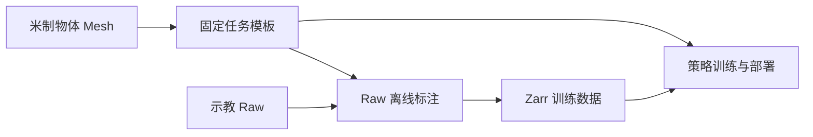

# 物体重建与 HOI

HOI（Hand–Object Interaction，手物交互）观测用手部与物体点云描述操作场景，供 CordViP 等策略训练与部署使用。物体几何由重建资产提供，在线位姿由 RGB-D 跟踪获得。

## 点云表示

**物体点云**来自固定 Mesh 表面模板：每帧只根据物体位姿变换模板点，保持对象分段和点的顺序。**手点云**来自固定手部模板，根据机械臂与手部关节状态，通过正运动学（FK）变换生成。两者都使用 xArm base 坐标系，以米为单位。

离线标注与在线部署共用物体模板、跟踪器和坐标变换；手部几何也共用同一条 FK 路径，使训练数据与运行时观测采用一致的表示。

## HOI 五阶段流程

1. **准备物体资产**：从参考图分割物体，通过 Hunyuan3D 重建 Mesh，再根据实测尺寸确定米制尺度；已有米制资产可直接复用。任务由对象名称、识别提示词和各自的 Mesh 组成，入口为 [build_task.py](../scripts/cordvip/build_task.py)。
2. **固定任务模板**：[allocate_points.py](../scripts/cordvip/allocate_points.py) 按物体表面积分配采样点，生成任务级 1024 点模板，固定对象分段与点序。实验期间复用这份模板。
3. **标注示教 Raw**：[annotate_episodes.py](../scripts/cordvip/annotate_episodes.py) 从录制的 RGB-D 逐帧估计物体位姿，将模板变换到机器人基座系。整段跟踪成功后，物体点云才写入对应 Raw。
4. **导出训练数据**：[export_zarr.py](../scripts/export_zarr.py) 读取物体标注，并由关节状态生成手点云，与所选状态、动作一同导出为 Zarr。
5. **训练与部署**：在 dexmani_policy 中训练策略；部署时加载同一任务的资产与模板，从实时 RGB-D 生成物体点云，与手部几何和其他观测共同送入模型。

任务资产统一放在 [assets/pointcloud_template/object](../assets/pointcloud_template/object/) 下，按任务和物体组织。米制 Mesh 确定尺度与局部坐标，任务模板确定点云表示；两者由研究者固定，运行时只读复用。已有数据和模型应使用实验对应的资产与模板。

## 核心模块

| 模块 | 职责 |
| --- | --- |
| [cordvip_geometry](../third_party/cordvip_geometry/) | 共用的物体分割、网格重建、尺度校准与 RGB-D 位姿跟踪后端。 |
| [geometry/hoi.py](../dexmani_real/geometry/hoi.py) | 读取任务与模板，将物体局部点变换到机器人基座系。 |
| [perception/hoi_worker.py](../dexmani_real/perception/hoi_worker.py) | 在线处理相机帧，为当前策略 Episode 生成物体点云。 |
| [perception/hand_cloud.py](../dexmani_real/perception/hand_cloud.py) | 通过固定手模板与 FK 生成手点云。 |
| [data/hoi.py](../dexmani_real/data/hoi.py) / [data/export.py](../dexmani_real/data/export.py) | 将离线物体点云写入 Raw，并组织训练数据导出。 |

## 在线观测流程

策略部署根据 Checkpoint 的观测需求启用 HOI，并按任务名加载资产与模板。每段开始时重置跟踪场景，首帧用 Grounding DINO 与 SAM2 定位、分割目标，由 FoundationPose 初始化位姿；后续通过 SAM2 和 FoundationPose 持续跟踪，再结合相机外参生成基座系点云。

跟踪器通过分割与深度一致性判断位姿是否有效；部署端继续检查观测时效。跟踪失效或必需观测过期会结束当前段，下一段重新初始化。手部反馈与物体点云分别更新，组合输入仍是时间近似，并不代表硬件同步。

任务操作命令见 [CordViP 实验入口](../scripts/cordvip/README.md)，后端安装见 [cordvip_geometry](../third_party/cordvip_geometry/README.md#安装与命令)，策略执行链路见[策略部署](policy_deployment.md)。

返回[项目架构](../README.md)。
