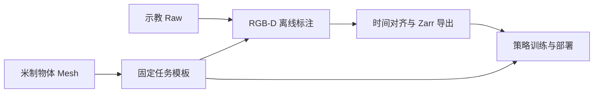

# 物体重建与 HOI

HOI（Hand–Object Interaction，手物交互）观测用手部与物体点云描述操作场景，供 CordViP 等策略训练与部署使用。

## 点云与资产

物体点云来自固定网格表面模板，由 RGB-D 跟踪位姿逐帧变换；手点云来自固定的 link 局部模板，由机械臂和手部关节通过 FK 变换。两者均为 xArm base 坐标系下的米制 float32 XYZ，保留点序和分段。

任务资产位于 `assets/pointcloud_template/object/<task>/`。米制网格确定物体尺度、原点和朝向；任务模板共 1024 点，按表面积分配配额，每对象至少 64 点，最多 16 个对象。新模板先按面积采样 8 倍候选点，再用固定种子和起点的 FPS 选点。手模板沿用各 link 的面积配额与 URDF visual 变换，使用同一采样函数。

手部 FK 批量收集所需 link placements，再按缓存的点到 link 索引变换表面点，保持模板点序、分段和输出形状。指尖 `fingertip_xyz` 是独立的低维观测，可按策略需要选择。

手模板保存 float32 `points[N,3]`，按 `part_names` 和整数 `part_offsets` 对应 URDF link。共享批量接口 `hand_geometry()` 接收相同批次长度的 EEF 变换 `[T,4,4]` 与 SDK 顺序的手关节 `[T,12]`，按请求返回 float32 指尖 `[T,5,3]` 和表面点 `[T,N,3]`，供导出、部署和可视化使用；允许空批次。

通用场景 `point_cloud` 由 `PointCloudProcessor` 处理 RGB-D，包含深度滤波、桌面裁剪、体素降采样和离群点过滤；HOI 点云直接使用固定 CAD/URDF 表面模板。

已有模板不会自动重采样。普通策略允许在合法输入形状和坐标要求内修改采样或几何进行研究，效果需自行验证。仅启用固定槽 contact loss 的预训练要求当前 1024 个 object 点槽具有一致含义，完整续训继续核对这一身份。

任务模板保存 `points_local`、`object_names` 和 `offsets`，加载时检查数组结构及对象对应关系。修改物体 Mesh、手部 URDF 或 Visual Mesh 后，须显式重建相应模板，再重新生成标注和训练数据；命令见[实验入口](../scripts/cordvip/README.md)。

通用场景点云在过滤后无有效点时返回 float32 `[0,6]`；非空但不足目标点数时循环重复已有 XYZRGB，超过目标点数时执行 FPS。重复填充仅满足输出形状，不增加真实几何信息。

## 数据流程

1. **准备资产**：[prepare_task.py](../scripts/cordvip/prepare_task.py) 按 `task.json` 分割参考图、通过 Hunyuan3D 重建，再用实测尺寸调整为米制尺度；已有米制网格直接复用。
2. **生成模板**：[sample_template.py](../scripts/cordvip/sample_template.py) 固定对象顺序、点分段与点序；已有模板直接复用，资产变更后显式重建。
3. **标注 Raw**：[annotate_episodes.py](../scripts/cordvip/annotate_episodes.py) 跟踪录制的 RGB-D，完成逐帧标注后发布位姿、质量和物体点云。
4. **导出数据**：[export_zarr.py](../scripts/export_zarr.py) 读取物体标注，对齐关节并生成手部几何，与所选状态和动作一同导出。
5. **训练与部署**：在 dexmani_policy 中训练；部署共用任务模板、跟踪器、坐标变换和 FK。

## 跟踪与时间对齐

在线 worker 加载并预热模型后宣告就绪。每段首帧对 RGB-D 去畸变，经 Grounding DINO、SAM2 和 FoundationPose 注册得到初始位姿。后续对活动对象合批 refinement，使用 CAD、深度及当前 Mask 验证候选。SAM2 默认每两个处理帧刷新，质量异常或恢复时提前刷新；`segmentation_interval_frames=1` 为逐帧分割。全部对象 LOST 时等待恢复到期。质量规则见[后端说明](../third_party/cordvip_geometry/README.md#质量检查)。

当前默认按非对称物体进行 6D Pose Tracking，FoundationPose 仅使用单位对称变换，未提供按物体的对称性配置。对称物体可能出现几何等价姿态的旋转歧义，不保证绕对称轴的绝对旋转角稳定；任务方向是否等价需另行判断。具体行为和未来扩展见 [Object Symmetry](../third_party/cordvip_geometry/README.md#object-symmetry)。

模型跨段复用，初始化重置视频、位姿和相机缓存，段内相机参数及图像尺寸固定。在线、离线共用 SceneTracker，并传入真实相机时间和来源序列；重复序列复用结果，跳帧不补造 SAM2 图像。

对象独立维护 TRACKING、OCCLUDED、LOST。证据不足时保留可靠内部位姿继续 Track，但当前观测无效；明确矛盾或遮挡超时才进入 LOST。恢复经过检测、分割、注册及下一处理帧的再次验证，两帧可信后才发布有效位姿。初始化失败在后续新观测重试。状态和配置见[后端说明](../third_party/cordvip_geometry/README.md#遮挡恢复)。

在线任一必需对象无效时发布零点云和 `valid=False`，全部恢复后重新发布有效点云。感知 Worker 只在请求有效期间持续处理。部署控制层遇到临时 HOI 失效会保持机器人并保留当前请求，待感知恢复后重建策略上下文；恢复期限和停止条件见[策略部署的 HOI 暂停与恢复](policy_deployment.md#hoi-暂停与恢复)。

HOI 的 `joint_state`、`eef_pose`、指尖及手点云共用插值到相机来源时间的关节。插值要求前后反馈间隔不超过 `execution.hoi_max_joint_gap_s`，默认 0.10 秒；精确命中直接取样，禁止外推和跨连续区间插值。

在线每段按观测所需设备建立反馈历史；关节对齐暂不可用时进入上述 HOI 暂停与恢复流程，共用整轮预算，默认 60 秒，`None` 表示直到用户停止或真实失败。离线导出采用 Raw 的原生连续区间，要求每段全部所选行均可对齐；首尾缺少插值样本或内部缺口均整条 Raw 拒绝，不裁剪。控制检查与 Raw 保留实际最新反馈。这里使用主机来源时间进行软件对齐，不代表硬件同步。

## 标注、导出与回放

独立 `episode/hoi.h5` 完成逐帧标注并关闭后原子发布，`data.h5` 与 `rgb.mp4` 只读。默认跳过已有文件，`--overwrite` 显式重算；失败保留原文件并清理本次临时文件。这里承诺单个离线 writer 下的完整文件可见性，不提供断电持久性保证。临时跟踪失败保留原始行、时间戳和有效性，不丢弃整个 episode。

| 内容 | 路径或位置 |
| --- | --- |
| 策略使用的基座系物体点云 | `hoi.h5:/object_pointcloud` |
| 物体局部到相机的位姿 | `hoi.h5:/object_pose_camera` |
| 逐对象有效性，形状 `[T,O]` | `hoi.h5:/object_valid` |
| 全部对象有效时为真，形状 `[T]` | `hoi.h5:/valid` |
| 逐帧、逐对象质量指标 | `hoi.h5:/quality/` |
| 固定模板、对象顺序及点分段 | `hoi.h5:/template/` |
| 相机到基座的变换 | `hoi.h5:/base_from_camera` |
| 实际跟踪配置 | `hoi.h5` 根属性 `tracking_config` |

可选诊断缺失或为 `None` 时保存 NaN 并显示缺口；实际状态判定所需指标仍由 tracker 校验。`mask_source=0` 表示纯深度检查，未计算的 mask 专属指标为 −1；`mask_age_frames` 记录距最近 SAM2 输入的真实相机来源序列差。两条路径均输出 `depth_coverage`；Mask 路径另外检查 Mask 和去遮挡后可见 CAD 的有效深度覆盖率。证据不足、遮挡超时及两帧恢复确认的定义见[后端说明](../third_party/cordvip_geometry/README.md#质量检查)。

无效对象的位姿为 NaN，缺失质量指标可为 NaN。只有全部对象有效时才生成模板点云，否则该帧物体点云全零。读取和写入都要求显式有效性，`object_valid` 与 `valid` 必须成对存在且一致；缺失或不一致时直接报错。

导出必须显式指定 `--fields`；未选物体点云时不打开 HOI。选择物体点云后，缺少文件或必要数据、存在无效帧或无法完整对齐时整条 Raw 拒绝。每个原生连续段对应一个 Zarr episode，并保存一一对应的 `source_episodes` 和 `source_row_ranges`，不额外裁剪或切段。

Zarr 元数据记录实际使用的处理参数。object `geometry_sha256` 使用有序局部点与 offsets 的固定字节编码，供固定槽接触监督使用，不包括显示名。手模板不计算哈希，但 link 名称仍必须有效映射到 FK。最终接纳的采集共享同一数值模板时记录公共摘要，否则为 `null`。普通策略允许同 schema 的合法模板混用，处理参数差异作为研究记录；固定槽 contact loss 必须有明确共享身份，`null` 不满足该约束。

[visualize_episode.py](../scripts/visualize_episode.py) 使用相同插值规则，显示手物几何、有效性、逐物体质量及原始来源时差；未计算的质量占位值显示为曲线缺口，隐藏无效物体点云，不可对齐的行保留原始时间位置并隐藏手几何，内部缺口不会阻止其余帧的诊断。

## 代码入口与参考

| 模块 | 职责 |
| --- | --- |
| [cordvip_geometry](../third_party/cordvip_geometry/) | 分割、重建、尺度调整和 RGB-D 位姿跟踪 |
| [geometry/hoi.py](../dexmani_real/geometry/hoi.py) | 任务资产、固定采样及点云坐标变换 |
| [perception/hoi_worker.py](../dexmani_real/perception/hoi_worker.py) | 在线物体点云生成 |
| [perception/hand_cloud.py](../dexmani_real/perception/hand_cloud.py) | 手部模板加载与 FK 几何 |
| [utils/timing.py](../dexmani_real/utils/timing.py) | 在线、离线共用的关节插值 |
| [data/hoi.py](../dexmani_real/data/hoi.py)、[data/export.py](../dexmani_real/data/export.py) | 标注发布、区间对齐与训练数据导出 |

实现借鉴 [GALATEA `36b90481` 的遮挡感知轮廓评估](https://github.com/boyuan-an/GALATEA/blob/36b90481ba458d9beb5b6ac1396c639ea49a4747/recon/galatea_recon/pipeline/object_quality.py) 和固定表面点采样思路，以实测 RGB-D 和机器人 FK 为依据。

任务命令见 [CordViP 实验入口](../scripts/cordvip/README.md)，执行链路见[策略部署](policy_deployment.md)。返回[项目首页](../README.md)。
