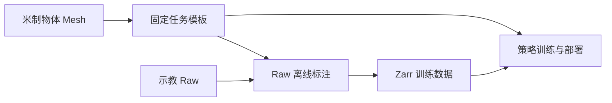

# 物体重建与 HOI

HOI（Hand–Object Interaction，手物交互）观测用手部与物体点云描述操作场景，供 CordViP 等策略训练与部署使用。

## 点云表示

**物体点云**来自固定网格表面模板，由 RGB-D 跟踪得到的位姿逐帧变换，保持对象分段和点序。**手点云**来自固定手部模板，根据机械臂与手部关节状态通过正运动学（FK）变换生成。两者都使用 xArm base 坐标系，以米为单位。

离线标注与在线部署共用物体模板、跟踪器和坐标变换；手点云导出与部署共用 FK，保持训练与部署的点云表示一致。

## 数据流程

1. **准备物体资产**：[prepare_task.py](../scripts/cordvip/prepare_task.py) 按 `task.json` 分割参考图，通过 Hunyuan3D 重建网格，再根据实测尺寸调整为米制尺度；已有米制网格直接复用。
2. **固定任务模板**：[sample_template.py](../scripts/cordvip/sample_template.py) 按物体表面积分配采样点，生成任务级 1024 点模板，固定对象分段与点序。实验期间复用这份模板。
3. **标注示教 Raw**：[annotate_episodes.py](../scripts/cordvip/annotate_episodes.py) 跟踪录制的 RGB-D，将模板变换到基座系，整段成功后写入对应 Raw。
4. **导出训练数据**：[export_zarr.py](../scripts/export_zarr.py) 读取物体标注，并由关节状态生成手点云，与所选状态、动作一同导出为 Zarr。
5. **训练与部署**：在 dexmani_policy 中训练策略；部署时加载同一任务的资产与模板，从实时 RGB-D 生成物体点云，与手部几何和其他观测共同送入模型。

任务资产位于 [assets/pointcloud_template/object](../assets/pointcloud_template/object/)，按任务和物体组织。米制网格确定尺度与局部坐标，模板确定点云表示；实验期间固定并复用两者，数据和模型使用对应的同一套资产。

## 核心模块

| 模块 | 职责 |
| --- | --- |
| [cordvip_geometry](../third_party/cordvip_geometry/) | 共用的物体分割、网格重建、尺度校准与 RGB-D 位姿跟踪后端。 |
| [geometry/hoi.py](../dexmani_real/geometry/hoi.py) | 读取任务与模板，将物体局部点变换到机器人基座系。 |
| [perception/hoi_worker.py](../dexmani_real/perception/hoi_worker.py) | 在线处理相机帧，为当前策略 Episode 生成物体点云。 |
| [perception/hand_cloud.py](../dexmani_real/perception/hand_cloud.py) | 通过固定手模板与 FK 生成手点云。 |
| [data/hoi.py](../dexmani_real/data/hoi.py) / [data/export.py](../dexmani_real/data/export.py) | 将离线物体点云写入 Raw，并组织训练数据导出。 |

## 在线观测流程

策略部署根据 Checkpoint 的观测需求启用 HOI，并按任务名加载资产与模板。每段首帧先对 RGB-D 去畸变，再由 Grounding DINO 检测目标，用检测框初始化 SAM2 分割，最后由 FoundationPose 初始化位姿。后续由 SAM2 跟踪分割、FoundationPose 合批更新位姿，结合相机外参生成基座系点云。

跟踪器检查分割与模型的深度一致性，部署端检查观测时效。跟踪失效或必需观测过期会结束当前段，下一段重新初始化。手部反馈与物体点云异步更新，组合观测采用近似时间对齐。

任务命令见 [CordViP 实验入口](../scripts/cordvip/README.md)，后端安装见 [cordvip_geometry](../third_party/cordvip_geometry/README.md#安装与命令)，执行链路见[策略部署](policy_deployment.md)。

返回[项目首页](../README.md)。
