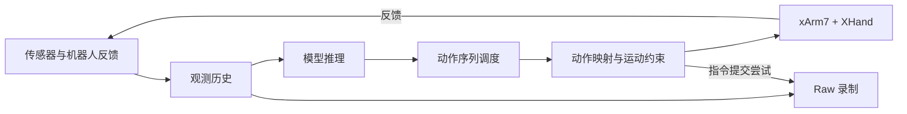

# 策略部署

策略部署将 dexmani_policy 的预测接入真实机器人闭环。模型负责根据观测输出动作序列，本仓库负责组织观测、调度动作、执行控制，并记录实验数据。

## 执行架构

观测按模型需求组合图像、关节、触觉和点云。调度器从预测序列中选择当前动作；关节动作经限位后提交，末端动作通过共享局部 IK 转为关节目标，再交由设备执行。

Checkpoint 描述模型的观测字段、动作、RGB 预处理和控制周期；[RealConfig](../dexmani_real/config/real.py) 与本地标定提供设备、传感器和运动限制等实验设置。执行周期和每次执行的动作步数默认取自 Checkpoint，也可由实验配置指定。部署先解析这些信息，再按实际需要启动传感器和感知模块。

场景点云使用 `RealConfig.pointcloud`，手表面点云使用 `RealConfig.hand_pointcloud`。指尖 FK 与数据导出共用机器人模型中的固定五指顺序（thumb、index、middle、ring、pinky）。普通策略允许调整合法采样与几何参数进行研究，处理记录的差异不会阻止部署，部署不计算或比较模板摘要；这不保证调整后的任务表现。模型实际输入输出形状、动作单位、坐标和本地模板合法性仍须满足消费者要求。部署分别保存 `training_processing` 与 `actual_processing`，已知差异会显示，缺少训练研究记录则为 None。现场相机与桌面标定使用当前值。

所有策略 RGB 在进入观测历史前按 [Canonical 图像几何](../README.md#实验流程)矫正为针孔图像，包括不请求相机参数的纯 RGB 策略。映射在相机配置时初始化，同一来源序号复用最近的矫正结果；Policy 继续使用针孔投影及 resize 坐标变换。Raw 录制和点云取色仍使用原始 RGB-D，已有 XYZ 和来源时间不变。

当前策略不消费原始 `depth`，部署观测入口会拒绝该字段。深度仍用于场景点云、HOI 和 Raw 录制；相机标定及深度单位检查保留在这些生产路径中。

## 核心模块

| 模块 | 职责 |
| --- | --- |
| [session.py](../dexmani_real/deployment/session.py) | 管理模型、设备和传感器，组织多段评估与结果汇总。 |
| [preflight.py](../dexmani_real/deployment/preflight.py) | 合并模型描述与本地配置，检查部署条件，加载所需任务模板。 |
| [observation.py](../dexmani_real/deployment/observation.py) | 将观测历史编码为模型输入。 |
| [inference.py](../dexmani_real/deployment/inference.py) | 加载、预热模型，并执行预测。 |
| [schedule.py](../dexmani_real/deployment/schedule.py) | 计算控制时刻与动作序列接续位置。 |
| [rollout.py](../dexmani_real/deployment/rollout.py) | 推进单段的观测采样、推理请求、动作提交与录制。 |

设备交互、运动约束、观测读取和数据存储分别复用 [robot](../dexmani_real/robot/)、[control](../dexmani_real/control/)、[runtime](../dexmani_real/runtime/) 和 [data](../dexmani_real/data/)。

## 一段评估的流程

1. **初始化会话**：从 [run_policy.py](../scripts/run_policy.py) 加载 Checkpoint 并解析配置，成功后才创建机器人、连接设备并按需启动传感器，随后进入待命状态。
2. **准备新段**：按 B 后捕获本段取消令牌，确认机器人反馈和必需观测有效，准备设备流式控制。启用 HOI 时，同时初始化当前场景的物体跟踪。
3. **闭环执行**：首次预测前用有效观测填充历史，首个预测调用重置模型的段内状态；之后持续采样、更新历史并请求预测，按控制周期选择动作并提交。启用录制时同步保存 Raw。
4. **结束与收尾**：操作者结束本段、总时长到期或其他必需输入失效时，停止设备并完成录制与在途预测的收尾。下一段重新建立历史和动作计划。

退出或急停打断段间收尾时，`PolicySession.episode` 仍持有当前 Rollout，未完成的 Recorder 和模型 Future 交由最终 `close()` 回收；pending 不表示录制成功。正常段间收尾只有在录制与在途预测均完成后才释放 Episode。

模型与传感器在会话中跨段复用，每个 Episode 独立管理历史、动作和录制。临时 HOI 失效可在当前段内自动恢复；已经结束的段仍需操作者重新按 B 开始新段。设备或程序故障会使会话报错退出。

## 动作序列如何接续

三种模式共用观测、控制与录制流程，区别在于预测时机和新旧动作序列的接续方式。

| 模式 | 接续方式 |
| --- | --- |
| `sync` | 等待预测，执行一段动作后再请求下一次预测。 |
| `async` | 执行当前序列时提前预测，按观测时间接续仍有效的新动作。 |
| `rtc` | 支持 RTC 的模型利用当前动作前缀生成预测，按已提交进度接续。 |

需要承接上一段动作的 ODE 策略使用 `sync`，每次执行模型约定的完整动作段，并将最后提交的关节目标传入下一次预测。

## 观测与录制

控制循环读取各来源最新的有效观测，相机派生的点云保留原始相机来源时间。系统按来源时效判断输入能否继续使用；重复读取不会使旧数据变新。

HOI 策略的关节与 FK 观测从反馈历史插值到点云的相机来源时间，前后反馈最大间隔由 `execution.hoi_max_joint_gap_s` 指定，默认 0.10 秒。HOI 关节暂时无法对齐或 HOI 点云过期时进入下述恢复流程；实际设备时效检查仍使用最新反馈。图像、关节和点云组合不代表硬件同步。HOI 的生成链路见[物体重建与 HOI](object_reconstruction.md)。

Raw 记录观测、实测状态、来源时间和指令提交尝试，供评估分析、Zarr 导出及回放使用。指令记录包含失败尝试，不能据此认定设备执行成功或已物理到位。启用录制后，相机和触觉等录制所需来源也会成为本段依赖。

HOI 暂停及恢复预测等待期间不追加 Raw 行；尝试提交恢复动作时，同一 Recorder 记录对应观测和完整目标，包括发送失败或发送返回后超时的尝试。进入 HOLD 时通过 `mark_gap()` 标记间断，下一条录制行开始新的连续区间。正常间断不设置录制截断原因；队列满或录制来源失效导致停止接纳时，才记录 `recording_truncated_reason`。

Raw 保留连续区间边界，每个原生连续段导出为一个训练 episode；关节对齐与采样窗口不跨 gap，同源各段共同进入训练或验证集。一条 Raw 的任一所选数据或段损坏时，整条回滚。物理回放仍只执行所选原始区间，运行前需将机器人就位到该区间的起始姿态。等待预测时尚无动作的记录不会自动补成旧动作。

Raw 的 `effective_parameters` 只保存实际使用的控制、算法和本次推理参数，加上实际相机与触觉复位结果。静态 `run_config.yaml` 与动态 `session_result.json` 分别保存；未执行的 HOME 配置和未启用的 RTC 参数不会进入普通录制准入。

任务成败可通过 [label_episode.py](../scripts/label_episode.py) 离线标注，与控制结束原因和录制保存结果分别记录。

模型在成功且未取消的预热完成后登记一次；HOI 首次有效观测后预热，之后各轮仍执行跟踪初始化和 episode reset。预热失败、取消或超时不登记成功。

## HOI 暂停与恢复

初始 HOI 注册最多等待 120 秒，无效观测由现有 Worker 在后续帧继续恢复。运行期间，仅 HOI 不可用、位姿无效、过期或关节对齐暂不可用时，Rollout 执行以下流程：

1. **HOI_HOLD**：清空策略历史和动作计划，发送机械臂减速保持与手部实测位置保持命令，每 1 秒刷新一次 2 秒命令租约。在途旧预测完成后回收结果，推理异常仍会终止运行。
2. **RESUMING**：当前 episode 的新鲜 HOI、关节对齐及其他必需输入全部有效，且旧预测已回收后，使用新的有效观测重建历史。首帧沿用正常启动的历史填充方式，首个预测调用策略的 `reset_episode()`，将推理随机数生成器重置到 `--seed` 指定的种子，不重复预热模型。
3. **RUNNING**：首条新策略动作发送成功、整轮预算未到期并完成控制记账后恢复运行；提交前再次检查 HOI。此前再次遮挡则回到 HOLD，同一次录制间断不重复标记。

运行与恢复共用整轮总预算，默认从实际开始运行起计 60 秒，CLI 用 `--max-duration` 覆盖；`--max-duration none`（Python 为 `None`）表示直到用户停止或真实失败。HOI 等待计入总预算，不设独立恢复期限。总预算到期通过正常停止路径结束本段，`termination_details` 为 `duration_timeout`。暂停不重置总时长或控制时钟，不补跑过去的控制槽；下一控制时刻由启动时间、最后控制槽和固定周期派生。启动、首帧、暖机及关闭的期限仍保留。

整个恢复区间保留同一 HOI 请求、Worker、模型和 Raw Episode。设备反馈、其他必需模态或录制失败仍沿用原停止路径；操作员结束和急停始终有效。

## 停止与回位

操作者通过 B 开始新段、S/C 保存结束、D 丢弃、Q 保存退出、Esc 急停。停止与必要收尾完成后，才能开始下一段。

VR 遥操作、策略部署与键盘点动共用 [home_robot()](../dexmani_real/runtime/home.py)：先停止，确认反馈有效且机械臂停稳，再规划和执行机械臂 HOME，最后执行手部回位。HOME 依赖已确认的环境模型和实验参数；碰撞路径检查用于 HOME，正常遥操作、策略末端控制与点动通过关节、工作空间和运动限制约束执行。

`home_model_confirmed=False` 是默认的操作者启用条件，不表示系统已经验证现场。普通 EEF 不检查 HOME 盒子及专用参数。Jog 不要求起点已经位于工作空间内，但本步 IK 终点仍须满足 workspace、关节、速度与 lead 约束，提交前继续检查时效与 stop；一步无法产生合法终点时拒绝。

键盘点动中，HOME 配置不满足要求或路径被拒绝时会提示具体原因，并重新准备 Jog；出现 `Keyboard jog ready` 后即可继续点动。Q、Esc、取消或设备故障仍沿原有停止与异常路径处理。

返回[项目架构](../README.md)。
