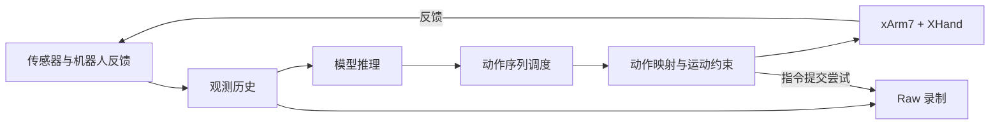

# 策略部署

策略部署将 dexmani_policy 的预测接入真实机器人闭环。模型负责根据观测输出动作序列，本仓库负责组织观测、调度动作、执行控制，并记录实验数据。

## 执行架构

观测按模型需求组合图像、关节、触觉和点云。调度器从预测序列中选择当前动作；关节动作经限位后提交，末端动作通过共享局部 IK 转为关节目标，再交由设备执行。

Checkpoint 描述模型的观测字段、动作、RGB 预处理和控制周期；[RealConfig](../dexmani_real/config/real.py) 与本地标定提供设备、传感器和运动限制等实验设置。执行周期和每次执行的动作步数默认取自 Checkpoint，也可由实验配置指定。部署先解析这些信息，再按实际需要启动传感器和感知模块。

场景点云使用 `RealConfig.pointcloud`，应与训练数据的点数、坐标、工作空间和桌面处理保持一致；手表面点云使用 `RealConfig.hand_pointcloud`。指尖 FK 与数据导出共用机器人模型中的固定五指顺序（thumb、index、middle、ring、pinky）。这些配置不从 checkpoint 提取，也不自动校准仿真与真机的观测语义。

当前策略不消费原始 `depth`，部署观测入口会拒绝该字段。深度仍用于场景点云、HOI 和 Raw 录制；相机标定及深度单位检查保留在这些生产路径中。

## 核心模块

| 模块 | 职责 |
| --- | --- |
| [session.py](../dexmani_real/deployment/session.py) | 管理模型、设备和传感器，组织多段评估与结果汇总。 |
| [preflight.py](../dexmani_real/deployment/preflight.py) | 合并模型描述与本地配置，检查部署条件，加载所需任务模板。 |
| [observation.py](../dexmani_real/deployment/observation.py) | 将观测历史编码为模型输入。 |
| [inference.py](../dexmani_real/deployment/inference.py) | 加载、预热模型，并执行预测。 |
| [schedule.py](../dexmani_real/deployment/schedule.py) | 计算控制时刻与动作序列接续位置。 |
| [rollout.py](../dexmani_real/deployment/rollout.py) | 推进单段的观测采样、推理请求、动作提交与录制。 |

设备交互、运动约束、观测读取和数据存储分别复用 [robot](../dexmani_real/robot/)、[control](../dexmani_real/control/)、[runtime](../dexmani_real/runtime/) 和 [data](../dexmani_real/data/)。

## 一段评估的流程

1. **初始化会话**：从 [run_policy.py](../scripts/run_policy.py) 加载 Checkpoint，解析配置，准备模型与设备，进入待命状态。
2. **准备新段**：按 B 后确认机器人反馈和必需观测有效，建立本段观测历史，并重置模型的段内状态。启用 HOI 时，同时初始化当前场景的物体跟踪。
3. **闭环执行**：持续采样观测、更新历史、请求预测，按控制周期选择动作并提交；启用录制时同步保存 Raw。
4. **结束与收尾**：操作者结束本段、总时长到期、HOI 恢复超时或其他必需输入失效时，停止设备并完成录制与在途预测的收尾。下一段重新建立历史和动作计划。

模型与传感器在会话中跨段复用，每个 Episode 独立管理历史、动作和录制。临时 HOI 失效可在当前段内自动恢复；已经结束的段仍需操作者重新按 B 开始新段。设备或程序故障会使会话报错退出。

## 动作序列如何接续

三种模式共用观测、控制与录制流程，区别在于预测时机和新旧动作序列的接续方式。

| 模式 | 接续方式 |
| --- | --- |
| `sync` | 等待预测，执行一段动作后再请求下一次预测。 |
| `async` | 执行当前序列时提前预测，按观测时间接续仍有效的新动作。 |
| `rtc` | 支持 RTC 的模型利用当前动作前缀生成预测，按已提交进度接续。 |

需要承接上一段动作的 ODE 策略使用 `sync`，每次执行模型约定的完整动作段，并将最后提交的关节目标传入下一次预测。

## 观测与录制

控制循环读取各来源最新的有效观测，相机派生的点云保留原始相机来源时间。系统按来源时效判断输入能否继续使用；重复读取不会使旧数据变新。

HOI 策略的关节与 FK 观测从反馈历史插值到点云的相机来源时间，前后反馈最大间隔由 `execution.hoi_max_joint_gap_s` 指定，默认 0.10 秒。HOI 关节暂时无法对齐或 HOI 点云过期时进入下述恢复流程；实际设备时效检查仍使用最新反馈。图像、关节和点云组合不代表硬件同步。HOI 的生成链路见[物体重建与 HOI](object_reconstruction.md)。

Raw 记录观测、实测状态、来源时间和指令提交尝试，供评估分析、Zarr 导出及回放使用。指令记录表示尝试提交的目标，不能据此认定设备已物理到位。启用录制后，相机和触觉等录制所需来源也会成为本段依赖。

HOI 暂停及恢复预测期间不追加 Raw 行；首条恢复动作成功提交后继续使用同一 Recorder，并标记新的连续区间。区间标记沿用 `mark_gap()`，录制结果中的原因仍为 `control_slots_skipped`。

Raw 保留连续区间边界。导出时，各区间分别形成训练序列，训练窗口不跨断点；物理回放只执行所选区间，运行前需将机器人就位到该区间的起始姿态。等待预测时尚无动作的记录不会自动补成旧动作。

任务成败可通过 [label_episode.py](../scripts/label_episode.py) 离线标注，与控制结束原因和录制保存结果分别记录。

## HOI 暂停与恢复

初始 HOI 注册最多等待 120 秒，无效观测由现有 Worker 在后续帧继续恢复。运行期间，仅 HOI 不可用、位姿无效、过期或关节对齐暂不可用时，Rollout 执行以下流程：

1. **HOI_HOLD**：清空策略历史和动作计划，发送机械臂减速保持与手部实测位置保持命令，每 1 秒刷新一次 2 秒命令租约。在途旧预测完成后回收结果，推理异常仍会终止运行。
2. **RESUMING**：当前 episode 的新鲜 HOI、关节对齐及其他必需输入全部有效，且旧预测已回收后，使用新的有效观测重建历史。首帧沿用正常启动的历史填充方式，首个预测调用策略的 `reset_episode()`，将推理随机数生成器重置到 `--seed` 指定的种子，不重复预热模型。
3. **RUNNING**：保持命令持续到首条新策略动作成功提交并完成控制记账；提交前再次检查 HOI。此前再次遮挡则回到 HOLD，原恢复期限和录制间断不重置。

恢复预算固定为 5 秒，从首次进入 HOLD 计至首条恢复动作成功提交，覆盖旧预测回收和新预测等待。超时通过正常停止路径结束本段，`termination_details` 为 `hoi_recovery_timeout`。暂停不重置总时长或控制时钟，不补跑过去的控制槽。

整个恢复区间保留同一 HOI 请求、Worker、模型和 Raw Episode。设备反馈、其他必需模态或录制失败仍沿用原停止路径；操作员结束和急停始终有效。

## 停止与回位

操作者通过 B 开始新段、S/C 保存结束、D 丢弃、Q 保存退出、Esc 急停。停止与必要收尾完成后，才能开始下一段。

VR 遥操作、策略部署与键盘点动共用 [home_robot()](../dexmani_real/runtime/home.py)：先停止，确认反馈有效且机械臂停稳，再规划和执行机械臂 HOME，最后执行手部回位。HOME 依赖已确认的环境模型和实验参数；碰撞路径检查用于 HOME，正常遥操作、策略末端控制与点动通过关节、工作空间和运动限制约束执行。

返回[项目架构](../README.md)。
