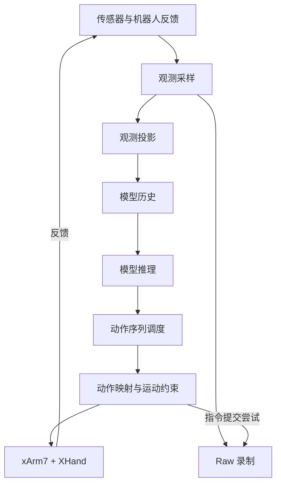

# 策略部署

策略部署将 dexmani_policy 的预测接入真实机器人闭环。模型负责根据观测输出动作序列，本仓库负责组织观测、调度动作、执行控制，并记录实验数据。

需要测量观测、推理、动作提交和录制耗时时，显式添加 `--profile-output PATH`。报告在会话收尾后独立导出，默认关闭；指标定义和手动验证方法见[性能画像](performance_profile.md)。

## 执行架构

启用 Raw 录制且策略使用 HOI 或场景点云时，两路共享本次关节采样，Raw 单独读取相机帧，因此 Raw RGB 与模型使用的 RGB 可能来自不同帧。

相机只用于静态标定时，取得参数后即关闭。启用 Raw 时持续采集 RGB-D，包括模型只消费静态标定的情况。

观测按模型需求组合图像、关节、触觉和点云。调度器从预测序列中选择当前动作；关节动作经限位后提交，末端动作通过共享局部 IK 转为关节目标，再交由设备执行。

Checkpoint 描述模型的观测字段、动作、RGB 预处理和控制周期。[RealConfig](../dexmani_real/config/real.py) 与本地标定提供设备、传感器和运动限制等实验设置。执行周期和每次执行的动作步数默认取自 Checkpoint，也可由实验配置指定。连接设备前，部署检查有效的 `execution.control_dt_s` 严格短于 2 秒命令租约。

HOI（`object_pointcloud`）与场景点云（`point_cloud`）是互斥输入。HOI 策略通过 CLI 的 `--task-dir` 或 `PolicySession(..., task_dir=...)` 指定与离线标注共用的任务资产目录。目录支持 `~`，相对路径基于当前工作目录。部署在创建设备前解析并校验任务，`run_config.yaml` 记录实际目录。Checkpoint 的 `task_name` 用作实验标签。

场景点云使用 `RealConfig.pointcloud`，手表面点云使用 `RealConfig.hand_pointcloud`。指尖 FK 与数据导出共用固定五指顺序（thumb、index、middle、ring、pinky）。部署使用当前几何参数和标定，分别记录 `training_processing` 与 `actual_processing`，有差异时在终端提示。

所有策略 RGB 在进入历史前统一为针孔图像，同一相机来源序号复用矫正结果。Policy 在该网格上继续做投影和 resize 坐标变换。图像几何与录制路径见[实验数据](data.md#图像与模型输入)。

当前策略不消费原始 `depth`，部署观测入口会拒绝该字段。深度仍用于场景点云、HOI 和 Raw 录制；相机标定及深度单位检查保留在这些生产路径中。

## 核心模块

| 模块 | 职责 |
| --- | --- |
| [session.py](../dexmani_real/deployment/session.py) | 管理模型、设备和传感器，组织多段评估与结果汇总。 |
| [preflight.py](../dexmani_real/deployment/preflight.py) | 合并模型描述与本地配置，检查部署条件并记录实际处理参数。 |
| [observation.py](../dexmani_real/deployment/observation.py) | 将观测投影为历史快照，并从历史窗口构建模型输入。 |
| [inference.py](../dexmani_real/deployment/inference.py) | 加载、预热模型，并执行预测。 |
| [schedule.py](../dexmani_real/deployment/schedule.py) | 计算控制时刻与动作序列接续位置。 |
| [rollout.py](../dexmani_real/deployment/rollout.py) | 推进单段的观测采样、推理请求、动作提交与录制。 |

设备交互、运动约束、观测读取和数据存储分别复用 [robot](../dexmani_real/robot/)、[control](../dexmani_real/control/)、[runtime](../dexmani_real/runtime/) 和 [data](../dexmani_real/data/)。

## 一段评估的流程

1. **初始化会话**：从 [run_policy.py](../scripts/run_policy.py) 加载 Checkpoint 并解析配置，成功后才创建机器人、连接设备并按需启动传感器，随后进入待命状态。
2. **准备新段**：按 B 后捕获本段取消令牌，确认机器人反馈和必需观测有效，准备设备流式控制。启用 HOI 时，同时初始化当前场景的物体跟踪。
3. **闭环执行**：首个预测调用重置模型的段内状态。控制循环持续采样、更新历史并请求预测。启用录制时同时生成 Raw。
4. **结束与收尾**：操作者结束本段、总时长到期或其他必需输入失效时，停止设备并完成录制与在途预测的收尾。下一段重新建立历史和动作计划。

退出或急停打断段间收尾时，`PolicySession.episode` 仍持有当前 Rollout，未完成的 Recorder 和模型 Future 交由最终 `close()` 回收；pending 不表示录制成功。正常段间收尾只有在录制与在途预测均完成后才释放 Episode。

模型与传感器在会话中跨段复用，每个 Episode 独立管理历史、动作和录制。临时 HOI 失效可在当前段内自动恢复；已经结束的段仍需操作者重新按 B 开始新段。设备或程序故障会使会话报错退出。

## 动作序列如何接续

三种模式共用观测、控制与录制流程，区别在于预测时机和新旧动作序列的接续方式。

| 模式 | 接续方式 |
| --- | --- |
| `sync` | 等待预测，执行一段动作后再请求下一次预测。 |
| `async` | 执行当前序列时提前预测，按请求时的控制槽和当前槽接续仍有效的新动作。 |
| `rtc` | 支持 RTC 的模型利用当前动作前缀生成预测，按已提交进度接续。 |

需要承接上一段动作的 ODE 策略使用 `sync`，每次执行模型约定的完整动作段，并将最后提交的关节目标传入下一次预测。

每个有效控制 tick 至多选择一个目标。映射后重新检查来源时效，async 还须在所选预测的整体窗口内才提交。如果映射期间整个窗口到期，已有的有效接续计划留给后续 tick，当前 tick 结束。没有可接续计划时结束本段。

## 观测与录制

HOI 的关节与 FK 观测使用按相机来源时间对齐的关节，设备反馈检查使用最新实测值。对齐暂不可用或 HOI 点云过期时进入下述恢复流程。对齐规则见[物体重建与 HOI](object_reconstruction.md#跟踪与时间对齐)。

用 `--output` 或 Python 的 `output_root` 可显式指定会话输出根目录。省略路径时，启用 Raw 的会话默认写入当前工作目录下的 `rollouts/`，关闭 Raw 的会话仅输出到终端。

启用会话输出目录时，`run_config.yaml` 保存会话实际配置、相机标定和训练与部署各自的处理参数，`session_result.json` 保存运行结果。Raw Episode 各自保存标定及实验参数，结构见[实验数据](data.md#raw-episode)。

模型在成功且未取消的预热完成后登记一次；HOI 首次有效观测后预热，之后各轮仍执行跟踪初始化和 episode reset。预热失败、取消或超时不登记成功。

## HOI 暂停与恢复

初始 HOI 注册最多等待 120 秒，观测证据不足时由现有 Worker 在后续帧继续恢复。感知后端异常会直接终止 Worker，并使会话沿故障路径停止和收尾。运行期间，仅 HOI 不可用、位姿无效、过期或关节对齐暂不可用时，Rollout 执行以下流程：

1. **HOI_HOLD**：清空策略历史和动作计划，发送机械臂减速保持与手部实测位置保持命令，每 1 秒刷新一次 2 秒命令租约。在途旧预测完成后回收结果，推理异常仍会终止运行。
2. **RESUMING**：当前 episode 的新鲜 HOI、关节对齐及其他必需输入全部有效，且旧预测已回收后，使用新的有效观测重建历史。首帧沿用正常启动的历史填充方式，首个预测调用策略的 `reset_episode()`，将推理随机数生成器重置到 `--seed` 指定的种子，不重复预热模型。
3. **RUNNING**：首条新策略动作发送成功、整轮预算未到期并完成控制记账后恢复运行；提交前再次检查 HOI。此前再次遮挡则回到 HOLD，同一次录制间断不重复标记。

HOLD 对模型和 Raw 均只读取视觉来源元数据，来源时效、设备反馈、触觉及必要的关节对齐照常检查。RESUMING 在下一控制采样时重新读取完整观测。进入 HOLD 时标记录制间断，尝试提交首条恢复动作时，下一条 Raw 行记录对应观测和目标。

每轮默认运行预算 60 秒，CLI 用 `--max-duration` 覆盖，Python 入口使用 `PolicySession(..., max_duration_s=...)`；CLI 的 `none` 与 Python 的 `None` 表示直到用户停止或真实失败。计时从准备完成并取得运动授权后开始，初始观测等待、模型预热、Recorder 初始化和设备准备不消耗运行预算。启动、观测、预热及关闭仍有各自等待期限。

运行期间按启动时间与预算直接判断是否到期，推理等待、动作提交、HOI HOLD 和 RESUMING 都计入同一预算。恢复不会重新计时；总预算到期沿正常停止路径结束本段，`termination_details` 为 `duration_timeout`。暂停不重置控制时钟，也不补跑过去的控制槽；下一控制时刻由启动时间、最后控制槽和固定周期派生。

整个恢复区间保留同一 HOI 请求、Worker、模型和 Raw Episode。设备反馈、其他必需模态或录制失败仍沿用原停止路径；操作员结束和急停始终有效。

## 观测构建

`project` 按模型模态保存不可写的历史快照；相同相机序号的 RGB 矫正结果复用。`PolicyWorker` 在同一模型线程中依次执行 `build` 和推理。

每次 `build` 批量计算当前窗口的派生几何，同一批关节共用一次 arm FK，指尖与手部点云共用 hand FK。`history` 保存最近 `n_obs_steps` 次有效控制采样，首个有效样本用于填满初始窗口。实际采样间隔可变，普通跳槽推进时钟并可能保留间断两侧的历史。HOI HOLD 清理策略上下文，恢复时从新的有效观测重建历史。

## 停止与回位

操作者通过 B 开始新段、S/C 保存结束、D 丢弃、Q 保存退出、Esc 急停。停止与必要收尾完成后，才能开始下一段。

VR 遥操作、策略部署与键盘点动共用 [home_robot()](../dexmani_real/runtime/home.py)：先停止，确认反馈有效且机械臂停稳，再规划和执行机械臂 HOME，最后执行手部回位。HOME 依赖已确认的环境模型和实验参数；碰撞路径检查用于 HOME，正常遥操作、策略末端控制与点动通过关节、工作空间和运动限制约束执行。

`home_model_confirmed=False` 是默认的操作者启用条件，不表示系统已经验证现场。普通 EEF 不检查 HOME 盒子及专用参数。Jog 不要求起点已经位于工作空间内，但本步 IK 终点仍须满足 workspace、关节、速度与 lead 约束，提交前继续检查时效与 stop；一步无法产生合法终点时拒绝。

键盘点动中，HOME 配置不满足要求或路径被拒绝时会提示具体原因，并重新准备 Jog；出现 `Keyboard jog ready` 后即可继续点动。Q、Esc、取消或设备故障仍沿原有停止与异常路径处理。

返回[项目架构](../README.md)。
