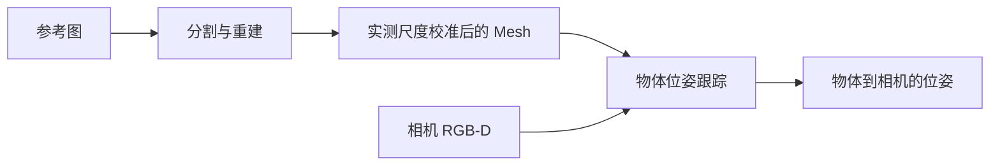

# cordvip_geometry

DexMani Real 共用的物体几何后端，负责图像分割、Mesh 重建、实测尺度校准与 RGB-D 位姿跟踪，提供 CLI 和 Python 接口。主项目根据物体位姿与固定模板生成物体点云，并通过机器人 FK 生成手点云。

## 核心流程



重建用于准备固定物体几何；跟踪在每段首帧初始化位姿，后续持续更新，并通过分割与深度一致性判断有效性。任务模板、Raw 数据和策略执行由主项目组织。

## 核心模块

以下文件均位于 [src/cordvip_geometry](src/cordvip_geometry/) 下。

| 模块 | 职责 |
| --- | --- |
| [assets.py](src/cordvip_geometry/assets.py) | 米制资产准备与读取。 |
| [reconstruction.py](src/cordvip_geometry/reconstruction.py) | 使用 Hunyuan3D 从物体图像重建 Mesh。 |
| [sam2.py](src/cordvip_geometry/sam2.py) | 使用 Grounding DINO 定位目标，通过 SAM2 初始化并持续跟踪分割。 |
| [tracking.py](src/cordvip_geometry/tracking.py) / [foundationpose.py](src/cordvip_geometry/foundationpose.py) | 结合分割与 FoundationPose 估计物体位姿，检查深度一致性。 |
| [rgbd.py](src/cordvip_geometry/rgbd.py) / [geometry.py](src/cordvip_geometry/geometry.py) | 组织米制 RGB-D、相机几何与网格处理。 |

## 安装与命令

在已有兼容 Torch/CUDA 的 `real_robot` 环境中，从仓库根目录执行。默认准备跟踪依赖与分割模型：

```bash
bash third_party/cordvip_geometry/scripts/install_perception.sh
python -m cordvip_geometry download
```

FoundationPose 权重需单独放入 `third_party/FoundationPose/weights/`；完成后用 `python -m cordvip_geometry check` 检查本地依赖与权重路径。

需要单图重建时，在完成默认安装的同一环境中追加：

```bash
bash third_party/cordvip_geometry/scripts/install_perception.sh reconstruction
python -m cordvip_geometry download --models shape
```

`python -m cordvip_geometry object` 提供单物体资产准备入口，具体参数见各命令的 `--help`。

## 相关文档

- [实验脚本与任务流程](../../scripts/cordvip/README.md)：任务资产、模板、Raw 标注与 Zarr 导出。
- [几何核心接口与流程](docs/usage.md)：资产接口、跟踪生命周期及位姿输出。
- [物体重建与 HOI](../../docs/object_reconstruction.md)：主项目中的点云表示与训练、部署链路。
